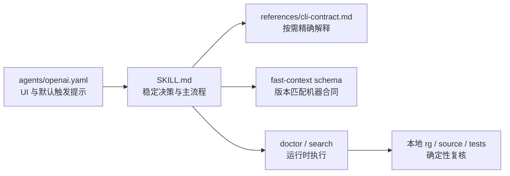
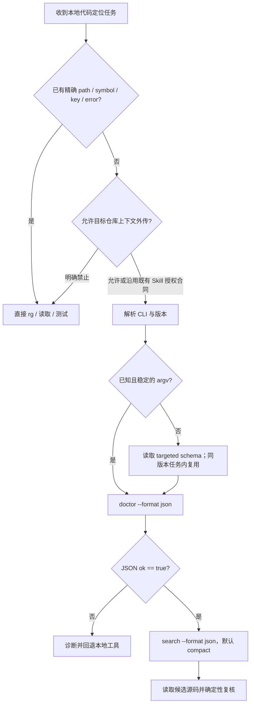

# fast-context 内置 Skill 面向 Agent 优化方案

## 1. 文档信息

| 项目 | 内容 |
| --- | --- |
| 文档状态 | 已实施、已验证（未发布） |
| 需求范围 | 基于当前 CLI Command Schema 与 compact JSON，优化内置 `fast-context` Skill 的 Agent 工作流、渐进式披露与验证链路 |
| 源码基线 | `7aa9831`（`v0.1.6-2-g7aa9831`） |
| 编写/实施日期 | 2026-08-04 |
| 关联文档 | [CLI Command Schema 技术方案](./fast-context-cli-command-schema-plan.md)、[CLI JSON Compact 输出技术方案](./fast-context-cli-json-output-format-plan.md)、[Skill + CLI + npm 发布技术方案](./fast-context-skill-cli-npm-release-plan.md) |

## 2. 结论

实施前的内置 Skill 并非“尚未支持”新能力：

- `internal/skills/assets/fast-context/SKILL.md:41-54` 已说明 targeted/full `schema`、canonical path、静态无副作用边界、compact JSON 与 `--pretty`；
- `internal/skills/assets/fast-context/references/cli-contract.md:60-74` 已同步 manifest 与 JSON presentation；
- `internal/skills/skills_test.go:37-54,79-107` 已用关键词锁定上述文案；
- `internal/cli/schema_commands_test.go:106-160` 与 `internal/cli/json_output_test.go:11-69` 已锁定 schema 的确定性、compact/pretty 语义等价与 escaping 合同。

实施前的差距更准确地说是“CLI 功能已追加到旧 Skill 流程”，还没有完成一次以 Agent 决策成本、契约漂移和版本错配为中心的重构。本次已按以下方向完成优化：

1. 将 `SKILL.md` 收敛为稳定的 Agent 决策卡：判断是否适用、确认外传边界、解析 CLI/能力、执行 preflight、搜索、确定性复核和 fallback。
2. 将版本敏感的命令路径、参数、默认值、argv binding、side effects 与退出码优先交给 targeted `schema`，不再在主 Skill 中平行维护完整 flags/env 表。
3. 已知且稳定的调用直接执行；仅在 argv 不熟悉、CLI 版本可能漂移或构建通用 adapter 时读取 schema。不要让 schema 成为每次搜索的固定前置成本。
4. Agent 和自动化始终消费默认 compact JSON；`--pretty` 只出现在人工排障说明中，不出现在标准 Agent 调用示例中。
5. 修复渐进式披露的可达性缺口：为 `skills show` 增加严格 allowlist 的 `--reference cli-contract`，使 npm 安装后的 Agent 能真正读取 `SKILL.md` 指向的版本匹配 reference。
6. 保留既有外传授权合同：Skill 已加载且目标项目 `doctor.ok=true` 后可执行 `search`，用户明确禁止外传时仍必须停止。此次不重新定义授权模型，只增加相应 forward-test。

本方案只做上述最小闭环，不修改搜索 pipeline、远端协议、凭据优先级、默认 semantic format 或发布状态。

## 3. 需求理解

### 3.1 优化对象不是单份 Markdown

内置 Skill 的实际产品链路为：



因此“Skill 优化”至少涉及四层：

| 层 | 事实源 | 本次责任 |
| --- | --- | --- |
| 触发层 | `SKILL.md` frontmatter、`agents/openai.yaml` | 只在未知本地代码入口、架构/调用链/影响范围定位时触发 |
| 工作流层 | `SKILL.md` | 保存稳定的决策、安全、preflight、搜索与复核流程 |
| 机器合同层 | `fast-context schema` / `internal/commandcontract` | 保存 canonical argv、input schema、availability、side effects、output 与 exit codes |
| 解释层 | `references/cli-contract.md` | 解释 schema 消费方式、输出字段、凭据与错误语义，不复制可机器发现的完整合同 |

### 3.2 Schema 与 Skill 的职责边界

`schema` 可以回答“如何调用”，不能回答“当前任务是否应该调用”。当前 manifest 已提供：

- canonical path、compatibility alias；
- JSON Schema Draft 2020-12 输入；
- `x-cli-binding`、argv ordering、repeatable/boolean/leading-dash 规则；
- dynamic availability、side effects；
- default format、formats、coarse output contract 与 exit codes。

Skill 仍必须负责：

- 精确 path/symbol/config key/error text 是否应直接使用本地工具；
- `search` 的外部传输边界；
- `doctor.ok` 不是远端凭据有效性、网络可达性或结果质量证明；
- 返回文件与行号只是候选；
- 失败后如何继续本地工作。

### 3.3 Compact 是物理排版，不是新的 format

当前实现中：

- `search`、`key extract`、`doctor`、`skills list` 默认 semantic format 为 `text`；
- `skills show` 默认 format 为 `content`；
- `schema` 默认且只支持 `json`；
- 任一命令选择 JSON 后，默认物理输出才是单行 compact JSON；
- `--pretty` 不会隐式选择 JSON，也不会改变字段、redaction、exit code 或 stdout/stderr。

因此 Agent 示例必须继续显式写 `--format json`（`schema` 可省略），但不应写 `--pretty`。

## 4. 当前代码事实与差距

### 4.1 已完成的 CLI 基础

| 事实 | 代码依据 | 对 Skill 的含义 |
| --- | --- | --- |
| public command 由 typed definitions 驱动 | `internal/commandcontract/definitions.go:9-18` | 不再在 Skill 中手写第二份完整命令注册表 |
| `search` 声明 doctor availability 与外传 side effects | `internal/commandcontract/definitions.go:151-162` | Skill 可将 schema availability 映射到 preflight，但仍保留安全决策 |
| schema full/targeted 共用同一 envelope | `internal/cli/schema_commands.go:24-71` | 已知 command 只读 targeted definition |
| targeted lookup 只接受 canonical path | `internal/commandcontract/registry.go:84-92` | Agent 不生成 alias，不依赖大小写宽松兼容 |
| schema 静态且不触发正常 handler | `internal/cli/schema_commands_test.go:163-218` | 能力发现可在 credential/network 不可用时执行 |
| compact/pretty 共用 presentation helper | `internal/cli/json_output.go:8-14` | Agent 无需额外 compact flag |
| packaged launcher 透明转发 argv/status/signal | `npm/fast-context/bin/fast-context.js:21-75` | Skill 使用 canonical CLI 即可，不需要 npm 专用调用分支 |

### 4.2 主 Skill 仍有较高的文案与认知成本

当前 `SKILL.md` 共 108 行，结构仍沿用 schema 出现前的“安装说明 → preflight → 搜索参数说明”主线。新增能力被插入第 41-54 行，但没有重排整体工作流，表现为：

- schema 的使用时机与“是否使用 semantic search”的决策分离，Agent 需要跨章节拼接；
- 主搜索示例仍把 positional query 放在 options 之前，与 manifest 发布的 canonical ordering（command path → options → positionals）不一致；
- 示例固定传入 `--tree-depth 0`，但默认 `bootstrap_hotspot` 下该值不是 classic 模式的 auto-depth 语义，首次调用没有必要携带；
- `tree-depth`、hotspot depth、凭据来源等版本敏感细节仍占据主 Skill，而这些内容更适合 targeted schema 或 reference；
- 没有明确要求同一 CLI version 的 targeted schema 在当前任务内复用，可能造成重复的大 JSON 调用；
- 没有明确把 `--help` 限定为人类帮助，而非机器合同。

### 4.3 渐进式披露资源无法通过 CLI 到达

这是当前最明确的功能缺口：

1. `SKILL.md:108` 指示 Agent 按需读取 `references/cli-contract.md`；
2. `internal/skills/skills.go:37-45` 的公共读取函数固定只返回 `SKILL.md`；
3. `internal/cli/skills_commands.go:46-67` 的 `skills show` 也只调用该函数；
4. `references/cli-contract.md` 与 `agents/openai.yaml` 虽被 `go:embed` 打进二进制，但没有公开读取入口。

这意味着通过 `fast-context skills show fast-context --format content` 动态加载的 Agent 能看到一个相对链接，却无法从已安装 CLI 获取链接目标。现有 `internal/skills/skills_test.go:79-107` 直接读取 embed 文件，只证明资源存在，不证明 Agent 可达。

### 4.4 UI 默认提示比 Skill 触发边界更宽

`agents/openai.yaml:4` 当前写的是“locate the implementation behind this request”，容易覆盖已知 symbol/path 等本应直接使用 `rg` 的任务；而 `SKILL.md:70-79` 已明确这些任务应跳过 semantic search。

`policy.allow_implicit_invocation: true` 可以保留，但 `default_prompt` 应收窄到 unknown local-code entrypoint，并保留本地复核要求。

### 4.5 版本与发布漂移已真实出现

当前仓库 HEAD 为 `7aa9831`，位于 tag `v0.1.6` 之后两个提交；本机已安装的 `fast-context 0.1.6` 对 `schema` 返回 `unknown command: schema`，而当前源码运行 `schema search` 成功并输出一行 compact manifest。

因此 Skill 不应只依赖硬编码最低版本号。更稳妥的 Agent 行为是 capability probe：

1. 优先执行 targeted `schema`；
2. 若根命令不存在，读取同一二进制的 `skills show ... --format content` 作为版本匹配回退；
3. 不自动全局更新 CLI，不把 `--help` 文本解析成机器合同；
4. 只有在用户要求或授权更新时才进入 npm 安装/升级流程。

### 4.6 验证覆盖仍偏向实现，不足以证明 Agent 使用正确

当前自动化已覆盖 schema/compact 的实现，但尚未覆盖：

- Agent 是否在已知 argv 时跳过 schema；
- 是否只查 targeted schema 而非每次加载 full manifest；
- 是否保持 compact、避免 `--pretty`；
- 是否按 canonical ordering/flags 生成 argv；
- 是否能通过 CLI 读取 reference；
- schema 不存在时是否回退到版本匹配 Skill；
- `doctor` exit `0` 但 `ok=false` 时是否阻止 search；
- 用户明确禁止外传时，隐式触发是否仍能停止。

## 5. 目标 Agent 工作流

### 5.1 决策流程



### 5.2 标准 Agent 调用

主 Skill 中保留一个最小示例，并遵循 manifest 的 canonical argv ordering：

```powershell
fast-context doctor --project "D:\path\to\repo" --format json

fast-context search `
  --project "D:\path\to\repo" `
  --max-results 10 `
  --format json `
  "where is user authentication and JWT validation implemented"
```

规则：

- 不在首个调用中固定 `--tree-depth 0`、`--max-turns` 或 `--max-commands`；只有出现范围过宽、结果为空或运行预算问题时，依据 targeted schema 与实际症状调整；
- query 以英文意图描述为主，必要时补充本地领域词；
- 对敏感、生成或高噪目录使用重复的 canonical `--exclude`；
- 默认不启用 `--include-snippets`；
- JSON 保持 compact；人工审阅时才临时添加 `--pretty`。

### 5.3 Targeted schema 使用规则

当 Agent 不确定参数、范围、binding、side effect 或输出合同，执行：

```powershell
fast-context schema --format json search
fast-context schema --format json key extract
```

读取顺序固定为：

1. 验证 `ok`、`manifest_version`、`scope.mode=command` 和目标 `scope.path`；
2. 使用 `commands[0].path`，不生成 `aliases`；
3. 按 `input_schema.required`、类型、enum、bounds 与 `additionalProperties=false` 构造输入；
4. 按 `x-cli-binding.order` 排 options，再放 positionals；repeatable array 重复 flag，boolean 按 binding 表达；
5. 值为空或以 `-` 开头时遵循 `argv_conventions` 的 inline/end-of-options 规则；
6. 执行 `availability.check_command` 并读取其 `json_pointer`；
7. 检查 `side_effects`，但不把 schema 当成授权；
8. 使用 `output.default_format`、`formats` 与 `exit_codes` 解释结果。

同一 `cli.version + manifest_version + canonical path` 在当前任务中只读取一次。full manifest 仅用于首次通用 adapter 发现或显式缓存刷新，不用于普通搜索。

### 5.4 版本错配回退

若 `schema` 是 unknown command/exit `2`：

```powershell
fast-context skills show --format content fast-context
```

Agent 应加载该二进制内嵌的版本匹配 Skill，继续其稳定工作流；不得反复重试 schema、解析 `--help` 作为 JSON、静默安装新版本或假装当前 CLI 支持新参数。

## 6. 详细优化方案

### 6.1 重构 `SKILL.md`

建议将正文调整为以下顺序：

1. **Core rule**：semantic search 只负责候选定位，结论必须本地复核；
2. **Decide locally or semantically**：精确目标直接本地，未知入口才使用 CLI；
3. **Protect the external-data boundary**：保留既有授权合同、exclude/snippet/敏感输出规则；
4. **Resolve the CLI and its contract**：版本解析、known argv、targeted schema、旧 CLI 回退；
5. **Preflight**：检查 JSON `ok`，不依赖 exit code；
6. **Search with compact JSON**：最小 canonical 示例、参数调优条件；
7. **Verify candidates**：读取源码、exact `rg`、tests/build/runtime；
8. **Fallback**：错误分类、已有 codesearch index、本地工具继续；
9. **Conditional reference**：仅在需要输出字段、错误或 adapter 细节时读取 `cli-contract`。

主 Skill 应删除或下沉：

- 完整搜索 flags/env 列表；
- `tree-depth` 与 hotspot 的长篇实现解释；
- 完整凭据来源细节；
- 可由 schema 直接返回的 alias、bounds、default/binding；
- `--pretty` 的多处重复说明。

主 Skill 必须保留：

- 触发与跳过边界；
- 外传事实与显式禁止优先；
- `doctor.ok` gate；
- compact JSON 默认；
- snippets 默认关闭；
- 候选不等于证据；
- 本地 fallback。

不设置机械的行数或 token 降幅门槛；验收以“是否删除重复合同且保留关键决策”为准。

### 6.2 重写 `references/cli-contract.md`

reference 从“另一份 CLI 手册”改为“Agent 消费合同指南”，建议保留：

- 安装 ownership 与版本错配诊断；
- schema envelope、targeted/full 选择与 argv 序列化算法；
- doctor/search/key 的当前结构化输出解释；
- credential priority、redaction 与显式 `state.vscdb` 边界；
- exit codes、local/remote error code 与 fallback；
- 回归命令。

建议删除由 manifest 完整表达的 flags/env 表，或只保留 schema 尚未表达、且 Agent 决策真正需要的语义。reference 超过 100 行时继续保留目录。

### 6.3 为 `skills show` 增加 allowlisted reference 读取

新增可选调用：

```text
fast-context skills show <skill> [--reference cli-contract] [--format content|json] [--pretty]
```

设计约束：

- `--reference` 只接受稳定逻辑 ID `cli-contract`，不接受任意相对/绝对路径；
- 未传 `--reference` 时，现有 `skills show` stdout、JSON、默认 format 和退出码字节合同不变；
- `content` 直接输出 reference Markdown；
- `json` 继续返回 `ok`、`skill`、`content`，仅在读取 reference 时追加 `resource: "references/cli-contract.md"`；
- reference 未知或遍历式输入返回参数错误 `2`；
- 读取仍是 `embedded_resource_read`，不访问磁盘、配置、凭据或网络；
- option 追加在现有 options 之后，保留既有 `pretty` binding order；相应测试不再假设 `pretty` 必须是最后一个 option；
- `manifest_version` 保持 `1`，这是 additive optional input，不改变既有命令语义。

实现位置：

| 文件 | 规划改动 |
| --- | --- |
| `internal/skills/skills.go` | 新增严格映射的 `ReadReference()`；保留 `ReadMarkdown()` 兼容入口 |
| `internal/cli/skills_commands.go` | 解析 reference，输出 content/JSON，默认路径保持原字节合同 |
| `internal/commandcontract/definitions.go` | 给 `skills.show` 追加 enum option，不手写 help/schema |
| `internal/cli/testdata/cli-command-manifest-v1.golden.json` | 更新 additive property，人工确认其它 command 未漂移 |

不新增 `skills export`、目录写入、任意 embed path 读取或 Skill 安装器。

### 6.4 收窄 `agents/openai.yaml`

保留：

- `display_name: "Fast Context"`；
- 当前 `short_description`；
- `policy.allow_implicit_invocation: true`。

将 `default_prompt` 收窄为未知入口场景，例如：

```yaml
default_prompt: "Use $fast-context to locate an unknown local-code entrypoint, then verify every candidate with deterministic local tools."
```

不在 UI prompt 中塞入 schema、doctor、compact 等完整流程；正文触发后再加载这些说明。

### 6.5 同步公开文档但不制造第三份合同

| 文件 | 同步内容 |
| --- | --- |
| `README.md` | 更新 canonical Agent workflow、reference 读取与版本错配说明 |
| `npm/fast-context/README.md` | 保持最短安装后 Agent 闭环；示例使用 options-before-positionals 和 compact JSON |
| `docs/fast-context-go-cli-architecture.md` | 更新 `skills show --reference` 的只读资源边界 |
| `docs/fast-context-skill-cli-npm-release-plan.md` | 仅修正仍被当作当前事实的命令/渐进式披露段落，或链接到本方案；不重写历史实施记录 |

schema/json 的既有实施方案只在存在直接冲突时加交叉引用，不重复编辑已验证的历史设计结论。

## 7. 分阶段实施计划

### M0：锁定合同与红灯测试（已完成）

工作内容：

- 固定 `--reference cli-contract` 的逻辑 ID、content/JSON 与错误合同；
- 先添加 reference 可达性、unknown/traversal 拒绝、默认 `skills show` 字节不变测试；
- 更新 `pretty` 测试为按 option name 查找，确保新增 option 不重排既有 binding；
- 为 `openai.yaml` 增加最小内容断言，锁定 `$fast-context`、unknown-entrypoint 与 implicit policy；
- 记录现有外传授权合同为不变项。

退出条件：新增测试在旧实现上准确失败，且失败只对应本需求。

### M1：补齐 Skill 资源读取闭环（已完成）

工作内容：

- 实现 allowlisted `ReadReference()`；
- 扩展 `skills show` 与 command definition；
- 更新 schema golden；
- 保持默认 show、compact/pretty、HTML escaping、exit code 与 side effect 不变。

退出条件：Agent 能通过已安装 CLI 读取主 Skill 和 `cli-contract`，任意路径输入均不可达。

### M2：重构 Agent 指令与元数据（已完成）

工作内容：

- 按第 6.1 节重排 `SKILL.md`；
- 按第 6.2 节去重 reference；
- 更新 `openai.yaml` 默认提示；
- 所有 Agent 示例使用 canonical path、options-before-positionals、targeted schema 与 compact JSON；
- 加入旧 CLI capability fallback，不硬编码尚未发布的最低版本号。

退出条件：主 Skill 不再承担机器可发现的完整参数合同，且核心安全/复核规则仍可独立执行。

### M3：文档、打包与离线验证（已完成）

工作内容：

- 同步 root/npm README 与架构说明；
- 在 `scripts/package-npm.ps1` 的安装 smoke 中验证：
  - packaged binary 能读取 `SKILL.md` 与 `cli-contract`；
  - targeted schema 默认只有一条物理 JSON 行；
  - `--pretty` 为多行且与 compact 语义相等；
  - schema scope/path/version 与安装包一致；
- 运行全量 Go、vet、launcher 与 Skill validator。

退出条件：源码二进制与 npm staging binary 的 Skill/schema/compact 合同一致。

### M4：Agent forward-test（已完成）

使用新会话/子代理，只给原始 Skill 与真实任务，不泄露预期答案。至少覆盖：

| 场景 | 期望行为 |
| --- | --- |
| 已知 symbol 或配置键 | 直接本地 `rg`，不调用 schema/search |
| 未知业务入口、已知标准 argv | doctor → search，不额外读 schema |
| 不熟悉某个 search flag | 只读 targeted `schema search`，不读 full manifest |
| 同一任务二次搜索 | 复用已读 schema，不重复发现 |
| JSON 自动化 | 使用 compact，不添加 `--pretty` |
| 旧 CLI 不支持 schema | 读取版本匹配内置 Skill，不解析 help、不静默升级 |
| doctor exit 0 但 `ok=false` | 不执行 search，报告具体本地阻塞 |
| 用户明确禁止外传 | 不执行 search，继续本地工具 |
| search 返回候选 | 回读源码并用 exact `rg`/tests 证明结论 |

真实 `search` 只在公开或专用 fixture 上执行；静态 schema、reference 与 compact 验收不得依赖网络。

## 8. 测试与验收矩阵

| 层级 | 计划检查 | 通过标准 |
| --- | --- | --- |
| Skill structure | `quick_validate.py internal/skills/assets/fast-context` | frontmatter、命名与目录有效 |
| Skill embed | `internal/skills` tests | 主 Skill/reference 与源码字节一致，LF 统一 |
| Resource allowlist | `internal/skills` / CLI tests | 只允许 `cli-contract`，拒绝 unknown/absolute/`..` |
| CLI compatibility | existing + new `skills show` tests | 未传 reference 的 content/JSON 完全不变 |
| Command contract | `internal/commandcontract` tests + golden | 新 option additive；旧 path/order/output/side effect 不漂移 |
| JSON presentation | CLI tests/smoke | compact 一行+LF；pretty 两空格+LF；语义相等 |
| Static boundary | schema/skills handler isolation tests | 不读取 runtime config/credentials/project/network |
| Go regression | `mise exec -- go test -count=1 ./...` | 全部通过 |
| Static analysis | `mise exec -- go vet ./...` | 无错误 |
| Launcher | `node npm/fast-context/test/launcher.test.js` | Windows 7 pass，POSIX-only 用例按平台处理 |
| Packaged CLI | `pwsh ./scripts/package-npm.ps1` | staging install 后 Skill/reference/schema/doctor smoke 通过 |
| Text hygiene | `git diff --check` | 无 whitespace 错误 |
| Agent behavior | 独立 forward-test matrix | 路由、schema、compact、preflight、复核与 fallback 符合预期 |

### 8.1 本次分析已完成的基线验证

以下是分析阶段的当前源码证据，不代表未来实现后的验收：

- `mise exec -- go test -count=1 ./...`：全部通过；
- `mise exec -- go vet ./...`：通过；
- `node npm/fast-context/test/launcher.test.js`：7 项通过，1 项 POSIX-only 测试在 Windows 跳过；
- `quick_validate.py internal/skills/assets/fast-context`：`Skill is valid!`；
- 当前源码 `go run ./cmd/fast-context schema --format json search`：成功、单行 compact manifest；
- 本机已安装 `fast-context 0.1.6`：`schema` 为 unknown command，证明 capability fallback 是实际边界；
- 未执行真实 Windsurf `search`、npm packaging、publish、tag、commit 或 push。

### 8.2 实施后验收记录

实施完成后执行了本节矩阵中的静态、单元、打包和 Agent 行为验证。关键结果如下：

- `mise exec -- go test -count=1 ./...`：全部通过；
- `mise exec -- go vet ./...`：通过；
- `node npm/fast-context/test/launcher.test.js`：7 项通过，1 项 POSIX-only 测试在 Windows 按预期跳过；
- `quick_validate.py internal/skills/assets/fast-context`：`Skill is valid!`；
- `pwsh -NoProfile -File ./scripts/package-npm.ps1`：在标准 Windows PATH 下完成三平台 build、四个 tarball pack、临时全局安装及 Skill/reference/schema compact/pretty/doctor smoke；
- `git diff --check`：通过；Skill、reference、metadata、golden 与平台 manifest 均为 UTF-8 无 BOM、LF 结尾；
- schema golden 只新增 `skills.show.reference`，既有 binding order 未重排，`manifest_version` 保持 `1`；
- 首轮 package smoke 暴露了脚本隐式依赖 PATH 中 `chmod` 的 Windows 可移植性问题。最终实现改为 Linux/macOS 平台 manifest 声明 package-specific `bin`，由 npm 对 Windows 产出的 tarball 在安装时恢复执行权限；Unix host 使用 .NET `UnixFileMode` 处理 staging/prebuilt 执行位。移除 PATH 隐式依赖后，上述标准命令完整通过。

#### 独立 Agent forward-test 证据

各场景使用 `fork_turns=none` 的新子代理，只提供当前 `SKILL.md`、真实任务边界、候选 packaged CLI，以及 `dist/skill-forward-test-fixture` 下不含私有代码的专用合成项目；子代理必须回报实际命令。结果如下：

| 场景/任务 | 独立任务 | 实际命令轨迹与结果 |
| --- | --- | --- |
| 精确 symbol/key | `ft_exact_current` | 只执行 `rg`/`bat`，穷尽确认 `RetryBackoffKey` 定义和值；未 resolve/version/schema/doctor/search，也未联网 |
| 未知入口、已有可信合同 | `ft_known_argv_current` | 读取 `doctor` JSON `ok=true` 后执行 compact `search`；未读取 targeted/full schema、未加 `--pretty`；将语义候选与本地 `rg`/源码证据明确分开 |
| 不熟悉 argv、任务内复用 | `ft_schema_current` | 只读取一次 compact targeted `schema --format json search`；未读取 full schema；第二组 argv 复用同一 `cli.version + manifest_version + canonical path`，正确处理 repeated flags、显式 boolean false、options-before-positionals 与 leading-dash query |
| `doctor.ok=false` gate | `ft_doctor_failure` | 不存在的专用项目得到 `project.exists=false`、顶层 `ok=false`；即使命令完成也未执行 `search`，只报告本地阻塞 |
| 明确禁止外传 | `ft_forbid_current` | 只执行本地 `rg`/`bat`；未 resolve/version/schema/doctor/search 或进行其他网络操作 |
| 旧 CLI capability fallback | `ft_old_cli_retry` | 已安装 `0.1.6` 报 `schema` unknown 后只加载该二进制内置版本匹配 Skill；未解析 `--help`、未尝试新版 `--reference`、未升级或搜索 |
| 候选必须确定性复核 | `ft_unknown_current` | semantic search 返回 `service.go`/`store.go` 候选后，继续用 exact `rg` 与源码读取补齐 `main.go`/配置调用链、停止条件和退避算法；未把候选直接当结论 |

真实远端调用只发生在上述无敏感信息的专用合成 fixture；未对 fast-context 仓库源码执行 semantic search。forward-test 临时输入与二进制在测试期间位于 Git ignored `dist/`，不属于交付文件。

## 9. 文件级变更矩阵

| 文件 | 类型 | 规划改动 |
| --- | --- | --- |
| `internal/skills/assets/fast-context/SKILL.md` | 修改 | Agent 决策卡、canonical 示例、capability fallback、compact-first |
| `internal/skills/assets/fast-context/references/cli-contract.md` | 修改 | 改为 schema/output/error 消费指南，去除重复合同 |
| `internal/skills/assets/fast-context/agents/openai.yaml` | 修改 | 收窄 default prompt |
| `internal/skills/skills.go` | 修改 | allowlisted reference reader |
| `internal/skills/skills_test.go` | 修改 | reference、metadata、核心边界测试 |
| `internal/cli/skills_commands.go` | 修改 | `--reference` content/JSON 输出 |
| `internal/cli/cli_test.go` | 修改 | 默认兼容、reference、compact/pretty、错误测试 |
| `internal/commandcontract/definitions.go` | 修改 | `skills.show` 追加 reference option |
| `internal/commandcontract/registry_test.go` | 修改 | option/binding 与 pretty 非末位兼容测试 |
| `internal/cli/testdata/cli-command-manifest-v1.golden.json` | 生成更新 | 仅新增 `skills.show.reference` 合同 |
| `scripts/package-npm.ps1` | 修改 | packaged Skill/reference/schema presentation smoke |
| `npm/packages/linux-x64/package.json` | 修改 | 用 package-specific `bin` 让 npm 在安装时恢复原生二进制执行权限 |
| `npm/packages/darwin-arm64/package.json` | 修改 | 用 package-specific `bin` 让 npm 在安装时恢复原生二进制执行权限 |
| `README.md` | 修改 | 当前 Agent workflow 与资源读取 |
| `npm/fast-context/README.md` | 修改 | 安装后的最短 Agent 闭环 |
| `docs/fast-context-go-cli-architecture.md` | 修改 | Skill reference 读取边界 |
| `docs/fast-context-skill-cli-npm-release-plan.md` | 条件修改 | 修正仍作为当前事实的旧命令/渐进披露说明 |

## 10. 非目标

- 不修改 `internal/search`、`internal/windsurf`、repo map、executor 或远端 protobuf；
- 不修改 credential priority、配置文件 schema 或 `state.vscdb` 发现策略；
- 不把 search/doctor/skills 的默认 format 改为 JSON；
- 不新增 `json-compact`、`json-pretty`、TTY 自动判断、NDJSON、streaming、分页或字段裁剪；
- 不把 full manifest 或完整 flags 表复制进 `SKILL.md`；
- 不允许任意 embed path、磁盘路径或目录导出；
- 不新增脚本/assets，也不引入 YAML/CLI framework 等长期依赖；
- 不在本任务发布 npm、改版本、创建 tag、提交、push 或刷新全局安装；
- 不在本任务同步外部插件仓库或已安装 cache；新版 CLI 发布后的薄插件同步作为独立后续任务。

## 11. 风险与应对

| 风险 | 影响 | 应对 |
| --- | --- | --- |
| reference option 扩大资源读取面 | 未来误暴露 embed 资源 | 逻辑 ID + 双层 allowlist，不接受路径 |
| 重写 Skill 时丢失安全规则 | 私有上下文误外传或把候选当证据 | 核心边界测试 + 明确禁止外传 forward-test |
| schema 成为每次调用的固定开销 | token/延迟抵消 compact 收益 | known argv 直用、targeted only、同版本任务内复用 |
| 旧 CLI 与新 Skill 不匹配 | unknown flag/command | capability probe + version-matched `skills show` fallback |
| 新 option 重排 binding order | adapter argv 漂移 | option 追加；测试按名称找 pretty，并审阅 golden |
| 文档再次复制机器合同 | 后续 CLI 变化导致漂移 | machine facts 归 `commandcontract/schema`，reference 只解释 |
| implicit invocation 范围过宽 | 无效搜索与外传面增加 | 收窄 default prompt；保留精确目标绕过与显式禁止优先 |

## 12. Definition of Done

- [x] `SKILL.md` 形成单向、可执行的 Agent 决策流程，不再拼接多个分散章节；
- [x] 常规 Agent 示例使用 canonical ordering、targeted schema、compact JSON，且不含 `--pretty`；
- [x] 已知 argv 不强制 schema，full manifest 不进入普通搜索流程；
- [x] 旧 CLI 能通过版本匹配 Skill 回退，不静默安装/升级；
- [x] npm 安装后的 CLI 可读取主 Skill 和 allowlisted `cli-contract`；
- [x] 默认 `skills show` 的 content/JSON/exit code 保持兼容；
- [x] schema manifest 只出现预期的 additive option，`manifest_version=1`；
- [x] 核心外传、doctor gate、snippet、候选复核与 fallback 规则有自动或 forward-test 证据；
- [x] Go tests、vet、launcher tests、Skill validator、packaged smoke 与 `git diff --check` 全部通过；
- [x] 真实 search 只使用专用合成 fixture，npm 发布仍按独立授权和发布流程执行。
