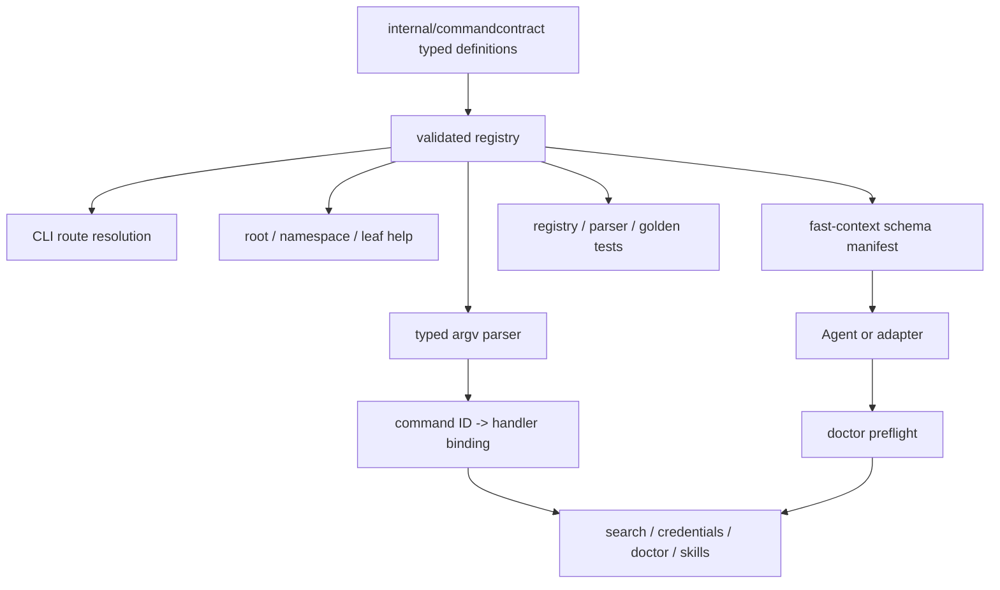

# fast-context CLI Command Schema 技术方案

## 1. 文档信息

| 项目 | 内容 |
| --- | --- |
| 文档状态 | 已实施、已验证（真实 search smoke 未运行） |
| 需求范围 | 为 `fast-context` 增加面向 Agent 和自动化适配器的版本化 CLI Command Schema |
| 当前基线 | `fast-context 0.1.6`，commit `58abff137d51501e5ba2a26e24653584cda94108` |
| 编写日期 | 2026-08-04 |
| 参考实现 | `onesearch` commit `4870a10`：`feat(cli): 新增面向 Agent 的命令 Schema` |
| 关联文档 | [fast-context Go CLI 技术架构方案](./fast-context-go-cli-architecture.md) |

## 2. 结论

`fast-context` 应新增：

```text
fast-context schema [--format json] [canonical-command-path...]
```

该命令返回版本化、确定性、机器可读的 CLI command manifest，供 Agent 精确获取：

- public canonical command path 与兼容 alias；
- 位置参数、flag、类型、枚举、默认值来源和 argv 绑定；
- 参数归一化规则；
- 命令可用性预检、静态 side effect 和输出/退出码粗粒度合同。

实现不能只新增一份手写 JSON。推荐新增轻量 `internal/commandcontract`，由同一份 typed command definitions 驱动：

```text
command definitions
  -> canonical/alias routing
  -> typed parser
  -> root/namespace/leaf help
  -> fast-context schema
  -> registry/parser/schema/golden tests
```

当前只有 6 个 public executable leaves；新增 `schema` 后共 7 个，远小于 `onesearch` 的 44 个命令。因此应复用其核心合同思路，但不复制 provider、capability status、Deep planner、敏感 stdin、`BuildArgv()` 和大型按域拆分结构。

V1 采用以下范围：

1. 输出完整 manifest，并支持按 canonical path 查询单条 command definition。
2. `schema` 仅输出 JSON；不读取配置、凭据和项目，不访问网络，也不输出本机路径或环境变量值。
3. V1 不提供 `--output`；stdout 已满足 Agent 消费，且当前 CLI 没有通用文件输出合同。
4. JSON Schema 负责规范 Agent 应生成的 canonical 输入；历史 CLI 中安全但宽松的 clamp/兼容输入通过 `x-cli-*` 扩展显式描述。
5. V1 只声明粗粒度 output contract，不为搜索结果、诊断 map 或远端 payload 伪造完整 output schema。
6. Manifest 保留 `cli.version`，但 golden 使用注入的固定测试版本，避免普通版本发布导致快照无业务变化却失败。
7. 每个 flag 的 `x-cli-binding.order` 固定其 definition 顺序，避免 adapter 依赖 JSON object property 顺序。

## 3. 需求理解与术语边界

### 3.1 本需求中的 Schema

本文所称 Schema 是 **CLI command manifest**，不是配置 schema，也不是远端模型工具 schema：

| 名称 | 当前/目标位置 | 负责内容 |
| --- | --- | --- |
| CLI command manifest | 目标：`fast-context schema` | public 命令、参数、argv binding、side effect、availability、输出和退出码 |
| Command input schema | manifest 的 `commands[].input_schema` | 单个命令的 canonical Agent 输入，使用 JSON Schema Draft 2020-12 受限子集 |
| Local config schema | `$HOME/.config/fast-context/config.json` | 当前仅允许用户级 `api_key` 配置 |
| Restricted tool schema | `internal/search/prompt.go` | 发送给 Windsurf 模型的 `restricted_exec`、`answer` 及 `rg/readfile/tree/ls/glob` 参数 |
| Embedded Skill contract | `internal/skills/assets/fast-context/**` | 何时使用 CLI、外传边界、doctor preflight、结果复核和 fallback |

`internal/search/prompt.go` 当前已有名为 `commandSchema()` 的函数，但它描述远端受限工具调用，不能复用或改名为 CLI manifest 的事实源。新增包应使用 `commandcontract`、`Manifest`、`CommandDefinition` 等明确术语，避免两个 schema 层混淆。

### 3.2 Schema 不等于 native tool 注册

新增 `fast-context schema` 后，Agent 仍需主动调用它，或由上层适配器读取 manifest 并映射为 native tool。CLI 不会因此自动出现在模型的 tool calling 列表中。

内置 Skill 仍负责：

- 判断任务是否适合语义代码搜索；
- 在真实 `search` 前执行 `doctor`；
- 告知 Agent 外部传输边界；
- 将 Schema 返回的参数合同转化为 CLI 调用；
- 对候选文件进行本地 `rg`/读取/测试复核。

Schema 负责精确输入合同，不替代 Skill 的决策与安全策略。

## 4. 当前源码与验证基线

### 4.1 工具链与当前状态

当前源码已核实：

- `go.mod` 与 `mise.toml` 均声明 Go `1.25.0`。
- `cmd/fast-context/main.go` 把 argv、stdout、stderr 交给 `cli.Execute()`，并将返回值作为进程退出码。
- 当前仓库在分析开始时工作树干净，HEAD 与本机已安装 `fast-context 0.1.6` 的 commit 一致。
- `mise exec -- go test -count=1 ./...` 通过。
- `mise exec -- go vet ./...` 通过。
- `npm/fast-context` 的 launcher 测试通过 7 项，Windows 下 1 项 POSIX signal 测试按预期跳过。

### 4.2 当前 public executable command surface

当前共有 6 个 canonical executable leaves；`key` 和 `skills` 是 namespace，不是独立执行叶子：

| ID | Canonical path | 当前 alias | 主要输入 | 当前输出/退出码 |
| --- | --- | --- | --- | --- |
| `search` | `search` | 无 | query；project/depth/turns/commands/results/timeout/exclude/format 等 flags | text/json；成功 0，运行失败 1，参数错误 2 |
| `key.extract` | `key extract` | 无 | 可选 `--path`、`--format` | text/json；成功 0，读取/解析失败 1，参数错误 2 |
| `doctor` | `doctor` | 无 | `--project/-p`、`--format` | text/json；检查不通过仍返回 0，调用方读取 `ok` |
| `skills.list` | `skills list` | `skills ls`；第二段当前大小写不敏感 | `--format text\|json` | text/json；成功 0，参数错误 2 |
| `skills.show` | `skills show` | `skills get`、`skills read`；第二段当前大小写不敏感 | skill name；`--format content\|json` | content/json；成功 0，资源错误 1，参数错误 2 |
| `version` | `version` | `--version`、`-v` | 无 | 单行 text；成功 0 |

根帮助入口 `-h`、`--help`、`help` 只负责帮助，不作为 manifest 中的 executable command。

新增 `schema` 后，V1 registry 固定包含 7 个 public executable definitions 和 2 个 namespace definitions（`key`、`skills`）；对外 manifest 只序列化 7 个 executable definitions。数量由测试固定，不在文档中依赖人工统计。

### 4.3 当前 CLI 调用链

```text
cmd/fast-context/main.go
  -> internal/cli.Execute(args, stdout, stderr)
     -> switch args[0]
        -> runSearch
           -> 手写参数循环
           -> config.ReadRuntime()
           -> search.RunPipeline(...)
           -> windsurf.Client
        -> runKey
           -> 手写参数循环
           -> credentials.Extract(...)
        -> runDoctor
           -> 手写参数循环
           -> filesystem/ripgrep/credentials 检查
        -> runSkills
           -> 独立子命令 switch + parseSkillsFormat
        -> printVersion / 手写 help
```

`search` 的参数解析、help、README、embedded CLI contract 和实际 `search.Options` 目前是多份人工维护的合同。

关键源码证据：

| 源码 | 已确认事实 |
| --- | --- |
| `cmd/fast-context/main.go:10-12` | `main` 只负责调用 `cli.Execute()` 并转发退出码 |
| `internal/cli/cli.go:23-51` | 顶层命令、version aliases 与未知命令由手写 switch 分派 |
| `internal/cli/cli.go:54-219` | `search` 手写解析 query、12 类 flags、默认值和输出分支 |
| `internal/cli/cli.go:222-400` | `key extract` 与 `doctor` 分别重复 value/format/parser 逻辑 |
| `internal/cli/cli.go:403-523` | split/duration/usage/version/root/search/key/doctor help 集中手写 |
| `internal/cli/skills_commands.go:31-157` | skills 另有子命令 aliases、format parser、JSON encoder 和 group help |
| `internal/config/config.go:10-24,83-157` | 静态默认、环境变量默认和整数 clamp 的真实来源 |
| `internal/search/prompt.go:160-262` | 现有 `commandSchema()` 生成远端 `restricted_exec` tool schema，不是 CLI manifest |
| `internal/credentials/credentials.go:287-334` | 显式 SQLite extract 会创建临时 snapshot 并清理 |
| `internal/version/version.go:3-7` | `Version`、`Commit`、`Date` 由构建流程注入 |

### 4.4 当前发现缺口

#### 缺口一：Agent 只能从文本反推命令

当前 root/leaf help 只提供人类可读文本。Agent 若要构造命令，需要自行推断：

- `skills list` 与 `skills show` 的 format 枚举不同；
- `doctor` 非 `ok` 时仍返回退出码 0；
- `--exclude` 可重复；
- `--project` 有 `-p` alias；
- query 可由多个非 flag token 合并；
- `--tree-depth`、`--max-*` 的范围和 clamp 语义；
- `--timeout` 同时接受 Go duration 与毫秒数字；
- 哪些命令读取凭据、项目文件或访问外部网络。

这些语义无法由普通 help 稳定、完整地表达。

#### 缺口二：命令合同存在多源维护

当前同一信息分散在：

- `internal/cli/cli.go` 的路由、parser 与手写 help；
- `internal/cli/skills_commands.go` 的 alias、format 和 JSON 类型；
- `README.md`；
- `npm/fast-context/README.md`；
- `internal/skills/assets/fast-context/SKILL.md`；
- `internal/skills/assets/fast-context/references/cli-contract.md`；
- `docs/fast-context-go-cli-architecture.md`。

若只新增手写 manifest，就会形成另一份可漂移合同，不能解决问题。

#### 缺口三：默认值与归一化需要机器可读表达

`search` 的默认值不是单一静态来源：

- `project` 来自当前工作目录；
- `max_turns`、`max_commands`、`timeout`、`repo_map_mode`、`include_snippets`、`verbose` 可由环境变量影响；
- `tree_depth`、`max_results` 和 `format` 使用本地固定默认值；
- flag 覆盖环境变量。

`README.md` 用“Flags override environment variables; both are clamped to safe ranges”概括当前行为；源码中整数 flag 使用 `config.ClampInt()`，但显式 `--timeout` 只解析 duration，只有 `FC_TIMEOUT_MS` 环境默认被 clamp 到 `1s..300s`。本方案不借 Schema 功能改变既有 timeout flag；应把 canonical Agent 输入限制在安全范围，同时在 README/contract 中准确区分“Agent canonical range”“env clamp”和“历史 argv compatibility”。

#### 缺口四：boolean 等号写法语义不可靠

当前 `splitFlag()` 会拆出 `--verbose=false` 的 inline value，但 boolean 分支不读取该值，仍把 flag 视为 `true`。`--include-snippets=false` 和 `--no-bootstrap=false` 存在同类问题。

发布 Agent Schema 前应把 boolean 解析收敛为：

- `--flag` 表示 `true`；
- `--flag=true|false` 按显式值解析；
- `ParsedCommand` 保留 present 状态，区分“未提供，继承 runtime default”和“显式 false”；
- 对受环境变量影响的 boolean，Agent 显式传入 `false` 时生成 `--flag=false`，只有希望继承 runtime 时才省略。

#### 缺口五：帮助层级不一致

`search`、`key extract`、`doctor` 有各自 help；`skills list --help` 与 `skills show --help` 当前都输出整个 skills group help。新增 registry 后应由同一份 definition 生成 root、namespace、leaf help，同时保留人类可读形式。

### 4.5 对 `onesearch` 参考实现的取舍

当前 `onesearch` 实现验证了以下结构有效：

- typed `CommandDefinition` 生成 Draft 2020-12 input schema；
- registry 同时驱动 parser、help、schema 和内部命令引用；
- full/targeted manifest 使用同一 envelope；
- schema 在 runtime config/service 初始化前静态分派；
- golden 只通过显式环境变量更新。

但以下内容是 `onesearch` 特有，不应直接复制：

- 44 个 workflow/provider/utility definitions 的多文件域拆分；
- provider status JSON Pointer、`PreferredFor` 与 capability command 生成；
- Deep planner 的 `command_argv`、PowerShell renderer 和 `BuildArgv()`；
- `config setup` 的 hidden TTY/stdin sensitive input channel；
- provider payload、MCP stdio 和动态 endpoint 语义。

参考实现还暴露出一个需要在本项目规避的问题：其 full manifest golden 固化了 `cli.version=0.2.5`，随后仅发布版本到 `0.2.6` 后，命令定义未变化但 golden 测试失败。`fast-context` 应把 manifest assembler 设计为显式接收 `cliVersion`：运行时传 `version.Version`，golden 传固定测试值，另用独立测试和 npm smoke 验证真实版本字段。

### 4.6 事实、推断与未验证边界

| 类型 | 结论 |
| --- | --- |
| 已验证事实 | 当前 6 个 executable leaves、2 个 namespace；路由/parser/help 分散；没有 CLI command manifest；基线 Go test/vet/npm launcher test 通过 |
| 已验证事实 | 当前 `internal/search/prompt.go` 的 schema 只服务远端 restricted tools，与 CLI command schema 不同 |
| 已验证事实 | `onesearch` 已落地 typed registry/full-target schema/strict parser/golden，但 release version 会使其当前 raw golden 漂移 |
| 合理推断 | Agent 和通用适配器可以通过 manifest 减少对文本 help 的推断，并稳定构造 canonical argv |
| 未验证边界 | 当前没有 native tool adapter 消费该 manifest，也没有 Agent 调用失败率、manifest token 成本或缓存命中率数据 |

因此本方案交付的是可信、可消费的 CLI 合同；不宣称新增 schema 后宿主会自动注册工具，也不为尚未出现的 adapter 设计额外协议。

## 5. 目标、非目标与兼容边界

### 5.1 目标

1. 新增 `fast-context schema`，返回完整、稳定、可版本化的 CLI command manifest。
2. 支持 `fast-context schema <canonical-path...>` 获取单条 definition，减少 Agent 后续上下文。
3. 用 typed command definitions 驱动 command routing、参数解析、help 和 manifest，消除核心合同多源漂移。
4. 准确表达 canonical Agent 输入、flag alias、repeatable、format、默认来源和归一化规则。
5. 表达 `doctor` preflight、外部传输、凭据/项目读取和输出/退出码边界。
6. Schema/help 在任何 runtime default、凭据、项目文件和网络访问之前完成分派。
7. 保持当前所有合法 canonical argv、alias、stdout/stderr 方向和退出码语义。
8. 保留并测试整数 clamp、多 token query、环境变量默认和 duration 兼容输入。
9. 修正 boolean inline value 的已确认歧义；保持 timeout flag 的既有兼容行为，并修正文档对 flag/env clamp 的过度概括。
10. 不增加第三方依赖，不改变搜索协议、Windsurf 请求或 npm launcher 转发模型。

### 5.2 非目标

V1 明确不做：

- 不新增或恢复 MCP Server。
- 不把 CLI manifest 注册成宿主 native tool。
- 不改变 `internal/search/prompt.go` 的远端 restricted tool schema。
- 不为 `search.Result`、doctor map、credential result 或远端 payload 建立完整 output JSON Schema。
- 不输出当前 API key、JWT、credential candidates、配置文件路径、cwd、project path 或环境变量值。
- 不读取当前 credentials/provider/network 状态来动态生成 manifest。
- 不维护手写发布版 `*.schema.json` 作为源码真相。
- 不为当前没有消费者的需求增加 `BuildArgv()`、shell renderer、completion 或 adapter SDK。
- 不在 V1 增加 category/capability/filter 查询语言；full + canonical target 已满足 7 个命令的规模。
- 不把全部 `FC_*`/credential 环境变量改造成新的 runtime schema；env-only tuning 继续由其所属模块和 embedded CLI contract 维护。
- 不在 V1 增加 `schema --output`；需要文件时由调用方接收 stdout，真实原子缓存需求出现后再做 additive extension。
- 不修改用户配置、全局 npm 安装、版本号、tag、release 或已安装插件缓存。

### 5.3 兼容边界

必须保持：

- `search`、`key extract`、`doctor`、`skills list/show`、`version` 的 canonical path 不变；
- `skills ls/get/read`、`--version`、`-v`、`--project/-p` 继续可用；
- `skills LIST/LS/SHOW/GET/READ` 等第二段大小写兼容行为继续可用；其它顶层 command 仍保持当前大小写敏感；
- 已在文档范围内的 in-range 参数及默认值行为不变；
- `doctor` 检查失败仍以退出码 0 完成，调用方读取 JSON `ok`；
- search runtime error 仍为 1，usage/unknown 仍为 2；
- search text/json、key text/json、skills content/json 的现有 payload 不因 manifest 重构而改形；
- npm launcher 继续透明转发 argv、stdio、exit status 和 signal。

允许且需要明确记录的行为收敛：

| 输入/界面 | 当前行为 | 目标行为 | 兼容判断 |
| --- | --- | --- | --- |
| `--verbose=false` 等 boolean inline value | 被当成 `true` | 解析为 `false` | 修复歧义输入；canonical presence flag 不变 |
| `--timeout` 超出 `1s..300s` | 任意可解析 duration 可执行 | 保持；Agent canonical schema 只生成 `1s..300s` | 不用 schema 功能引入 timeout breaking change；同步修正文档 |
| `search -- -leading-query` | `--` 被视为未知 flag | `--` 结束 flag 解析 | additive |
| `skills list/show --help` | 输出 group help | 输出对应 leaf help | 人类帮助精确化，退出码仍为 0 |
| `skills LIST/SHOW` | 第二段经 `strings.ToLower()` 解析 | 由 definition 的 path matching metadata 保留 | 兼容行为冻结，不扩展到其它顶层命令 |
| `skills ... --format JSON` / 带外层空白 | format 先 `TrimSpace` + `strings.ToLower` | 在 enum 校验前按 option normalization 保留 | canonical enum 仍只输出小写 |
| `version --help` | 忽略 trailing token 并打印版本 | 输出 `version` leaf help | 人类帮助精确化，退出码仍为 0 |
| `version <extra>` / `version --unknown` | trailing 输入被静默忽略 | 参数错误，退出码 2 | 无效输入严格化；`version`/`--version`/`-v` 有效调用不变 |
| `--project=` / `key extract --path=` | 空值会静默回退到 cwd/default source | handler 前参数错误，退出码 2 | 安全收敛；阻止显式空范围与 Schema `minLength` 漂移 |
| help 的排列和文案 | 手写顺序 | registry 稳定生成 | 文本可能变化，命令行为不变 |

## 6. 关键设计决策

| 编号 | 决策 | 理由 |
| --- | --- | --- |
| D1 | 命令名使用 `fast-context schema` | 与 `onesearch` 参考入口一致，避免再增加 `manifest`、`commands` 等同义顶层命令 |
| D2 | 对外称为 CLI command manifest，使用独立 `manifest_version` | 避免与 local config schema、远端 restricted tool schema 混淆 |
| D3 | 采用 typed Go registry，而非手写 JSON 或反向解析 help | parser/help/schema 必须共享事实源，才能保证合同可信 |
| D4 | `internal/commandcontract` 只维护 7 个叶子和 2 个 namespace，首版不按域拆成大量文件 | 当前命令规模小，避免机械复制 `onesearch` 的复杂度 |
| D5 | full 和 targeted query 共用同一 assembler，target 只接受 canonical path | full 用于首次发现/缓存，target 减少上下文；alias 只用于兼容执行，不鼓励 Agent 生成 |
| D6 | Schema 默认且仅支持 JSON，V1 不支持 `--output`、quiet、verbose | 保持静态只读与最小命令面；人类说明继续使用 `--help` |
| D7 | JSON Schema 表示 canonical Agent 生成域，兼容 clamp/多 token query/duration 输入由 `x-cli-*` 扩展描述 | 不破坏既有宽松、安全兼容行为，也不把它伪装成 canonical 输入 |
| D8 | V1 只声明 coarse output contract 与 per-command exit codes | 当前不同命令的 JSON envelope 不统一；强行完整建模会扩大范围并制造假合同 |
| D9 | schema/help 在 runtime defaults、credentials、filesystem 和 network 前静态分派 | 能力发现不应产生本机状态读取或外部副作用 |
| D10 | Manifest assembler 显式接收 CLI version；golden 使用固定 test version | 避免版本发布造成无业务意义的 golden 漂移，同时保留运行时版本追踪 |
| D11 | V1 不实现 `BuildArgv()` | 当前没有 planner/status/adapter 作为内部消费者；`x-cli-binding` 已满足外部 Agent 映射 |
| D12 | 不修改 `internal/output` 的搜索结果格式 | Schema 使用独立 typed encoder，避免影响已有 text/json 与错误分类合同 |

## 7. 总体设计



### 7.1 依赖方向

```text
internal/commandcontract
  -> 标准库
  -> internal/config 的导出常量（只引用默认值、范围和 env 名，不调用 ReadRuntime）

internal/cli
  -> commandcontract
  -> config / credentials / search / skills / version

internal/search
  -> 不依赖 commandcontract
```

`internal/commandcontract` 不导入 `internal/cli`、`internal/search` 或 `internal/credentials`，避免 import cycle。`internal/config` 继续拥有 runtime default primitives；command definitions 只引用其无副作用常量，不能调用 `ReadRuntime()`。这样 runtime 与 manifest 不复制范围/fallback，同时仍能纯函数生成 manifest。

### 7.2 Execute 顺序

目标 dispatch 顺序：

```text
global version aliases (--version / -v)
  -> root/help target detection
  -> resolve canonical/alias invocation
  -> typed parse
  -> schema static execution
  -> normal command handler binding
  -> runtime defaults / credentials / filesystem / network
```

参数错误必须在 handler 前返回。对 `schema`，成功和参数错误都使用静态 JSON encoder；对现有命令，参数错误继续使用 text stderr 和退出码 2，避免无授权改变全局错误 envelope。

## 8. 对外命令合同

### 8.1 调用形式

```powershell
# 获取全部 public executable commands
fast-context schema --format json

# 获取 search 的单条定义
fast-context schema --format json search

# 获取嵌套命令定义
fast-context schema --format json key extract

# 获取 schema 的人类可读帮助
fast-context schema --help
```

V1 规则：

1. 不传 command path 时返回 7 个 public canonical commands，并包含 `schema` 自身。
2. 传 command path 时只接受 canonical path；`schema skills ls`、`schema --version` 等 alias query 返回参数错误。
3. full 与 targeted 使用同一 envelope；targeted 的 `commands` 长度固定为 1。
4. `--format` 省略时默认为 `json`，显式值也只接受 `json`。
5. 不接受 `--output`、`--quiet`、`--verbose` 或未知 flag。
6. 成功返回 0；参数/target/format 错误返回 2；stdout 编码或写入失败返回 1。
7. Schema 命令的成功与参数错误均输出 JSON 到 stdout，stderr 只保留不可编码/不可写的本地错误。
8. 输出不包含 timestamp、cwd、project path、credential source、环境变量值或随机字段。

### 8.2 Manifest envelope

```json
{
  "ok": true,
  "kind": "fast_context_cli_command_manifest",
  "manifest_version": 1,
  "cli": {
    "name": "fast-context",
    "version": "0.1.6"
  },
  "scope": {
    "mode": "command",
    "path": ["search"]
  },
  "argv_conventions": {
    "ordering": ["command_path", "options", "end_of_options_when_needed", "positionals"],
    "scalar_flag_value": "separate_token",
    "leading_dash_or_empty_flag_value": "inline_equals",
    "repeatable_array": "repeat_flag_in_input_order",
    "environment_boolean_false": "explicit_equals"
  },
  "commands": []
}
```

字段语义：

- `kind`：固定为 `fast_context_cli_command_manifest`。
- `manifest_version`：manifest 破坏性合同版本，首版为 `1`。
- `cli.version`：当前二进制版本；开发构建可为 `dev`。
- `scope.mode`：`all` 或 `command`。
- `scope.path`：full 时为空数组；targeted 时为 canonical path。
- `argv_conventions`：所有 command 共用、可由 adapter 直接消费的 canonical token 排列/编码规则。
- `commands`：按 category rank 和 canonical path 稳定排序。

### 8.3 Command definition

每条 command 至少包含：

```json
{
  "id": "search",
  "path": ["search"],
  "category": "workflow",
  "summary": "Find relevant local code through bounded semantic search.",
  "aliases": [],
  "capabilities": ["code_context", "semantic_code_search"],
  "input_schema": {},
  "availability": {},
  "side_effects": [],
  "output": {}
}
```

V1 内部模型只包含当前真实需要的字段：

```go
type CommandDefinition struct {
    ID           string
    Path         []string
    Aliases      [][]string
    Category     Category
    Summary      string
    Capabilities []string
    PathMatching PathMatchingDefinition
    Positionals  []PositionalDefinition
    Options      []OptionDefinition
    Availability AvailabilityDefinition
    SideEffects  []string
    Output       OutputDefinition
}
```

`PathMatchingDefinition` 只为 `skills` 两个 leaves 记录 `case_insensitive_segments: [1]`；canonical path 和 schema targeted query 仍使用小写精确值。V1 不预留 provider、preferred capability、deprecated command、input channel 或 planner 字段；出现真实需求时再做 additive extension。

### 8.4 V1 command definitions

| ID | Path | Category | Capabilities | Availability | Side effects |
| --- | --- | --- | --- | --- | --- |
| `search` | `search` | `workflow` | `semantic_code_search`、`code_context` | 动态；先执行 `doctor` 并读取 `/ok` | project/config/credential read、external network、repository context transmission |
| `key.extract` | `key extract` | `utility` | 无 | 命令静态存在；结果取决于目标 credential source | credential source read；SQLite 时临时 snapshot write + cleanup |
| `doctor` | `doctor` | `utility` | 无 | 静态诊断命令 | cwd/environment/filesystem/config read、`credential_source_read`；输出仅 redacted，不代表未读取 credential material |
| `skills.list` | `skills list` | `utility` | 无 | static | 无；只返回编译期 definition metadata |
| `skills.show` | `skills show` | `utility` | 无 | static | embedded resource read |
| `version` | `version` | `utility` | 无 | static | 无 |
| `schema` | `schema` | `utility` | 无 | static | 无 |

`availability.dynamic=false` 只表示命令入口不需要额外 preflight，不保证输入文件存在或业务结果成功。`key.extract` 的 source 是否存在由真实执行结果证明。

### 8.5 Input Schema 规则

每个 command 的 `input_schema` 使用 JSON Schema Draft 2020-12 的受限子集：

- `type`；
- `properties`；
- `required`；
- `default`；
- `description`；
- `examples`；
- `enum`；
- `minimum`、`maximum`；
- `minLength`；
- `pattern`；
- `items`、`minItems`、`maxItems`；
- `additionalProperties: false`；
- `x-cli-binding`；
- `x-cli-default-source`；
- `x-cli-normalization`；
- `x-cli-compatibility`。

基本不变量：

1. Agent 按 schema 生成的任意 canonical input 必须能被同一 definition 驱动的 parser 接受。
2. `additionalProperties: false` 对应 CLI 拒绝未知 flag/property。
3. enum、required、repeatable 和 positional 数量不得只存在于 JSON；parser 必须使用同一 definition 执行。
4. 历史 CLI 可以接受比 canonical schema 更宽的兼容输入，但必须通过 `x-cli-compatibility` 或 `x-cli-normalization` 说明。
5. Agent 应生成 canonical token，不生成 alias；alias 只作为迁移兼容元数据。
6. Schema 中不放置 secret、用户路径或当前环境值作为 default/example。
7. Flag binding 必须发布从 `0` 开始的稳定 `order`；canonical renderer 按该值输出 flags，不依赖 `properties` 对象顺序。

#### `schema` 命令自身的 input schema

`schema` 必须自描述 targeted path，而不是只在 prose 中说明：

```json
{
  "type": "object",
  "properties": {
    "command_path": {
      "type": "array",
      "items": {
        "type": "string",
        "minLength": 1,
        "pattern": "^[a-z0-9][a-z0-9-]*$"
      },
      "x-cli-binding": {
        "kind": "positional",
        "index": 0,
        "variadic": true,
        "lookup": "canonical_only"
      }
    },
    "format": {
      "type": "string",
      "enum": ["json"],
      "default": "json",
      "x-cli-binding": {
        "kind": "flag",
        "token": "--format"
      }
    }
  },
  "additionalProperties": false
}
```

`command_path` 为空数组时表示 full scope；非空时，整个 token array 必须精确命中一个 canonical executable path。Command alias、flag alias、namespace-only path 和大小写兼容执行入口都不是合法 target。

### 8.6 Search input 示例

以下示例只展示关键字段，最终 golden 由 registry 生成：

```json
{
  "$schema": "https://json-schema.org/draft/2020-12/schema",
  "type": "object",
  "properties": {
    "query": {
      "type": "string",
      "minLength": 1,
      "pattern": "\\S",
      "description": "Natural-language code search query.",
      "x-cli-binding": {
        "kind": "positional",
        "index": 0,
        "end_of_options": "when_value_starts_with_dash"
      },
      "x-cli-compatibility": {
        "additional_positionals": "join_with_single_space"
      }
    },
    "project": {
      "type": "string",
      "minLength": 1,
      "x-cli-binding": {
        "kind": "flag",
        "token": "--project",
        "aliases": ["-p"]
      },
      "x-cli-default-source": {
        "kind": "current_working_directory"
      }
    },
    "max_turns": {
      "type": "integer",
      "minimum": 1,
      "maximum": 5,
      "x-cli-binding": {
        "kind": "flag",
        "token": "--max-turns"
      },
      "x-cli-default-source": {
        "kind": "environment_or_fallback",
        "environment": "FC_MAX_TURNS",
        "fallback": 3
      },
      "x-cli-normalization": {
        "kind": "clamp",
        "minimum": 1,
        "maximum": 5
      }
    },
    "exclude": {
      "type": "array",
      "items": {"type": "string"},
      "x-cli-binding": {
        "kind": "flag",
        "token": "--exclude",
        "repeatable": true
      }
    },
    "timeout_ms": {
      "type": "integer",
      "minimum": 1000,
      "maximum": 300000,
      "examples": [30000],
      "x-cli-binding": {
        "kind": "flag",
        "token": "--timeout",
        "serialize": "base10_milliseconds",
        "argv_decoder": "go_duration_or_integer_milliseconds",
        "parsed_value": "time.Duration"
      },
      "x-cli-default-source": {
        "kind": "environment_or_fallback",
        "environment": "FC_TIMEOUT_MS",
        "fallback": 30000,
        "environment_normalization": {
          "kind": "clamp",
          "minimum": 1000,
          "maximum": 300000
        }
      },
      "x-cli-compatibility": {
        "accepted_argv_syntax": ["go_duration", "milliseconds"],
        "explicit_flag_range": "any_parseable_duration"
      }
    }
  },
  "required": ["query"],
  "additionalProperties": false
}
```

Canonical Agent 调用应把完整 query 作为一个 argv token；多 token query 只作为当前终端兼容行为保留。

### 8.7 默认值表达

为避免把当前机器状态缓存进 manifest，默认值按以下规则表达：

| 默认来源 | Schema 表达 | 示例 |
| --- | --- | --- |
| 固定且不受 runtime 影响 | 标准 `default` | `format: text`、`tree_depth: 3`、`max_results: 10` |
| 当前工作目录 | 省略真实 `default`，使用 `x-cli-default-source.kind=current_working_directory` | `project` |
| 环境变量或 fallback | 省略有效值，记录 env 名和静态 fallback | `FC_MAX_TURNS -> 3`、`FC_TIMEOUT_MS -> 30000` |
| 运行时默认 credential source | 不输出实际路径，只记录语义来源 | `key extract --path` 省略时的 Linux/WSL Devin CLI TOML |

环境变量名称不是 secret，可以作为合同元数据；环境变量值不得进入 manifest 或 golden。

#### Env-only runtime settings 的边界

`input_schema` 描述可由 Agent 结构化生成的 argv，不把 env-only tuning 伪装成 command property。只有直接决定某个 option effective default 或 override 基线的变量，才通过 `x-cli-default-source`/compatibility 引用 config-owned name/fallback；例如 `FC_MAX_TURNS`、`FC_TIMEOUT_MS`、`FC_REPO_MAP_MODE`、`FC_BOOTSTRAP_ENABLED`、`FC_INCLUDE_SNIPPETS`、`FAST_CONTEXT_DEBUG`。

以下仍属于 runtime/安装/安全合同，而不是 V1 command input schema：

- Bootstrap/hotspot tuning：`FC_BOOTSTRAP_TREE_DEPTH`、`FC_BOOTSTRAP_MAX_TURNS`、`FC_BOOTSTRAP_MAX_COMMANDS`、`FC_HOTSPOT_TOP_K`、`FC_HOTSPOT_TREE_DEPTH`、`FC_HOTSPOT_MAX_BYTES`；
- executor output bounds：`FC_RESULT_MAX_LINES`、`FC_LINE_MAX_CHARS`；
- executable/security：`FC_RG_PATH`、`FC_INSECURE_TLS`；
- credential sources：`FAST_CONTEXT_KEY`、`WINDSURF_API_KEY` 和 local config。

实现不能因 registry-backed help 删除这些现有文档边界。Root/leaf usage、arguments 和 flags 来自 command definitions；search help 的 Environment appendix 继续由 config/模块常量和现有 contract 维护，并用文本/identifier parity tests 防止遗漏。若未来确实需要机器读取所有 runtime settings，应新增独立、版本化的 runtime manifest，而不是向 `input_schema.properties` 塞入不可由 argv 绑定的字段。

### 8.8 参数归一化

`x-cli-normalization` 描述 parser 的兼容行为：

- `tree_depth`：clamp `0..6`；
- `max_turns`：clamp `1..5`；
- `max_commands`：clamp `1..20`；
- `max_results`：clamp `1..30`；
- `timeout_ms`：canonical Agent input 为 `1000..300000` 的整数毫秒，序列化到 `--timeout`；`FC_TIMEOUT_MS` 继续 clamp 到该范围，显式 CLI flag 继续兼容任意可解析 Go duration/毫秒值；
- `repo_map_mode` 与 `format`：enum，不做静默 fallback；
- boolean：presence 为 `true`，显式 `=true|false` 按值解析；environment-backed property 使用 present/absent 三态，显式 `false` 生成 `--flag=false`，absent 才继承 runtime。

标准 `minimum/maximum`、`pattern` 描述 Agent 应生成的 canonical domain；`x-cli-binding` 还必须说明以 `-` 开头的 positional 何时插入 `--`。`x-cli-normalization` 描述 CLI 为历史 argv 保留的安全兼容行为。两者不是冲突：schema-valid 输入按 canonical binding 渲染后必须解析，超范围输入不属于 canonical Agent 输入但 CLI 可以 clamp 后继续执行。

`include_snippets` 与 `verbose` 不能设置标准 boolean `default`，因为它们的 effective default 由环境决定；其 binding 要声明 `absent=inherit_runtime`、`true=presence_flag`、`false=explicit_boolean_value`。`no_bootstrap` 表示“是否强制关闭 bootstrap”，不等价于 effective `bootstrap_enabled`；显式 false 只表示不施加该 override，不能用来强制开启被环境关闭的 bootstrap。

`skills.list`/`skills.show` 的 `format` option 在 enum 校验前应用 `trim_space_then_lowercase` compatibility normalization，保留当前 `JSON`、`CONTENT` 和带外层空白的有效输入；manifest 的 enum 与 Agent canonical output 仍使用小写。其它 command 的 format/repo-map enum 继续大小写敏感，不能全局放宽。

`timeout_ms` 是 structured canonical property 名，不是 parser 内部存储类型。Option definition 必须分开声明 `PropertyType=integer_milliseconds`、`ArgvDecoder=duration_or_integer_milliseconds` 和 `ParsedType=time.Duration`：canonical renderer 输出十进制毫秒；CLI decoder 保留 `1500us`、`1ns`、负 duration 等当前可解析 argv 的完整精度，handler 继续接收 `time.Duration`。兼容输入不要求能无损反向表示为 canonical `timeout_ms`。

所有 canonical argv 使用 manifest `argv_conventions` 固定 token 顺序：command path → 按 definition 顺序输出的 flags → 必要时单独的 `--` → positionals。Repeatable flag 保持 input array 顺序；当任一 positional 以 `-` 开头时，所有 flags 必须在 `--` 前完成输出。普通 scalar flag value 使用下一 token；空字符串或以 `-` 开头的 flag value 使用 `--flag=<value>`，避免被 adapter/parser 误判为新 flag。CLI parser 仍保留当前 flags/positionals 混排兼容，但 Agent 和 test renderer 只生成上述 canonical 顺序。

### 8.9 Availability

`search` definition 应输出：

```json
{
  "dynamic": true,
  "check_command": ["doctor"],
  "input_bindings": [
    {
      "target": "project",
      "source": "project",
      "omit_when_absent": true
    },
    {
      "target": "format",
      "constant": "json"
    }
  ],
  "json_pointer": "/ok",
  "preflight_level": "local_environment",
  "does_not_prove": [
    "credential_validity",
    "network_reachability",
    "remote_service_acceptance",
    "search_result_quality"
  ]
}
```

`input_bindings` 以机器可读方式说明：search 显式传入 `project` 时映射到 doctor 的同名 property，未传时两者都使用 cwd；doctor 的 `format` 固定为 `json`。Agent 随后检查：

- `project.exists`；
- `ripgrep.ok`；
- `credentials.ok`；
- top-level `ok`。

即使 doctor `ok=true`，也只证明本地 project/ripgrep/credential material 可解析，不证明 key 有效、Windsurf 可达、远端协议正常或结果质量符合预期。

### 8.10 Side effect

Side effect 使用稳定标签，不输出动态状态：

| 标签 | 含义 |
| --- | --- |
| `project_filesystem_read` | 读取 project tree、匹配文件或 snippets |
| `credential_source_read` | 读取环境或本地 credential material |
| `external_network` | 访问 Windsurf 认证、rate-limit 或 search endpoint |
| `repository_context_transmission` | query、repo map 和受限工具结果会发送到外部服务 |
| `temporary_filesystem_write_when_sqlite` | 显式提取 `state.vscdb` 时创建并清理临时 snapshot |
| `embedded_resource_read` | 读取二进制内嵌 Skill 资源 |

不存在 side effect 的命令输出空数组，不输出字符串 `none`。

`doctor` 和 `search` 都会通过 `credentials.FindAPIKey()` 读取实际 credential material，再只输出 redacted 结果或用于认证；二者必须声明 `credential_source_read`。策略消费者不能因为 doctor 不访问网络或输出已脱敏，就把它误判为“只读元数据且不触碰 secret”。

### 8.11 Output 与退出码

V1 `output` 只声明：

- `default_format`；
- `formats`；
- `variants`；
- `contract`；
- `redaction`（如适用）；
- `exit_codes`。

示例：

```json
{
  "default_format": "json",
  "formats": ["json"],
  "contract": "command_manifest",
  "exit_codes": [
    {"code": 0, "meaning": "completed"},
    {"code": 1, "meaning": "local_output_failure"},
    {"code": 2, "meaning": "invalid_argument"}
  ]
}
```

各命令的关键差异：

| Command | Default format | Formats | 特殊退出语义 |
| --- | --- | --- | --- |
| `search` | `text` | `text`,`json` | runtime/network/auth/protocol failure 为 1 |
| `key.extract` | `text` | `text`,`json` | source read/parse failure 为 1；key 只输出 redacted form |
| `doctor` | `text` | `text`,`json` | availability 不满足仍返回 0，读取 JSON `ok` |
| `skills.list` | `text` | `text`,`json` | embedded definition 列表 |
| `skills.show` | `content` | `content`,`json` | embedded resource read failure 为 1 |
| `version` | `text` | `text` | 只返回单行版本 |
| `schema` | `json` | `json` | 参数错误也返回 JSON，exit 2 |

V1 不把 `search.Result`、doctor report、credential report、Skill Markdown 或 error hints 全量复制成 output schema。现有 CLI contract 继续负责详细字段说明。

### 8.12 Schema 参数错误

错误保持 JSON：

```json
{
  "ok": false,
  "error": {
    "code": "INVALID_ARGUMENT",
    "message": "unknown canonical command path"
  },
  "available_paths": [
    "doctor",
    "key extract",
    "schema",
    "search",
    "skills list",
    "skills show",
    "version"
  ]
}
```

`available_paths` 稳定排序，只包含 canonical leaves，不包含 alias 或 namespace。

错误消息不回显未知 flag 或 target 的原始 argv token，避免自动化日志意外记录误传的敏感值；调用方通过稳定错误码和 `available_paths` 修正调用。

## 9. 内部实现设计

### 9.1 `internal/commandcontract`

推荐文件：

```text
internal/commandcontract/
  definition.go
  definitions.go
  registry.go
  registry_test.go
```

职责：

- `definition.go`：类型、manifest DTO、JSON Schema 生成、稳定拷贝和排序。
- `definitions.go`：7 个 command 与 2 个 namespace 的静态 definitions。
- `registry.go`：validation、canonical/alias/namespace lookup、最长 path 匹配。
- `registry_test.go`：唯一性、字段完整性、schema binding 和 availability 引用测试。

Registry 至少验证：

1. command ID、canonical path 和 alias 唯一。
2. namespace path 唯一，不能遮蔽完整 executable path。
3. command summary、category、output contract 和 side effect 不缺失。
4. path matching 只能引用有效 segment；canonical lookup 始终精确，compatibility matching 不产生歧义。
5. positional name 唯一；required 不能跟在 optional 后；variadic/joined positional 必须位于末尾。
6. option property、canonical flag 和 flag alias 唯一。
7. enum/default/type 一致；numeric 与 trim/lowercase normalization 的适用类型和顺序合法。
8. repeatable 只用于 array；boolean 只使用 presence/explicit-bool binding。
9. dynamic availability 引用的 `check_command` 必须解析到 canonical public definition；`input_bindings` 的 target 必须存在于 check command，source 必须存在于当前 command，constant 必须通过目标 input schema。
10. output default format 必须包含于 formats；exit code 不重复。
11. definition 返回深拷贝，调用方不能修改 registry 内部状态。

### 9.2 CLI route 与 binding

新增：

```text
internal/cli/command_routes.go
internal/cli/command_bindings.go
```

`command_routes.go` 负责：

- canonical/alias longest-prefix resolution；
- namespace help target；
- root/version/help 的静态入口；
- targeted schema 的 canonical-only lookup。

`command_bindings.go` 维护 `CommandID -> handler` 的薄绑定。启动/测试时验证每个 public executable definition 恰好有一个 handler；namespace 不绑定 handler。

现有 handler 仍归属 `internal/cli`，不移动 search、credentials、skills 业务逻辑。

### 9.3 Typed parser

新增 `internal/cli/command_parser.go`，只解析一次 argv：

1. 从 definition 注册 canonical flag 与 flag alias。
2. 支持 `--flag value`、`--flag=value`、短 alias 和 repeatable flag。
3. 支持 `--` 结束 flag 解析。
4. 按 type 解析 string、integer、boolean、duration 和 string array；duration option 把 canonical integer-ms 与兼容 duration argv 都解码为 `time.Duration`。
5. 先应用 option-specific normalization，再应用 enum、required、positional count、default source 和 numeric normalization。
6. 对 query 保留“多个 positional 以单空格 join”的兼容行为。
7. 未知 flag、多余 positional、缺少值和非法 type 在 handler 前返回参数错误。

Parser 输出 typed `ParsedCommand{Values, Present}`；`Present` 必须保留显式 boolean false 与未提供之间的差异。各 handler 只负责把值映射到现有 `search.Options`、credential/doctor/skills 调用，不再重复解析 argv。

为降低 search 回归风险，应拆出纯函数 `buildSearchOptions(parsed, runtimeDefaults, cwd)`，仅在 `Present` 为 true 时覆盖 environment-backed defaults，并表驱动验证每个 property 到 `search.Options` 字段的映射。

### 9.4 Help 生成

新增 `internal/cli/command_help.go`：

- root help 按 workflow/utility 稳定分组；
- namespace help 列出 canonical leaves 与 summary；
- leaf help 列出 usage、positionals、flags、alias、type、default source、枚举和 normalization；
- search Environment appendix 保留现有 env-only/runtime/credential 标识，不把它们伪装成 argv property；
- `-h/--help` 在 handler 前返回 0；
- `schema --help` 使用人类可读 text，不生成 manifest。
- `version` 作为 canonical leaf 参与 help/严格参数校验；全局 `--version/-v` 仍优先直接打印版本。

Help 不从生成后的 JSON 反向解析，而直接消费 typed definitions。

### 9.5 Schema assembler

新增 `internal/cli/schema_commands.go`：

- full/targeted query；
- category/path 稳定排序；
- typed success/error envelope；
- JSON-only format；
- 通过传入的 stdout/stderr 编码，不直接访问全局 `os.Stdout`；
- 不调用 `config.ReadRuntime()`、`cwd()`、`credentials`、`executor`、`search` 或 `windsurf`。

纯函数边界建议为：

```go
func BuildManifest(registry *commandcontract.Registry, cliVersion string, path []string) (commandcontract.Manifest, error)
```

运行时：

```go
BuildManifest(registry, version.Version, path)
```

Golden：

```go
BuildManifest(registry, "test", nil)
```

### 9.6 Schema 专属静态 JSON encoder

当前 skills 的 package 级 `encodeJSON()` 使用 Go 默认 HTML escaping；`skills show --format json` 会把 Skill 内容中的 `<...>` 编码为 `\u003c...\u003e`。V1 必须保留这一既有字节行为，不移动或修改 skills encoder。

`schema_commands.go` 使用专属 static encoder；不得顺手重写 search、doctor、key、skills 的现有 JSON payload。Schema encoder 要求：

- indent 固定为两个空格；
- `SetEscapeHTML(false)`；
- typed struct + 稳定排序；
- 单个 trailing newline；
- 写入错误返回 1；
- 不运行 search error hint 或 credential redaction pipeline。

Dispatcher 测试还应把 6 个 normal handler 替换为 panic/call-counter stub，再执行 schema full/target/help；任一 counter 非零即失败。配合 `BuildManifest(registry, cliVersion, path)` 只接收静态参数的函数签名，可证明 schema active path 没有进入 runtime handler，而不是只凭输出中“没有泄漏 marker”推断未读取。

### 9.7 为什么 V1 不实现 `BuildArgv()`

`onesearch` 的 `BuildArgv()` 有 Deep planner、status command 和 PowerShell 展示字符串等真实内部消费者。`fast-context` 当前没有同类调用链。

V1 的可信性由以下闭环保证：

```text
typed definition
  -> parser
  -> input_schema + x-cli-binding
  -> parse-only consistency tests
```

测试中增加不导出的 `renderCanonicalArgvForTest()`：直接读取 manifest 的 `argv_conventions` 与 `x-cli-binding`，按“path → flags → `--` → positionals”生成 token，覆盖 enum 边界、numeric 边界、repeatable array、environment-backed boolean 三态、leading-dash/empty flag value 和 leading-dash positional，并把生成 token 交回 typed parser。该 helper 只验证机器合同闭环，不成为生产 API。

若未来出现 native tool adapter、planner 或 programmatic invocation API，再新增 token-array `BuildArgv()`；届时不得返回 shell command string，也不得用空格拼接 token。

## 10. 安全、确定性与版本策略

### 10.1 静态无副作用边界

执行 `schema` 时禁止：

- 调用 `config.ReadRuntime()`；
- 解析 `$HOME/.config/fast-context/config.json`；
- 调用 `credentials.FindAPIKey()` 或 `credentials.Extract()`；
- 解析 cwd 或 project 为绝对路径；
- 查找/启动 ripgrep；
- 创建 SQLite snapshot；
- 构造 Windsurf client 或执行任何 HTTP 请求；
- 读取 embedded Skill 正文；
- 写入文件。

Manifest 只包含编译进二进制的静态 definition 和 build version。

### 10.2 敏感信息与路径

Definition validation 和测试必须保证：

- default/examples 不包含 API key、JWT、token 或 credential value；
- 不包含 drive path、UNC path、Unix user-directory path、当前 cwd 或当前 home；
- 可以包含可移植语义值，如 `$HOME/.config/fast-context/config.json`、`<project-root>` 和环境变量名称；
- side effect 可以说明 credential read，但不能输出 candidate path；
- golden 不包含 build commit/date，因为它们会制造无业务意义的漂移并可能泄露构建环境信息。

### 10.3 确定性

- command：category rank + canonical path 排序；
- alias：path lexical 排序；
- capabilities、side effects、formats：lexical 排序；
- properties：使用稳定 key 排序；
- exit codes：按 code 排序；
- 不输出 timestamp、random ID、map 原始迭代顺序或动态状态。

同一 registry、同一 `cliVersion` 和同一 scope 必须产生 byte-for-byte 相同 JSON。

### 10.4 Manifest version

- 首版 `manifest_version: 1`。
- 新增 command、可选 metadata 或 description 属于 additive change，不提升 major。
- 删除/重命名 canonical path、改变 property type/required、改变 `x-cli-binding` 或已有字段语义时提升 manifest major。
- `cli.version` 表示生成 manifest 的二进制版本，不能替代 `manifest_version`。
- Local config 没有独立版本字段，本功能不改变其 `api_key` schema。

### 10.5 Golden 策略

新增：

```text
internal/cli/testdata/cli-command-manifest-v1.golden.json
```

规则：

1. Golden 由 `BuildManifest(registry, "test", nil)` 生成。
2. 普通测试只比较，不自动重写。
3. 仅 `UPDATE_FAST_CONTEXT_CLI_MANIFEST_GOLDEN=1` 时允许更新。
4. 更新后必须人工检查完整 diff。
5. 真实 `cli.version` 由独立单元测试和 packaged binary smoke 验证。

这样版本发布不会要求更新业务合同 golden，但 command/path/input/output 变化仍会产生明确 diff。

## 11. 文件级变更设计

### 11.1 新增文件

| 文件 | 计划职责 |
| --- | --- |
| `internal/commandcontract/definition.go` | typed definition、manifest DTO、input schema 生成和稳定排序 |
| `internal/commandcontract/definitions.go` | 7 个 command、2 个 namespace 的唯一静态定义 |
| `internal/commandcontract/registry.go` | validation、copy、canonical/alias/namespace lookup |
| `internal/commandcontract/registry_test.go` | registry 不变量、binding 元数据、availability 和深拷贝测试 |
| `internal/cli/command_routes.go` | root/version/help/namespace/canonical/alias route resolution |
| `internal/cli/command_bindings.go` | command ID 到现有 handler 的唯一绑定 |
| `internal/cli/command_parser.go` | definition-driven typed argv parser |
| `internal/cli/command_parser_test.go` | 合法/非法 argv、default、clamp、duration、boolean、`--`、query join 测试 |
| `internal/cli/command_help.go` | registry-backed root/namespace/leaf help |
| `internal/cli/schema_commands.go` | full/target manifest、static JSON success/error |
| `internal/cli/schema_commands_test.go` | full/target/error/deterministic/static/golden 测试 |
| `internal/cli/testdata/cli-command-manifest-v1.golden.json` | 固定 test version 的 generated contract snapshot |

### 11.2 修改文件

| 文件 | 计划改动 |
| --- | --- |
| `internal/cli/cli.go` | `Execute()` 改为 registry route + typed parser + binding；保留现有 handler 业务与输出 |
| `internal/cli/skills_commands.go` | 接收 typed parsed values，移除独立 alias/format parser；JSON DTO 与默认 escaping 字节行为保持不变 |
| `internal/cli/cli_test.go` | 增加 command/binding/help/版本 alias/无副作用一致性测试 |
| `internal/config/config.go` | 导出 definitions/runtime 共用的 env 名、默认值和 duration clamp 边界；不改变环境变量优先级 |
| `README.md` | 增加 schema/full/target/术语/Agent workflow；同步 boolean 与 timeout 语义 |
| `npm/fast-context/README.md` | 在 npm 安装后的 Agent workflow 中增加 targeted schema 发现 |
| `internal/skills/assets/fast-context/SKILL.md` | 说明何时读取 targeted/full schema，避免每次搜索无条件加载 full manifest |
| `internal/skills/assets/fast-context/references/cli-contract.md` | 增加 manifest envelope、字段语义、命令集合、退出码和回归命令 |
| `internal/skills/skills_test.go` | 验证 embedded Skill/contract 包含 schema 发现和静态边界 |
| `docs/fast-context-go-cli-architecture.md` | 增加 commandcontract 模块、dispatch 顺序和 CLI manifest 层 |
| `scripts/package-npm.ps1` | 对安装后的 launcher 执行 targeted schema smoke，并校验 kind/version/path |

### 11.3 明确不修改

| 文件/模块 | 原因 |
| --- | --- |
| `cmd/fast-context/main.go` | 已正确转发 argv/writer/exit code |
| `internal/search/**` | 搜索协议、pipeline、远端 tool schema 和结果不属于本功能 |
| `internal/windsurf/**` | 不改变认证、HTTP、protobuf 或错误分类 |
| `internal/credentials/**` | 只在 manifest 描述已有 side effect，不改变发现优先级或提取逻辑 |
| `internal/output/**` | 不改变现有 search text/json/error 合同 |
| `internal/version/version.go` | 继续使用现有 build injection；assembler 接收版本参数 |
| `npm/fast-context/bin/fast-context.js` | launcher 已透明转发任意 argv/status/signal |
| `npm/**/package.json`、`.deploy/version` | 本方案不执行发布或版本提升 |
| `.github/workflows/release.yml` | 已运行 Go tests、launcher tests 和跨平台 `package-npm.ps1` smoke，无需复制 schema 步骤 |
| `go.mod`、`go.sum` | 使用标准库与现有包，不新增依赖 |
| `internal/skills/assets/fast-context/agents/openai.yaml` | 宿主展示 metadata 不因 CLI introspection 改变 |

## 12. 分阶段实施计划

### M1：冻结公共命令合同与红灯测试

**工作内容**

1. 按当前 dispatch、help、README、embedded contract 和测试冻结 6 个既有 leaves、2 个 namespace、command/flag aliases。
2. 记录每个命令的 positionals、options、默认来源、normalization、side effect、output 和 exit codes。
3. 新增 registry/parser/schema 测试骨架；先证明当前代码没有 command manifest 单一事实源。
4. 固定兼容性矩阵：多 token query、flags 前后顺序、repeatable exclude、short flag、`--flag=value`、integer clamp、duration syntax。
5. `schema` definition 在本阶段只作为目标合同草案，不进入默认 registry，避免出现无 handler 的半成品命令。

**交付物**

- `internal/commandcontract` 类型与 definitions 草案。
- command surface/alias/behavior table-driven tests。

**退出条件**

- 6 个旧 leaves 与新增 schema 的目标数量无遗漏。
- 每个 definition 都能追溯到当前真实源码行为或本文明确批准的收敛项。
- 未开始修改 search/network 业务。

**预计工作量**：0.5 人日。

### M2：建立 Registry、Typed Parser 与 Help

**工作内容**

1. 先为 6 个既有 executable definitions 实现 validation、deep copy、canonical/alias lookup。
2. 实现 route resolution、typed parser 和 handler bindings。
3. 把 search/key/doctor/skills 的手写参数循环迁移到 typed values。
4. 保留 runtime env default、整数 clamp、多 token query 和现有输出。
5. 修复 boolean inline value，并保留 present 状态；不改变 timeout flag 的既有可解析范围。
6. 增加 `--` end-of-options。
7. 由 registry 生成 root/namespace/leaf help。

**交付物**

- `internal/commandcontract/**`
- `internal/cli/command_routes.go`
- `internal/cli/command_bindings.go`
- `internal/cli/command_parser.go`
- `internal/cli/command_help.go`
- parser/help/binding tests

**退出条件**

- 6 个既有 definitions 与 bindings 一一对应；所有旧 canonical/alias 的合法 argv parse-only 通过。
- `buildSearchOptions` 的所有字段与当前 `search.Options` 映射一致。
- 未知 flag/多余 positional/非法 enum/type 在 handler 前返回 2。
- root/namespace/leaf help 均返回 0 且不执行真实 command。
- `internal/cli` 定向测试通过。

**预计工作量**：1.5–2 人日。

### M3：实现静态 Command Manifest

**工作内容**

1. 实现 manifest DTO、Draft 2020-12 input schema 和 `x-cli-*` extensions。
2. 将 `schema` definition、handler binding 和 full/targeted/canonical-only/JSON-only 实现原子加入默认 registry，使 public count 从 6 变为 7。
3. 实现 typed static success/error encoder。
4. 在 runtime/env/credential/filesystem/network 前静态执行 schema。
5. 增加 fixed test version golden 和 deterministic tests。

**交付物**

- `internal/cli/schema_commands.go`
- `internal/cli/schema_commands_test.go`
- `internal/cli/testdata/cli-command-manifest-v1.golden.json`

**退出条件**

- Full manifest 有 7 个 definitions。
- Targeted entry 与 full 中同 ID entry 深度相等。
- 相同输入连续生成 byte-for-byte 相同输出。
- 无 HOME/cwd/project/credential/env value/time/commit/date 泄漏。
- Schema 不读取配置或凭据，不访问网络，不写文件。

**预计工作量**：1 人日。

### M4：同步 Agent 文档与发布 smoke

**工作内容**

1. 更新 root/npm README、embedded Skill、CLI contract 和架构文档。
2. 在 Skill 中推荐“已知命令直接用；精确合同读取 targeted schema；首次通用发现才读取 full”。
3. 更新 `internal/skills` 文本断言。
4. 在 `scripts/package-npm.ps1` 的已安装 tarball smoke 中调用 `schema --format json search`，验证 kind、manifest version、CLI version 与 canonical path。

**交付物**

- 用户/Agent 文档更新。
- packaged launcher schema smoke。

**退出条件**

- 文档不复制整份 generated manifest。
- Embedded Skill 与 CLI contract 包含 schema 发现、preflight 和静态边界。
- npm tarball 安装后可经 launcher 读取 targeted schema。

**预计工作量**：0.5 人日。

### M5：完整验证与发布检查

**工作内容**

1. 运行定向/全量 Go tests 和 vet。
2. 运行 npm launcher tests。
3. 运行 schema/help/invalid argv smoke。
4. 运行 package-npm 本地 tarball smoke。
5. 复核 golden、文档路径、敏感信息和 Git diff。
6. 若实施阶段准备发布，再由独立任务决定版本、tag、push 与 release；本方案不自动执行。

**退出条件**

- 第 13 节测试全部通过或明确记录环境阻塞。
- Diff 只包含本文文件矩阵范围。
- 没有版本/tag/push/publish 动作。

**预计工作量**：0.5 人日。

总预计工作量：4–4.5 人日。若实现阶段不重构 leaf help 或不执行本地 tarball smoke，工作量可降低，但不建议牺牲 parser/schema 同源和 packaged binary 验收。

## 13. 测试与验证方案

### 13.1 Registry 单元测试

至少覆盖：

1. 7 个 command ID/path 唯一，2 个 namespace 唯一。
2. command alias 与 canonical/namespace 不冲突。
3. flag canonical token、short alias 和 property name 不冲突。
4. public definition 都有 summary、category、availability、side effect 和 output。
5. `search` capabilities 固定为 `semantic_code_search`、`code_context`。
6. `search` availability 引用 canonical `doctor`，而不是 help/alias；project/format input bindings 可由两端 schema 验证。
7. repeatable/array、duration、boolean/default source/normalization 类型合法。
8. `doctor` 与 `search` 都声明 `credential_source_read`；`skills.list` side effects 为空，`skills.show` 声明 `embedded_resource_read`。
9. 返回值是深拷贝，测试修改不会污染 registry。
10. manifest command/properties/formats/exit codes 顺序稳定。

### 13.2 Parser 与 Options 映射测试

表驱动覆盖：

- 每个 command 的最小合法 argv；
- 所有 canonical command alias；
- skills 第二段的 `LIST/LS/SHOW/GET/READ` 大小写兼容，以及其它顶层命令仍大小写敏感；
- `--project` 与 `-p`；
- `--format value` 与 `--format=value`；
- skills format 的 lowercase/uppercase/外层空白 normalization，及其它 command enum 仍大小写敏感；
- query 单 token、多 token、flags 前后混排；
- `search -- -leading-query`；
- leading-dash query 同时带 `--project` 和 repeatable `--exclude`，renderer 必须把所有 options 放在 `--` 前；leading-dash flag value 使用 inline equals；
- repeatable `--exclude` 保序；
- integer in-range 与上下界外 clamp；
- `--timeout 30s`、`--timeout 30000`、`--timeout 1500us`、`--timeout 1ns`、负 duration、非法 duration、env 上下界 clamp，以及显式超范围 duration 保持不被 clamp/不丢精度；
- `--verbose`、`--verbose=true`、`--verbose=false`；
- runtime env default 与显式 flag override；对 `include_snippets`、`verbose` 覆盖 env true/false 下的 absent、`=true`、`=false` 三态；
- `repo-map-mode` 和 format enum；
- missing query/skill、unknown flag、extra positional；
- `skills list` 不接受 positional，`skills show` 恰好一个 skill；
- parse error 不构造 Windsurf client、不读取 credential source。

另增加 cross-package 断言：清空相关 env 后，`config.ReadRuntime()` 的 effective fallback 与 command definition 的 `x-cli-default-source.fallback`、canonical bounds 一致；设置 env 后，absent input 继承 runtime、explicit input 覆盖 runtime。

### 13.3 Help 与 Binding 测试

- root help 列出的 canonical top-level entries与 registry 一致；
- `key`、`skills` namespace help 列表与 registry 一致；
- 7 个 canonical leaf 和所有 alias 的 `--help` 均返回 0；
- leaf help 包含 canonical usage、summary、argument、flag type/default source；
- search/root help、README 与 embedded CLI contract 共同继续覆盖 `FC_BOOTSTRAP_*`、`FC_HOTSPOT_*`、`FC_RESULT_MAX_LINES`、`FC_LINE_MAX_CHARS`、`FC_RG_PATH`、`FC_INSECURE_TLS`、`FAST_CONTEXT_KEY`、`WINDSURF_API_KEY` 的既有边界；
- help 不调用 search、doctor、key extract 或 embedded Skill read；
- 每个 public definition 恰好有一个 handler binding；namespace 没有 handler。
- `skills show --format json` 保持当前 HTML escaping 字节行为，证明 schema 专属 encoder 没有改变既有输出。

### 13.4 Schema 单元测试

1. Full：`ok=true`、kind、version、scope=all、7 commands。
2. Target：`schema search`、`schema key extract`、`schema schema` 各只返回一条。
3. Target entry 与 full 中对应 entry深度相等。
4. `schema skills ls`、未知 path、非 JSON format、未知 flag 返回 JSON error/exit 2。
5. 所有 input schema 都有 Draft URI、object type、`additionalProperties=false` 和可解析 binding。
6. `schema` 自身发布 variadic canonical-only `command_path` 和 JSON-only `format` binding。
7. Test-only canonical renderer 对 query non-whitespace/leading-dash、timeout numeric bounds、boolean 三态和 repeatable array 生成的 argv 全部能由 parser parse-only。
8. `search` default source/normalization/availability/side effect 精确存在。
9. `doctor` output 明确“非 ok 仍 completed 0”。
10. `key.extract` 声明 redaction 和 SQLite 临时 snapshot side effect。
11. 连续生成两次 byte-for-byte 相同。
12. Fixed test version golden 匹配；普通版本变量变化不影响 golden。
13. Runtime manifest 的 `cli.version` 等于 `version.Version`。
14. 设置带 marker 的 `FAST_CONTEXT_KEY`、`WINDSURF_API_KEY`、HOME 和 cwd 后，输出不包含 marker 或解析后的路径。
15. Schema 在不存在/损坏 local config、无 credential、无 ripgrep 环境下仍可成功生成。
16. 将所有 normal handler 替换为 panic/call-counter stub 后，schema full/target/help 均不触发任何 handler 或 runtime default resolver。

### 13.5 CLI smoke

成功路径：

```powershell
mise exec -- go run ./cmd/fast-context schema --format json
mise exec -- go run ./cmd/fast-context schema --format json search
mise exec -- go run ./cmd/fast-context schema --format json key extract
mise exec -- go run ./cmd/fast-context schema --help
mise exec -- go run ./cmd/fast-context search --help
mise exec -- go run ./cmd/fast-context skills show --help
```

退出码 2 不使用 `go run` wrapper 作为证据；单元测试直接验证 `Execute()`，或构建临时二进制后验证：

```powershell
mise exec -- go build -o .cache/schema-smoke/fast-context.exe ./cmd/fast-context
& .cache/schema-smoke/fast-context.exe schema --format json skills ls
$LASTEXITCODE
```

预期为 2，且 stdout 是结构化 JSON error。

### 13.6 完整本地验证

```powershell
mise exec -- go test -count=1 ./...
mise exec -- go vet ./...

Push-Location npm/fast-context
npm test
Pop-Location

git diff --check
```

实现完成且需要验证分发时再执行：

```powershell
./scripts/package-npm.ps1
```

该脚本会构建三个目标并写入 `dist/`，属于实现/发布前验证产物，不在本文档编写阶段执行。

### 13.7 真实 search 边界

Registry/parser 重构会触及 search argv 到 `search.Options` 的映射，因此发布前建议在公开或专门构造的 fixture 仓库做一次真实 search smoke：

1. 加载 embedded Skill。
2. `doctor --project <public-fixture> --format json` 返回 `ok=true`。
3. 使用代表性 flags 执行一次 `search --format json`。
4. 对候选文件做本地复核。

真实 search 只验证参数绑定没有破坏外部调用链；它不证明 manifest 正确性，也不应在 CI、golden 或文档中记录 key、JWT、私有源码或用户路径。若外部服务暂时不可用，parser/options mapping 的本地测试仍是功能验收主证据，live smoke 单独标记未验证。

## 14. Definition of Done

### 14.1 Command Contract

- [x] 7 个 public executable definitions 和 2 个 namespace 进入 validated registry。
- [x] Canonical path、command alias、flag alias、property name 唯一且稳定。
- [x] Parser、help、schema 和 handler binding 消费同一份 definition。
- [x] 不存在独立手写发布版 JSON schema。

### 14.2 Agent Schema

- [x] `fast-context schema` 返回完整、稳定、可解析的 manifest。
- [x] `fast-context schema <canonical-path...>` 返回与 full 中完全相同的单条 definition。
- [x] Manifest 清楚区分 `manifest_version`、`cli.version`、local config schema 和 restricted tool schema。
- [x] Input schema 包含 required/type/enum/repeatable/default source/normalization/argv binding。
- [x] Manifest 发布全局 `argv_conventions`，adapter 无需猜测 flags、`--`、positionals、inline equals 和 repeatable 顺序。
- [x] Availability、side effect、output format 和 per-command exit code可机器读取。
- [x] Schema 不读取或输出 runtime config、credentials、project、cwd、environment values 或 network state。
- [x] Schema 不写文件、不访问网络、不执行 search/doctor/key/skills 业务。

### 14.3 Parser 与兼容性

- [x] 当前所有合法 canonical/alias argv 行为保持。
- [x] Integer clamp、多 token query、repeatable exclude、env default 和 flag override 保持。
- [x] Timeout canonical Agent range、env clamp 与显式 flag compatibility 已区分，既有 flag 范围不变。
- [x] Boolean inline true/false 不再被误解释。
- [x] `--` end-of-options 可传入以 `-` 开头的 query。
- [x] 未知 flag、缺值、多余 positional 和非法 type 在 handler 前返回 2。
- [x] Search/key/doctor/skills 的现有成功/错误 payload 不因 schema 改形。

### 14.4 Help、文档与分发

- [x] Root/namespace/leaf help 来自 registry，全部静态返回 0。
- [x] README、npm README、embedded Skill、CLI contract 和架构文档已同步。
- [x] Skill 推荐 targeted schema，避免每次调用无条件加载 full manifest。
- [x] Fixed-version golden 通过，真实 CLI version 由独立测试验证。
- [x] npm tarball 安装后的 launcher 能读取 targeted schema，版本与 package 一致。
- [x] 文档/golden 不包含用户绝对路径、credential value、源码正文或 build timestamp。

### 14.5 验证与交付

- [x] Commandcontract/CLI/skills 定向测试通过。
- [x] `mise exec -- go test -count=1 ./...` 通过。
- [x] `mise exec -- go vet ./...` 通过。
- [x] `npm test` 通过；Windows POSIX-only skip 按预期。
- [x] `scripts/package-npm.ps1` 在需要分发验收时通过。
- [x] `git diff --check` 通过。
- [x] 未修改版本、tag，未 push、publish 或刷新全局安装/插件缓存。
- [x] 真实 search 未运行时明确标记，不用 schema/static tests 替代 live 结论。

## 15. 风险与取舍

| 风险 | 概率 | 影响 | 应对 |
| --- | --- | --- | --- |
| Parser 重构破坏合法 argv | 中 | 高 | 先冻结 table-driven compatibility matrix；handler 前 parse-only；`buildSearchOptions` 逐字段测试 |
| JSON Schema 与 CLI clamp 语义不一致 | 中 | 中 | 标准范围定义 canonical Agent domain；`x-cli-normalization` 明示历史兼容 clamp |
| 环境变量使静态 default 失真 | 高 | 中 | 动态来源不写有效 `default`，输出 env name + fallback，不读取当前值 |
| Query 多 token 行为被 generic parser 收紧 | 中 | 高 | 明确 `join_with_single_space` compatibility 并加入 flags 混排测试 |
| Schema 输出泄露本机路径或 credential marker | 低 | 高 | 纯静态 assembler；hostile env/home/cwd marker tests；golden/path scan |
| Full manifest 增长占用 Agent 上下文 | 低 | 低 | 当前仅 7 commands；Skill 默认 targeted query，full 只用于发现/缓存 |
| Manifest 被误认为 native tool 注册 | 中 | 中 | README/Skill 明确 schema 需要主动消费或 adapter 映射 |
| `cli.version` 造成 golden 发布漂移 | 已在参考实现发生 | 中 | assembler version injection；golden 固定 `test`；runtime/package version 独立验证 |
| Help 文本变化影响依赖文本快照的脚本 | 低 | 中 | 保留 canonical usage/exit code；发布说明标记 help 由 registry 生成；Agent 使用 schema |
| Timeout 的 Agent range、env clamp、显式 flag range 被混为一谈 | 中 | 中 | Manifest 用 canonical `timeout_ms`；compatibility 明示显式 flag 不 clamp；同步修正 README/contract |
| Side effect 标签被误解为 live 验证 | 中 | 中 | availability 明确 `does_not_prove`；真实调用结果仍是唯一运行证据 |

## 16. 回滚方案

### 16.1 发布前

- 回退 `internal/commandcontract`、CLI registry/parser/help/schema、测试和文档即可。
- 不涉及数据库、用户配置、凭据、缓存格式或依赖迁移。
- 不需要清理用户文件，因为 `schema` 不写文件。

### 16.2 发布后

- npm 已发布版本不可覆盖；发现回归时发布后续 patch。
- 若只发生 schema 字段错误，保持 canonical command 可执行，修正 manifest 和测试后发布 patch。
- 若 parser 重构影响现有合法 argv，可在 patch 中回退 handler binding/parser，同时保留或临时禁用 schema；不得伪造仍可信的 manifest。
- 若需要破坏性修改 manifest，提升 `manifest_version`，不要在同一 major 下静默改义。
- 回滚不修改 credential priority、search protocol 或已发布 package 内容。

## 17. 最终决策

推荐实施 `fast-context schema`，并将其定义为静态、版本化的 CLI command manifest，而不是新的 runtime config schema、MCP Server 或远端 tool schema。

实现顺序固定为：

```text
冻结 6 个既有命令合同
  -> 建立轻量 typed registry
  -> 由 registry 收敛 parser/help/binding
  -> 新增 full/targeted static manifest
  -> 同步 Skill/README/架构与 fixed-version golden
  -> 完成 Go/npm/package smoke 验证
```

该方案保留 `onesearch` 已验证的“单一事实源 + strict/static discovery + deterministic golden”核心，同时按 `fast-context` 的 7-command 规模删去没有真实消费者的 provider/planner/`BuildArgv()`/file-output 复杂度。实施完成后，Agent 可以稳定发现和构造命令，而现有搜索协议、凭据优先级、输出 payload 和 npm launcher 仍保持原有边界。
