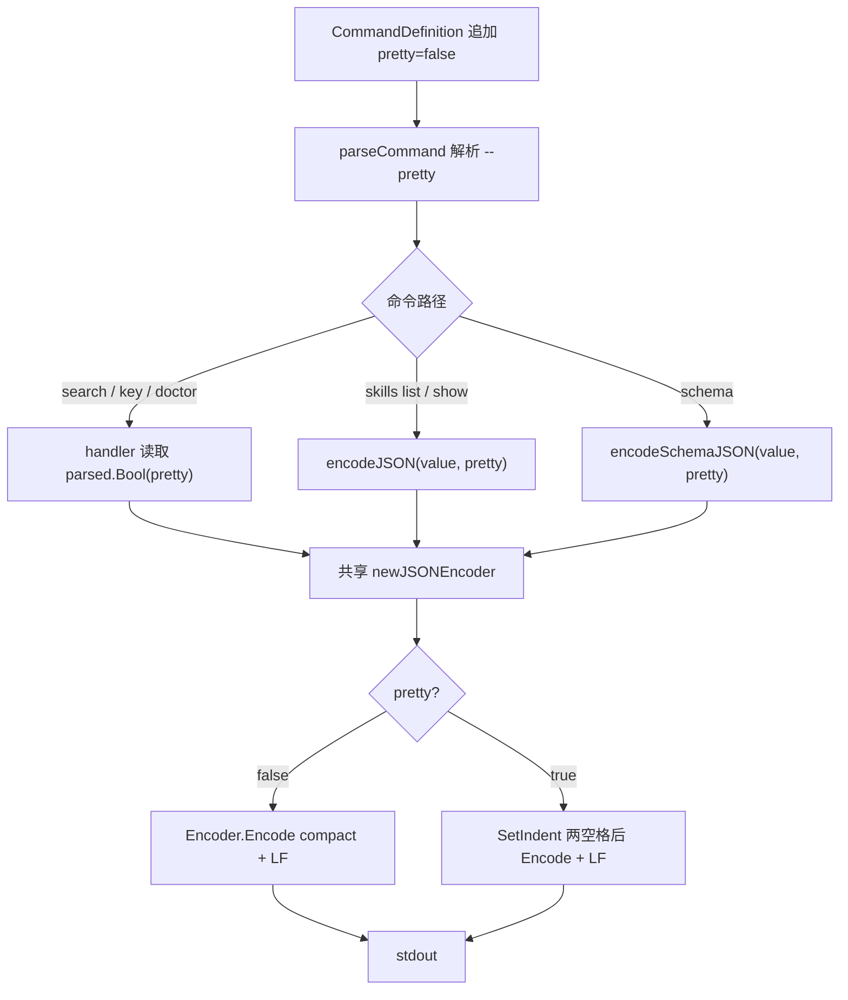

# fast-context CLI JSON Compact 输出与 `--pretty` 技术方案

## 1. 文档信息

| 项目 | 内容 |
| --- | --- |
| 文档状态 | 已实施，待提交/发布 |
| 需求目标 | 以 compact 作为 CLI JSON 的规范默认物理格式，`--pretty` 仅供显式人工查看 |
| 源码基线 | `31c05b3`（包含面向 Agent 的 command schema） |
| 当前发布基线 | `0.1.6`（`58abff1`） |
| 编写日期 | 2026-08-04 |
| 实施日期 | 2026-08-04 |
| 参考实现 | Onesearch `298da3b`：默认输出紧凑 JSON 并支持 `--pretty` |
| 关联文档 | [fast-context CLI command schema 技术方案](./fast-context-cli-command-schema-plan.md)、[fast-context Go CLI 技术架构方案](./fast-context-go-cli-architecture.md) |

## 2. 结论

本方案采用以下统一合同：

1. 任何命令在选择 JSON 输出时，默认使用单行 compact JSON，并保留一个结尾 LF。
2. `--pretty` 是 boolean presentation option，默认值为 `false`；显式启用后使用两空格缩进，并保留一个结尾 LF。
3. JSON 排版只由 argv 决定，不根据 TTY、pipe、重定向或宿主环境自动切换。
4. compact 与 pretty 只改变无语义空白，不改变字段、类型、顺序合同、转义策略、脱敏、退出码或 stdout/stderr 分流。
5. `search`、`key extract`、`doctor`、`skills list`、`skills show` 和 `schema` 六个支持 JSON 的命令公开 `--pretty`；text-only 的 `version` 不增加无效参数。
6. 本次不改变各命令现有的 `--format` 默认值。除 JSON-only 的 `schema` 外，Agent 仍显式使用 `--format json`；`--pretty` 不隐式切换 format。
7. command manifest 的 `manifest_version` 保持 `1`；`pretty` 是新增的可选输入属性，不是新的 output format，也不进入 `output.variants`。
8. schema 运行时默认改为 compact，但 manifest golden 继续通过显式 pretty encoder 生成，兼顾 Agent token 成本与代码审查可读性。

该方案直接覆盖当前五处 JSON encoder，同时保持搜索 pipeline、凭据、远端协议、配置持久化和 npm launcher 不变，是实现需求的最小充分改动。

### 2.1 实施结果

本方案已按上述合同完成：

- 六个 JSON-capable commands 均通过 command definitions 公开 `pretty=false`；`version` 仍不接受该 flag，既有 default format、formats、variants、binding order 和 `manifest_version=1` 保持不变。
- 新增 CLI 层共享 JSON encoder；search、key、doctor、skills 与 schema 默认 compact，显式 pretty 使用两空格缩进，两种模式均保留一个结尾 LF。
- normal JSON 继续使用 Go 默认 HTML escaping，schema 继续使用 `SetEscapeHTML(false)`；pretty 未进入 `search.Options` 或任何业务、协议与持久化状态。
- schema runtime 默认 compact，fixed-version manifest golden 通过显式 pretty encoder 更新；golden diff 仅新增六组 optional `pretty` properties。
- root/npm README、embedded Skill、CLI contract、command-schema 方案与架构文档已同步。

实施后无网络 smoke 的物理输出如下：

| 输出 | compact | pretty |
| --- | ---: | ---: |
| 完整 `schema` | 12,543 bytes / 1 行 | 22,451 bytes / 832 行 |
| 定向 `schema search` | 5,731 bytes / 1 行 | 10,148 bytes / 348 行 |
| `skills list --format json` | 298 bytes / 1 行 | 406 bytes / 18 行 |
| `skills show fast-context --format json` | 8,534 bytes / 1 行 | 8,612 bytes / 16 行 |

已通过定向测试、`go test -count=1 ./...`、`go vet ./...`、npm launcher 测试和八组 compact/pretty CLI smoke。npm 测试首次在受限沙箱中因 Node child process `spawn EPERM` 失败；在获准的沙箱外以相同命令重跑后 7 项通过、1 项 POSIX-only 测试按预期跳过。未执行真实 Windsurf search、`scripts/package-npm.ps1`、npm publish、tag、commit 或 push。

## 3. 背景与当前证据

### 3.1 当前 JSON 输出链路

当前所有 CLI JSON encoder 都无条件调用 `SetIndent("", "  ")`：

| 命令范围 | 当前源码 | 当前 JSON 行为 | 既有流与退出语义 |
| --- | --- | --- | --- |
| `search` | `internal/cli/cli.go:77-103` | 成功和失败均为两空格缩进 | JSON payload 写 stdout；`--verbose` 进度写 stderr；运行失败返回 `1` |
| `key extract` | `internal/cli/cli.go:155-195` | 成功和失败均为两空格缩进 | JSON payload 写 stdout；失败返回 `1` |
| `doctor` | `internal/cli/cli.go:197-258` | report 为两空格缩进 | report 写 stdout；availability 不满足仍返回 `0`，调用方读取 `ok` |
| `skills list/show` | `internal/cli/skills_commands.go:30-87` | 共用 `encodeJSON()`，固定两空格缩进 | JSON 写 stdout；`show --format content` 保持原始 Markdown |
| `schema` | `internal/cli/schema_commands.go:25-117` | 独立静态 encoder，固定两空格缩进 | 成功及参数错误写 stdout；编码失败写 stderr；保持静态无副作用边界 |

这五处都使用 `json.Encoder.Encode()`，因此移除默认 `SetIndent()` 后仍会自然保留结尾 LF，不需要改用 `json.Marshal()` 或手工拼接换行。

### 3.2 当前命令默认格式

`internal/commandcontract/definitions.go` 是 public option、默认值、help 和 manifest input schema 的单一事实源。当前格式合同如下：

| Command ID | 默认 format | 支持 formats | 本方案是否增加 `--pretty` |
| --- | --- | --- | --- |
| `search` | `text` | `text`, `json` | 是 |
| `key.extract` | `text` | `text`, `json` | 是 |
| `doctor` | `text` | `text`, `json` | 是 |
| `skills.list` | `text` | `text`, `json` | 是 |
| `skills.show` | `content` | `content`, `json` | 是 |
| `schema` | `json` | `json` | 是 |
| `version` | `text` | `text` | 否 |

本需求中的“JSON 规范默认输出”指 JSON 的物理排版默认值，不等同于把所有命令的语义默认 format 改成 JSON。后者会改变裸命令输出和既有脚本合同，应作为独立兼容性决策，不纳入本方案。

### 3.3 当前体量快照

在源码基线 `31c05b3` 上，使用 Go `json.Compact()` 对当前 pretty bytes 仅移除无语义空白，再补回结尾 LF，得到以下快照；该方法不会重写 string escaping：

| 输出 | 当前 pretty bytes | compact bytes | bytes 减少 | 物理行数变化 |
| --- | ---: | ---: | ---: | ---: |
| 完整 `schema` | 20,056 | 11,180 | 44.26% | 760 → 1 |
| 定向 `schema search` | 9,748 | 5,503 | 43.55% | 336 → 1 |
| `skills show fast-context --format json` | 8,089 | 8,011 | 0.96% | 16 → 1 |

完整与定向 schema 的缩减最明显，证明 schema 不能因为当前独立 pretty/golden 合同而排除在本次调整之外。`skills show` 的主要体量来自被编码为 JSON string 的 Skill 内容，外层缩进占比较小，因此收益较低但仍应遵循统一合同。

上述数据是一次源码快照，只说明优化量级。实际 token 数取决于模型 tokenizer、字段内容和宿主包装，不作为固定验收阈值；验收应锁定 JSON 物理格式与语义等价，而不是某个 token 百分比。

### 3.4 当前测试基线

分析阶段已执行：

```powershell
mise exec -- go test -count=1 ./...
```

所有 package 通过。当前测试大多使用 `json.Unmarshal()` 验证 payload，受 whitespace 变化影响较小；需要重点调整的现有断言包括：

- `internal/cli/cli_test.go` 中 `skills` JSON 对 `"ok": true` 的 pretty 字节断言；
- `internal/cli/schema_commands_test.go` 中 schema 默认 pretty、确定性和 byte-for-byte golden 合同；
- `docs/fast-context-cli-command-schema-plan.md` 中 schema 固定两空格缩进的既有说明。

## 4. 术语与范围

### 4.1 术语

| 术语 | 定义 |
| --- | --- |
| JSON compact 排版 | JSON token 之间不写入缩进或结构换行；整个 JSON value 为一条物理数据行，末尾保留 LF |
| JSON pretty 排版 | 使用两空格缩进和结构换行，末尾保留 LF |
| 语义 format | `text`、`content`、`json` 等输出数据形态，由 `--format` 选择 |
| Payload contract | JSON 字段、类型、可选性、顺序约定、错误 envelope 和退出码 |

compact/pretty 是 presentation 层选择，不是新的语义 format。JSON string 内部的换行继续编码为 `\n`，不算额外物理输出行。

### 4.2 纳入范围

- 六个 JSON-capable public commands 的 option contract、help 和 manifest input schema；
- search、key、doctor、skills 和 schema 的最终 CLI JSON encoder；
- JSON 成功与当前已有的 JSON 错误路径；
- schema manifest golden 的生成排版；
- root README、npm README、embedded Skill、CLI contract 和直接冲突的架构/方案文档；
- 与排版合同直接相关的 parser、command contract、CLI 和 golden 测试。

### 4.3 非目标

- 不把 `search`、`doctor`、`key extract`、`skills list/show` 的默认 format 改为 JSON；
- 不增加 `json-compact`、`json-pretty` 等新 format enum；
- 不让 `--pretty` 隐式选择 JSON；
- 不按 TTY 自动选择排版；
- 不增加 NDJSON、流式 JSON、分页、cursor、字段选择或新的 payload 精简模式；
- 不修改用户配置文件 JSON、npm `package.json`、MCP/HTTP/protobuf wire payload 或远端模型消息；
- 不修改 search result、doctor report、credential result、Skill DTO 或 schema envelope 字段；
- 不统一或重构现有 JSON 编码错误处理语义；
- 不给 `version` 增加无效果的 `--pretty`；
- 不在本功能中发布 npm、创建 tag、更新版本号或刷新全局安装。

## 5. 参考 Onesearch 的取舍

### 5.1 复用的设计原则

从 Onesearch `298da3b` 复用以下已经验证的选择：

1. `pretty` 是 default `false` 的 boolean presentation option。
2. compact 是 JSON 默认；只有 `pretty=true` 时调用 `SetIndent("", "  ")`。
3. 继续使用 `json.Encoder.Encode()`，保留标准库编码行为和结尾 LF。
4. 不使用 TTY 自动切换，保证相同 argv 得到稳定 bytes。
5. compact 与 pretty 解码后必须深度相等。
6. pretty 不属于 payload variant，不改变错误分类、脱敏或退出码。
7. 大型 manifest golden 显式使用 pretty，运行时默认 compact 由独立测试锁定。

### 5.2 不直接照搬的部分

fast-context 与 Onesearch 的实现边界不同：

- Onesearch 普通命令已经默认 JSON；fast-context 多数命令仍默认 text/content。本方案不借排版需求改变这一语义默认值。
- Onesearch 有统一动态 renderer、quiet/verbose 字段裁剪、`--output` 文件和 `regression` 特殊路径；fast-context 没有这些合同。
- fast-context 有五处独立 encoder，其中 schema 必须保持 `SetEscapeHTML(false)`，而 skills 必须保持 Go 默认 HTML escaping。
- fast-context 的 schema manifest 明确发布 `x-cli-binding.order`；新增 option 应追加到各命令 options 尾部，避免重排既有 flag order。
- fast-context 的非 schema 参数错误当前是 stderr text，不应因本功能改造成 JSON。

## 6. 方案选择

### 6.1 规范行为

```text
--format json
  -> 单行 compact JSON
  -> 恰好一个结尾 LF

--format json --pretty
  -> 两空格缩进的多行 JSON
  -> 恰好一个结尾 LF

--format json --pretty=false
  -> 与省略 --pretty 相同的 compact JSON
```

parser 已支持 boolean presence flag 和 inline boolean，因此 public 语法为：

- `--pretty`
- `--pretty=true`
- `--pretty=false`

### 6.2 行为矩阵

| 命令范围 | format | pretty | 结果 |
| --- | --- | --- | --- |
| 六个 JSON-capable commands | `json` | 省略或 `false` | compact JSON + LF |
| 六个 JSON-capable commands | `json` | `true` | 两空格 pretty JSON + LF |
| `search`、`key extract`、`doctor`、`skills list` | `text` | 任意值 | text 输出不变，pretty 无效果 |
| `skills show` | `content` | 任意值 | 原始 Skill Markdown 不变，pretty 无效果 |
| `schema` | 非 `json` | 任意值 | 保持现有结构化参数错误与 exit `2` |
| `version` | `text` | 不适用 | 不支持 `--pretty` |

因此人工查看 JSON 时应显式写完整意图：

```powershell
# Agent/脚本：compact JSON
fast-context doctor --project . --format json
fast-context schema search

# 人工查看：pretty JSON
fast-context doctor --project . --format json --pretty
fast-context schema search --pretty
```

`fast-context doctor --pretty` 仍使用其现有默认 `text` format；`--pretty` 不隐式切换为 JSON。

### 6.3 不使用 TTY 自动切换

TTY 不是可靠的人类意图信号：Agent shell 可能分配伪终端，相同命令在终端与捕获环境中会得到不同 bytes，测试和复现也会变得不稳定。因此：

- 不调用 `isatty`；
- 不根据 stdout 是否被 pipe 或 redirect 改变排版；
- 不根据 `--verbose`、环境变量或宿主平台改变 pretty 默认值。

### 6.4 结构化错误边界

- search 的 JSON runtime error 与成功结果使用同一个 pretty 选择；
- key extract 的 JSON success/error 使用同一个 pretty 选择；
- doctor report 使用同一个 pretty 选择；
- schema 在成功解析 argv 后产生的 unknown canonical path error 尊重 `pretty`；
- schema argv parse error 发生在 handler 之前。当前 parser 在失败时不返回可信的 partial parsed state，本方案不增加二次 argv 扫描，因此该错误继续使用默认 compact JSON；
- 非 schema 的参数错误继续写 stderr text，unknown root command/help/version 的现有行为不变。

## 7. 总体设计



`pretty` 只存在于 CLI presentation 层。特别是 `search.Options` 不增加 `Pretty` 字段，避免展示状态进入搜索 pipeline、repo map、远端请求、结果 DTO 或协议层。

## 8. 详细设计

### 8.1 Command contract

在 `internal/commandcontract/definitions.go` 新增唯一 helper：

```go
func prettyOption() OptionDefinition {
    return OptionDefinition{
        Name:        "pretty",
        Flag:        "--pretty",
        Type:        TypeBoolean,
        Description: "Indent JSON output; ignored for non-JSON formats.",
        Default:     false,
        HasDefault:  true,
    }
}
```

接入规则：

1. 给 `search`、`key.extract`、`doctor`、`skills.list`、`skills.show` 和 `schema` 追加 `prettyOption()`。
2. option 放在每个 command 的 `Options` 尾部，保持所有既有 `x-cli-binding.order` 数值不变。
3. `version` 保持无 options。
4. `OutputDefinition.DefaultFormat`、`Formats`、`Variants`、`Contract`、`Redaction` 和 exit codes 不变。
5. `pretty` 不进入 required，不进入 output variants。
6. `manifest_version` 保持 `1`；完整 golden 因新增 optional property 而更新。

command help 和 input schema 已由 definition 自动生成，不需要另建平行 flag registry。manifest 中的目标形态为：

```json
{
  "pretty": {
    "type": "boolean",
    "default": false,
    "description": "Indent JSON output; ignored for non-JSON formats.",
    "x-cli-binding": {
      "kind": "flag",
      "order": 12,
      "token": "--pretty",
      "true": "presence_flag",
      "false": "explicit_boolean_value"
    }
  }
}
```

其中 `order` 仅为 `search` 的示意值；测试应从 definition 计算预期，不在文档或实现中复制魔法数字。

### 8.2 共享 JSON presentation helper

新增 `internal/cli/json_output.go`，只统一 encoder 的排版选择：

```go
func newJSONEncoder(w io.Writer, pretty bool) *json.Encoder {
    encoder := json.NewEncoder(w)
    if pretty {
        encoder.SetIndent("", "  ")
    }
    return encoder
}
```

该 helper 不负责：

- 选择 JSON/text/content；
- 修改 value；
- 设置 HTML escaping；
- 处理错误或决定退出码；
- 写 stderr；
- 访问配置、凭据或网络。

这样既避免五处 conditional indent 漂移，又不合并各命令已有的输出和失败语义。

### 8.3 Search、key 与 doctor

在 `internal/cli/cli.go`：

- 三个 handler 从 `ParsedCommand` 读取 `pretty := parsed.Bool("pretty")`；
- JSON 分支改用 `newJSONEncoder(stdout, pretty)`；
- search 的成功 `result` 与失败 `output.ErrorJSON(err, result)` 使用同一 encoder 配置；
- key extract 的成功/失败 map 使用同一 encoder 配置；
- doctor report 使用同一 encoder 配置；
- 保留当前 `_ = encoder.Encode(...)` 行为，不借本功能改变编码失败的 exit contract；
- 保留 text formatter、stderr、progress callback、doctor exit `0` 和 key/search exit code。

`buildSearchOptions()` 和 `search.Options` 不读取或保存 `pretty`。

### 8.4 Skills JSON

将 `internal/cli/skills_commands.go` 的 helper 调整为：

```go
func encodeJSON(w io.Writer, value any, pretty bool) int
```

`skills list/show` 仅在 `format == "json"` 时传入 parsed pretty；text/content 分支完全不变。

必须保留当前 Go 默认 HTML escaping。尤其 `skills show --format json` 中的 `<...>` 继续编码为 `\u003c...\u003e`；本次只能改变结构空白，不能把 skills encoder 切换成 schema 的 `SetEscapeHTML(false)` 合同。

### 8.5 Schema 静态 encoder

将 `internal/cli/schema_commands.go` 的签名调整为：

```go
func encodeSchemaJSON(w io.Writer, value any, pretty bool) error
```

实现顺序：

1. 通过 `newJSONEncoder(w, pretty)` 创建 encoder；
2. 继续调用 `encoder.SetEscapeHTML(false)`；
3. 调用 `Encode(value)`；
4. 保留当前写失败返回 `1`、stderr 错误信息和静态 dispatch 边界。

`runSchema()` 读取 `parsed.Bool("pretty")`，并传给 full/target success 和 `BuildManifest()` 返回的 unknown canonical path error。`Execute()` 中 parse 失败的 schema error 使用 `pretty=false`，不做 raw argv 二次解析。

schema 仍在 runtime handler 之前完成，不读取配置、凭据、project、cwd 或 environment value，不访问网络，也不调用 normal handlers。

### 8.6 HTML escaping 与结尾 LF

排版修改后必须保持两类既有 escaping：

| 路径 | HTML escaping |
| --- | --- |
| search/key/doctor/skills | Go `json.Encoder` 默认行为，保持现状 |
| schema | `SetEscapeHTML(false)`，保持现状 |

所有路径继续使用 `Encode()`，目标字节合同为：

- compact：一个 JSON value + 一个 LF；
- pretty：两空格缩进 JSON value + 一个 LF；
- 不输出 BOM；
- 不附加空白行。

### 8.7 Manifest golden

默认 schema 改为 compact 后，不能让大型 golden 退化为单行文件。调整 `TestSchemaMatchesFixedVersionGolden`：

```text
BuildManifest(..., "test", nil)
  -> encodeSchemaJSON(..., pretty=true)
  -> cli-command-manifest-v1.golden.json
```

同时新增独立测试锁定运行时默认 compact。golden 更新仍只允许通过现有 `UPDATE_FAST_CONTEXT_CLI_MANIFEST_GOLDEN=1` gate，并人工确认：

- 六个 JSON-capable commands 各新增一个 optional `pretty` property；
- 既有 option 的 binding order 不变；
- `version` 未新增 pretty；
- output formats、variants、exit codes、availability 和 side effects 未漂移；
- `manifest_version` 仍为 `1`。

## 9. 文件改动规划

### 9.1 核心实现

| 文件 | 规划改动 |
| --- | --- |
| `internal/commandcontract/definitions.go` | 新增 `prettyOption()`；追加到六个 JSON-capable command definitions |
| `internal/cli/json_output.go` | 新增共享 compact/pretty encoder 构造函数 |
| `internal/cli/cli.go` | search/key/doctor 读取 pretty 并使用共享 encoder |
| `internal/cli/skills_commands.go` | `encodeJSON` 接收 pretty；保持默认 HTML escaping |
| `internal/cli/schema_commands.go` | schema success/error 传递 pretty；保持独立静态边界和 `SetEscapeHTML(false)` |

### 9.2 测试与生成产物

| 文件 | 规划改动 |
| --- | --- |
| `internal/cli/json_output_test.go` | 覆盖 compact/pretty、尾 LF、语义相等和 escaping 基础行为 |
| `internal/commandcontract/registry_test.go` | 断言六个命令有 pretty=false、version 无 pretty、既有 binding order 不变 |
| `internal/cli/command_parser_test.go` | 覆盖 `--pretty`、`=true`、`=false`、默认 false 和非 JSON format 组合 |
| `internal/cli/cli_test.go` | 覆盖 skills、doctor、key 的 compact/pretty 与既有 stdout/exit/redaction/escaping |
| `internal/cli/schema_commands_test.go` | 覆盖 full/target/error、默认 compact、显式 pretty、确定性、静态边界和 pretty golden |
| `internal/cli/testdata/cli-command-manifest-v1.golden.json` | 通过显式 pretty update gate 更新新增 option |
| `internal/skills/skills_test.go` | 校验 embedded Skill/contract 已说明默认 compact 与人工 `--pretty` |

### 9.3 文档

| 文件 | 规划改动 |
| --- | --- |
| `README.md` | 增加统一 JSON 排版合同、Agent/人工示例和 byte-level 兼容说明 |
| `npm/fast-context/README.md` | 同步 npm 安装后的 compact/pretty 使用方式 |
| `internal/skills/assets/fast-context/SKILL.md` | 明确 Agent 默认不传 pretty，人工检查才显式启用 |
| `internal/skills/assets/fast-context/references/cli-contract.md` | 记录 flags、行为矩阵、尾 LF、escaping、错误和 schema golden 合同 |
| `docs/fast-context-cli-command-schema-plan.md` | 修订“schema 固定两空格缩进”的后续排版合同，说明 golden 仍显式 pretty |
| `docs/fast-context-go-cli-architecture.md` | 在 CLI 输出层补充 compact/pretty presentation 边界 |

### 9.4 明确不修改

| 文件/模块 | 原因 |
| --- | --- |
| `cmd/fast-context/main.go` | 已透明传入 argv/stdout/stderr/exit code |
| `internal/search/**` | pretty 不进入业务、repo map、远端请求或结果 DTO |
| `internal/output/**` | 该 package 只生成 search text/error DTO，不拥有最终 JSON encoder |
| `internal/config/**` | 用户配置 JSON 是独立持久化合同 |
| `internal/credentials/**` | 不改变凭据来源、脱敏或错误 |
| `internal/windsurf/**`、`internal/protowire/**` | 不改变外部 wire protocol |
| `npm/fast-context/bin/fast-context.js` | launcher 已透明转发任意 argv 与 stdio |
| `npm/**/package.json`、`.deploy/version` | 不在本功能中提升或发布版本 |
| `go.mod`、`go.sum` | 仅使用 Go 标准库，不新增依赖 |

## 10. 分阶段实施计划

### 阶段一：冻结公共合同与红灯测试

1. 在 command definitions 中追加 `pretty=false`。
2. 为六个 JSON-capable commands 和 `version` 建立正反断言。
3. 锁定既有 option binding order、formats、variants、exit codes 和 manifest version。
4. 增加 parser boolean 组合测试。
5. 增加默认 compact、显式 pretty、语义相等和尾 LF 的失败测试。

### 阶段二：实现共享排版与普通命令接入

1. 新增 `newJSONEncoder()`。
2. 接入 search、key、doctor 三条 JSON 路径。
3. 调整 skills `encodeJSON()` 签名并接入 pretty。
4. 验证 text/content、stderr、exit code 和 skills HTML escaping 不变。

### 阶段三：接入 schema 并更新 golden

1. 让 schema full/target success 和 handler 内错误尊重 pretty。
2. 保持 parse-before-handler error 默认 compact。
3. 保持 schema `SetEscapeHTML(false)` 和静态无副作用边界。
4. 将 golden encoder 固定为 explicit pretty。
5. 通过 update gate 更新 golden 并审查完整合同 diff。

### 阶段四：同步公共文档与内置 Skill

1. 更新 root/npm README、Skill 和 CLI contract。
2. 修订 schema 旧方案中的固定 indent 冲突。
3. 更新架构文档的 presentation 层说明。
4. Agent 示例继续使用 compact JSON，不机械追加 `--pretty`。
5. 人工检查示例显式加入 `--pretty`。

### 阶段五：验证与交付

1. gofmt 目标 Go 文件。
2. 运行定向与全量测试、vet、npm launcher 测试。
3. 执行本地无网络 CLI smoke。
4. 检查 golden、文档、diff 和 whitespace。
5. 不执行真实 search、npm publish、tag 或 push，除非另有明确授权。

## 11. 测试方案

### 11.1 Encoder 与字节合同

至少覆盖：

1. 默认 JSON 只有一个实际 LF，且它是最后一个 byte。
2. pretty JSON 包含两空格结构缩进，并只有一个结尾 LF。
3. compact 与 pretty 分别 `json.Unmarshal()` 后深度相等。
4. `--pretty=false` 与省略 flag byte-for-byte 相同。
5. compact/pretty 都没有 BOM 和额外空白行。
6. normal encoder 继续 HTML escape；schema encoder 继续不 HTML escape。

### 11.2 Command contract 与 parser

至少覆盖：

1. 六个 JSON-capable commands 的 `pretty` 类型为 boolean、默认 false、flag 为 `--pretty`。
2. `version` 不暴露 pretty。
3. pretty 是每个目标 command 的最后一个 option，既有 option order 不变。
4. `output.variants` 不包含 pretty。
5. input schema 包含 default、description 和 boolean argv binding。
6. parser 接受 `--pretty`、`--pretty=true`、`--pretty=false`。
7. text/content 与 pretty 的组合合法且输出不变。
8. help 自动展示 `--pretty` 及“仅影响 JSON”的说明。
9. manifest round-trip 测试能生成并重新解析 `pretty=true/false` 的 canonical argv。

### 11.3 CLI 命令测试

使用本地 fixture、临时目录和 fake credential/ripgrep，禁止真实网络：

- `skills list/show`：compact、pretty、语义相等、content 不变、HTML escaping 不变；
- `doctor`：compact、pretty、语义相等、credential 仍脱敏、`ok=false` 仍 exit `0`；
- `key extract`：成功/失败 compact 与 pretty，key 不泄漏，exit code 不变；
- `search`：共享 encoder 单元测试锁定 bytes，CLI/parser 测试锁定 pretty 传递；不为排版测试发起真实远端调用；
- text mode：search/key/doctor/skills list 的 stdout/stderr 与现有断言保持；
- non-schema usage error：仍是 stderr text、exit `2`。

### 11.4 Schema 测试

至少覆盖：

1. full 与 targeted schema 默认均为单行 compact + LF。
2. full 与 targeted `--pretty` 均为两空格多行 + LF。
3. compact/pretty manifest 深度相等。
4. 两种模式各自连续执行 byte-for-byte 稳定。
5. unknown canonical path 在成功解析 pretty 时遵守 pretty。
6. schema argv parse error 保持默认 compact、stdout JSON、exit `2`。
7. schema 不调用 normal handlers，不读取 runtime 状态，不访问网络。
8. golden 显式使用 pretty，CLI version 归一化和 update gate 保持。
9. golden 中只出现预期 optional property，旧 binding order 和 output metadata 不漂移。

### 11.5 验证命令

```powershell
mise exec -- go test -count=1 ./internal/cli ./internal/commandcontract ./internal/skills ./internal/output
mise exec -- go test -count=1 ./...
mise exec -- go vet ./...
npm --prefix npm/fast-context test
git diff --check
```

本地无网络 smoke：

```powershell
mise exec -- go run ./cmd/fast-context schema
mise exec -- go run ./cmd/fast-context schema --pretty
mise exec -- go run ./cmd/fast-context schema search
mise exec -- go run ./cmd/fast-context schema search --pretty
mise exec -- go run ./cmd/fast-context skills list --format json
mise exec -- go run ./cmd/fast-context skills list --format json --pretty
mise exec -- go run ./cmd/fast-context skills show fast-context --format json
mise exec -- go run ./cmd/fast-context skills show fast-context --format json --pretty
```

发布或分发验收阶段再运行 `scripts/package-npm.ps1`，确认安装后的 launcher 透明传递 `--pretty`。真实 Windsurf search 不属于本地 JSON 排版功能的必要验收；若发布前执行，只能作为独立的远端兼容 smoke，不能替代上述字节合同测试。

## 12. 兼容性与迁移

### 12.1 保持兼容的部分

- 标准 JSON parser 解码结果不变；
- JSON field、类型、null/empty 语义和 escaping 策略不变；
- text/content 输出不变；
- `--format` 默认值和允许值不变；
- stdout/stderr 分流与退出码不变；
- schema 静态边界不变；
- npm launcher 和平台包参数转发不变。

### 12.2 有意变化的部分

默认 JSON bytes 会从多行两空格缩进变为单行 compact：

- 依赖逐行 grep、固定缩进、snapshot、hash 或文本 diff 的调用方需要显式增加 `--pretty` 或更新预期；
- 依赖标准 JSON parser 的 Agent、脚本和 adapter 无需迁移；
- 文档中的 JSON code fence 可继续为可读性使用 pretty，不代表运行时默认。

该 byte-level 变化应在后续 release note 中明确说明，并给出 `--pretty` 迁移示例。

### 12.3 Manifest 版本

`manifest_version` 保持 `1`，原因是：

- manifest envelope、JSON Schema 表达和 binding 结构没有变化；
- `pretty` 是 additive optional boolean property；
- whitespace 不属于 manifest 数据模型版本；
- `output.variants` 不新增值。

## 13. 风险与应对

### 13.1 依赖 pretty bytes 的消费者

风险：脚本可能按行读取对象、匹配 `"ok": true`、保存 snapshot 或计算 hash。

应对：README/release note 明确 byte-level breaking change；人工/旧 snapshot 场景显式使用 `--pretty`；自动化使用标准 JSON parser。

### 13.2 完整 schema 变成超长单行

风险：少数终端、日志收集器或上层工具存在单行长度限制。

应对：Agent 优先使用 `schema <canonical-path...>`；人工审阅使用 `--pretty`。fast-context 当前没有 `--output`，本方案不为该风险扩展文件写入合同。

### 13.3 五条 encoder 路径漂移

风险：只修改 search 或 schema，导致命令间默认行为不一致。

应对：共享 `newJSONEncoder()`；command registry 测试覆盖六个命令；CLI 测试分别覆盖 normal、skills、schema 路径。

### 13.4 HTML escaping 被误改

风险：复用 helper 时错误地把 schema 的 `SetEscapeHTML(false)` 扩散到 skills/search，破坏既有 bytes 和潜在安全假设。

应对：共享 helper 只控制 indent；escaping 由调用方维持；为 normal/schema 两类分别建立断言。

### 13.5 “compact 默认”与“默认 JSON”混淆

风险：维护者可能顺带把裸 `search`、`doctor` 或 `skills show` 的默认 format 改成 JSON。

应对：测试锁定各命令现有 `DefaultFormat`；文档明确 `--pretty` 不隐式切换 format；任何语义默认迁移另立方案。

### 13.6 Golden 可审阅性下降

风险：默认 compact 直接驱动 golden 会使 700 余行 manifest 变成一行。

应对：golden 固定显式 pretty；运行时默认 compact 由独立测试验证，不让测试产物排版反向决定产品默认值。

### 13.7 Schema parse error 无法恢复 pretty

风险：`schema --pretty` 后若出现 argv parse error，当前 parser 返回空 parsed state，错误仍为 compact。

应对：明确该边界并保持 compact；不为 presentation flag 二次扫描 raw argv，也不扩大 parser 返回合同。有效 argv 和 handler 内结构化错误完整支持 pretty。

## 14. 验收标准

1. 六个 JSON-capable commands 在 help 与 manifest 中公开 `--pretty`，默认 `false`；`version` 不公开。
2. 所有 CLI JSON 默认输出单行 compact，并保留恰好一个结尾 LF。
3. 显式 `--pretty` 输出两空格缩进 JSON，并保留恰好一个结尾 LF。
4. `--pretty=false` 与省略 flag byte-for-byte 相同。
5. compact 与 pretty 解码后的 JSON 深度相等。
6. text/content 输出在有无 pretty 时 byte-for-byte 不变。
7. search/key/doctor/skills 保持既有 HTML escaping；schema 保持 `SetEscapeHTML(false)`。
8. fields、formats、默认 format、variants、redaction、exit codes、stdout/stderr 和错误分类不变。
9. pretty 不进入 `search.Options`、远端请求、结果 DTO 或持久化状态。
10. schema full/target/success/error 均覆盖排版测试，并继续保持静态无副作用。
11. 既有 option binding order 不变；manifest version 保持 `1`。
12. manifest golden 保持可审阅的 pretty JSON，并只通过显式 update gate 更新。
13. README、npm README、embedded Skill、CLI contract、schema 方案和架构文档同步完成。
14. 定向测试、全量测试、vet、npm launcher 测试、无网络 smoke 和 `git diff --check` 全部通过。
15. 未修改版本、tag，未执行 push、publish 或真实远端 search，除非另有授权。

## 15. 推荐实施结论

实施时以 command definitions 作为 `--pretty` 的唯一公共合同来源，以 CLI 层共享 encoder helper 统一五处最终 JSON presentation，并把 schema 纳入相同的 compact 默认。运行时默认追求 Agent token 效率，manifest golden 和人工检查通过显式 `--pretty` 保持可读性。

该设计不改变 JSON 数据模型、默认 format、协议或业务链路，不引入依赖或 TTY 分支；兼容性变化被严格限制在 JSON whitespace bytes，是满足“compact 为 JSON 规范默认输出”的最小充分方案。
