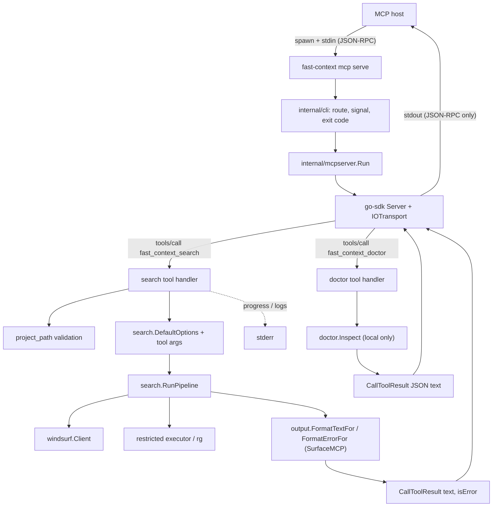
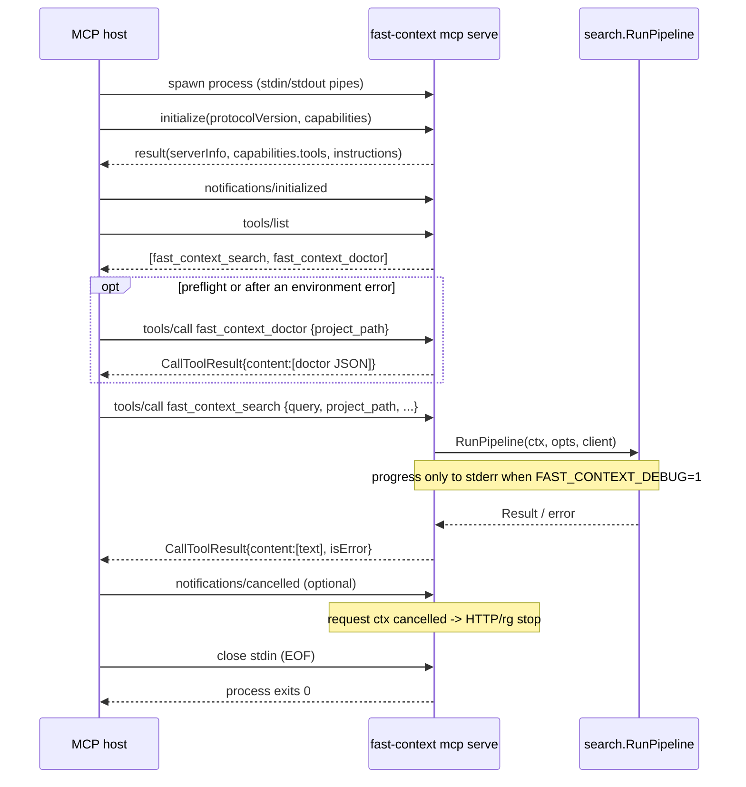

# fast-context `mcp serve` stdio MCP Server 技术方案

## 1. 文档信息

| 项目 | 内容 |
| --- | --- |
| 文档状态 | 已实施 P0（2026-11-05），实施结果与偏差见 §19；P1 进度通知未实施。工具集合、server 名称与凭据工具取舍已于 2026-11-05 确认（见 §17） |
| 需求目标 | 新增 `fast-context mcp serve` 子命令，通过 stdio 以 Model Context Protocol（MCP）server 身份向 MCP 宿主暴露语义代码搜索与本地就绪检查工具 |
| 源码基线 | `a896b05`（`chore: add skill doc`），发布版本 `1.0.1`（`.deploy/version`） |
| 编写日期 | 2026-11-05 |
| 行为参考 | npm `fast-context-mcp@1.5.2`（当前 `latest`）的 `src/server.mjs`、`src/project-path.mjs`、`src/core.mjs` |
| 依赖 | `github.com/modelcontextprotocol/go-sdk v1.8.0`（2026-09-04 发布，`go 1.25.0`），已引入为直接依赖 |
| 关联文档 | [fast-context Go CLI 技术架构方案](./fast-context-go-cli-architecture.md)、[fast-context CLI command schema 技术方案](./fast-context-cli-command-schema-plan.md)、[fast-context CLI JSON Compact 输出与 `--pretty` 技术方案](./fast-context-cli-json-output-format-plan.md) |

## 2. 结论

本方案采用以下设计：

1. 新增 `fast-context mcp serve`，只支持 stdio 传输：stdin/stdout 承载以换行分隔的 JSON-RPC 2.0 消息，stderr 只用于诊断日志。本期不做 HTTP、SSE 或 Streamable HTTP。
2. 新增 `internal/mcpserver` 包，承载 MCP server 组装、工具定义和工具 handler。MCP SDK 依赖只出现在这个包中；`internal/cli` 只负责路由、信号处理和退出码，`search`、`output` 等核心包不感知 MCP。
3. 使用官方 `github.com/modelcontextprotocol/go-sdk`，固定到 `v1.8.0`，不手写 JSON-RPC 与 MCP 生命周期。该版本的 `go 1.25.0` 与本项目工具链一致，并支持协议版本 `2024-11-05` 到 `2026-07-28`。
4. 暴露两个工具。`fast_context_search` 的工具名、参数名、参数范围和默认值对齐上游 `fast-context-mcp@1.5.2`，现有 MCP 宿主配置只需替换启动命令即可迁移。`fast_context_doctor` 是本项目新增的只读预检工具，返回与 CLI `doctor --format json` 逐字节相同的报告，不访问网络。不提供上游的 `extract_windsurf_key`，因为它会把完整 API key 写入模型上下文。
5. 工具执行复用 `search.RunPipeline()` 和 `windsurf.Client`，结果以 text content 返回，格式化复用 `internal/output`。新增一个"调用面"维度，让 MCP 输出中的提示使用 `project_path`、`exclude_paths`、`tree_depth` 等工具参数名，不再使用 `--project` 等 CLI flag；CLI 输出逐字节保持不变。
6. 工具执行失败时返回 `isError: true` 的 `CallToolResult`，不升级为 JSON-RPC 协议错误。参数 schema 校验由 SDK 完成；`project_path` 是否为绝对路径、是否为目录由 handler 校验。
7. 生命周期：stdin EOF 或 SIGINT/SIGTERM 视为正常结束，退出码 `0`；传输层或 server 运行失败退出 `1`；argv 参数错误退出 `2`。
8. 在 command contract 中新增 `mcp` namespace 和 `mcp.serve` 命令定义，manifest 增量扩展，`manifest_version` 保持 `1`，golden 只新增该命令定义。
9. 不修改 Windsurf 协议客户端、受限执行器、凭据解析顺序、npm launcher 和已有 CLI 命令的行为。

改动集中在两个新包（`internal/mcpserver`、`internal/doctor`）、一个 CLI handler、一组命令定义，以及 `output`、`search`、CLI `doctor` 中三处小范围、可回归验证的抽取。整体复杂度评估为中低。

## 3. 需求理解与术语边界

### 3.1 需求拆解

| 需求要素 | 本方案中的含义 |
| --- | --- |
| `fast-context mcp serve` | `mcp` 是新的命令 namespace，`serve` 是其下唯一的可执行叶子命令，canonical ID 为 `mcp.serve` |
| MCP 模式 | 进程作为 MCP server，由 MCP 宿主（Claude Desktop、Codex、Cursor、MCP Inspector 等）以子进程方式拉起，通过 `initialize`、`tools/list`、`tools/call` 交互 |
| 通过 stdio 通信 | 使用 MCP 规范的 stdio transport：每条 JSON-RPC 消息占一行，以 `\n` 分隔；stdout 只能写协议消息 |
| 复用现有能力 | 搜索语义、凭据、仓库地图、受限执行器、结果解析与格式化全部复用现有包，不形成第二套实现 |

### 3.2 MCP server 与 CLI command manifest 的关系

[command schema 方案 §3.2](./fast-context-cli-command-schema-plan.md) 明确规定：`fast-context schema` 只输出 CLI 输入合同，不负责 native tool 注册。`mcp serve` 正好补上这一层，即标准化的 native tool 注册通道。两者职责不同：

| 能力 | `fast-context schema` | `fast-context mcp serve` |
| --- | --- | --- |
| 消费方 | 通过 shell 调用 CLI 的 Agent 或适配器 | 支持 MCP 的宿主 |
| 合同形态 | 静态 JSON manifest，描述 argv 绑定 | `tools/list` 返回的 MCP tool 定义，描述 JSON 参数 |
| 参数命名 | CLI 属性名（`project`、`exclude`、`include_snippets`） | 上游兼容名（`project_path`、`exclude_paths`、`include_code_snippets`） |
| 执行方式 | Agent 自行拼接 argv 并执行 | 宿主发起 `tools/call`，由 server 进程内直接调用 `search.RunPipeline()` 或 `doctor.Inspect()` |
| 副作用 | 无 | `fast_context_search` 与 CLI `search` 相同；`fast_context_doctor` 与 CLI `doctor` 相同，只读本地 |

`mcp serve` 本身也是一条 CLI 命令，所以会出现在 manifest 中。但它是一个长期运行、阻塞等待 stdin 的进程，不应由 Agent 在 shell 中直接调用，这一点通过 summary 和内置 Skill 说明（见 §11.2）。

### 3.3 术语

| 术语 | 含义 |
| --- | --- |
| MCP 宿主 / client | 拉起 `fast-context mcp serve` 并通过 stdio 发送请求的一方 |
| tool | MCP server 通过 `tools/list` 声明、可由宿主经 `tools/call` 调用的能力；本方案提供 `fast_context_search` 与 `fast_context_doctor` |
| 工具执行错误 | 工具已被调用但业务失败，返回 `CallToolResult{isError: true}`，模型可见并可据此调整参数 |
| 协议错误 | JSON-RPC 层错误（未知方法、请求格式错误等），由 SDK 生成，模型通常不可见 |
| 调用面（surface） | 同一份搜索结果面向 CLI 用户还是 MCP 工具调用者；只影响提示文案中的参数名称 |

## 4. 当前源码与验证基线

### 4.1 工具链与状态

| 项目 | 当前状态 | 证据 |
| --- | --- | --- |
| Go 工具链 | `go 1.25.0`，由 mise 管理 | `mise.toml`、`go.mod`、`go version` 实际输出 `go1.25.0 windows/amd64` |
| 直接依赖 | 仅 `modernc.org/sqlite v1.53.0` | `go.mod` |
| MCP 支持 | 无。代码中没有 MCP 依赖或入口，`mcp` 只出现在注释和帮助文案中 | 全仓库 `rg -i '\bmcp\b'` |
| 测试基线 | 全部通过 | 分析阶段执行 `mise exec -- go test -count=1 ./...` |
| 公共命令 | 7 个可执行叶子命令、2 个 namespace（`key`、`skills`） | `internal/commandcontract/definitions.go:9-26` |

### 4.2 当前 CLI 调用链

```text
cmd/fast-context/main.go:10-12
  -> cli.Execute(context.Background(), os.Args[1:], os.Stdout, os.Stderr)
internal/cli/cli.go:27-74
  -> registry 解析 canonical path / alias
  -> parseCommand() 按 command definition 做 typed 解析
  -> defaultCommandHandlers[definition.ID]
internal/cli/cli.go:76-102  runParsedSearch
  -> buildSearchOptions(parsed, config.ReadRuntime(), cwd())
  -> search.RunPipeline(ctx, opts, windsurf.NewClient(nil))
  -> output.FormatText / output.FormatError / JSON encoder
```

需要关注的约束：

- `internal/cli/command_bindings.go:44-63` 在 `init()` 中校验 command definition 与 handler 一一对应，新增定义必须同时绑定 handler。
- `cli.Execute()` 的签名不含 stdin，handler 签名同样不含 stdin。
- `main.go` 使用 `context.Background()`，没有注册信号处理；CLI 中按 Ctrl+C 走 Go 默认的进程终止。

### 4.3 可直接复用的能力

| 能力 | 位置 | MCP 模式下的用法 |
| --- | --- | --- |
| 搜索编排 | `internal/search/pipeline.go:18` `RunPipeline(ctx, opts, client)` | 工具 handler 的核心调用 |
| 运行时默认值 | `internal/config/config.go:127-147` `ReadRuntime()` | server 启动时读取一次，作为工具默认值和 server 级参数 |
| 远端客户端 | `internal/windsurf/client.go:65-78` `NewClient(nil)` | server 生命周期内共享一个实例；`http.Client` 并发安全 |
| 凭据解析 | `internal/search/search.go:75` 在每次 `Run` 时调用 `credentials.FindAPIKey()` | 每次工具调用重新解析，server 启动时不需要凭据 |
| 项目根保护 | `internal/search/project_root.go:15-30` | 拒绝用户主目录和文件系统根，MCP 模式下照常生效 |
| 文本格式化 | `internal/output/output.go:12`、`:121-163`、`:165-211` | 工具结果文本；需要按调用面调整提示措辞 |
| 版本信息 | `internal/version` | 作为 MCP `serverInfo.version` |
| 本地就绪检查 | `internal/cli/cli.go:196-258` `runParsedDoctor`：project、ripgrep、credentials、version 四类检查 | 抽取到 `internal/doctor` 后作为 `fast_context_doctor` 的实现 |
| JSON 编码 | `internal/cli/json_output.go:8-14`：非 pretty 时为默认 `json.NewEncoder` | doctor 工具使用相同的编码配置，保证与 CLI 字节一致 |

### 4.4 stdio 纯净性核查

在 stdio transport 中，stdout 只要多写一个非协议字节，宿主的消息解析就会失败。对现有代码的核查结果如下：

| 检查项 | 结果 | 证据 |
| --- | --- | --- |
| 库代码是否直接写 `os.Stdout` / `fmt.Print*` / `log.*` | 否。所有输出都经由注入的 `io.Writer` | `rg 'os\.Stdout\|fmt\.Print\|log\.(Print\|Fatal)'` 仅命中 `cmd/fast-context/main.go:11` 的注入点 |
| 子进程是否继承 stdin | 否。`exec.Command` 均未设置 `Stdin`，Go 默认连接 `os.DevNull`，不会读走 MCP 消息 | `internal/executor/executor.go:210`、`internal/dirscore/dirscore.go:457,727`、`internal/search/autogrep.go:156` |
| 子进程 stdout/stderr 是否泄漏到父进程 stdout | 否。executor 写入 `bytes.Buffer`，dirscore/autogrep 使用 `cmd.Output()` 捕获 | `executor.go:212-215`、`dirscore.go:1084`、`autogrep.go:162` |
| 进度输出 | 只经 `Options.Progress` 回调，CLI 中写 stderr | `internal/cli/cli.go:79-83` |

结论：现有库代码满足 stdio 纯净性要求，`mcp serve` 不需要为此改造任何核心包。

### 4.5 当前缺口

| 缺口 | 位置 | 影响 |
| --- | --- | --- |
| 没有 MCP 依赖与入口 | `go.mod`、`definitions.go` | 需新增依赖、命令定义与 handler |
| 运行时默认值到 `search.Options` 的映射绑定在 CLI 解析结果上 | `internal/cli/cli.go:104-152` `buildSearchOptions(parsed ParsedCommand, ...)` | MCP handler 无法复用，复制会造成两处映射漂移 |
| 提示文案使用 CLI flag | `output.go:158-159`（`--project`、`--exclude`）、`output.go:195-204`（`--tree-depth`、`--max-turns`、`key extract` 等） | MCP 调用者看到的参数名与工具参数不一致；上游 MCP 使用参数名，见 `core.mjs:2150-2153,2389-2395` |
| 宽根目录错误文案含 `--project` | `project_root.go:22,26` | 同上，但该错误由 `search` 包产生 |
| 无信号处理 | `main.go:11` | 长驻 server 需要在收到信号时关闭会话并以 `0` 退出 |
| `Execute` 不接收 stdin | `cli.go:23` | `mcp serve` handler 需要直接使用 `os.Stdin` |
| 部分子进程未绑定 ctx | `dirscore.go:457,727`（rg 8s、git 10s）、`autogrep.go:102,156`（rg 5s）使用 `exec.Command` 加自带超时 | 宿主取消工具调用后，这些子进程最长还会运行到各自的超时 |
| doctor 报告在 CLI handler 中内联构造 | `internal/cli/cli.go:196-258` `runParsedDoctor` | `mcpserver` 不能 import `cli`（会形成循环），MCP doctor 工具无法复用 |

### 4.6 上游参考实现

上游 `fast-context-mcp@1.5.2` 通过 `npm view` 确认为当前 `latest`，由 `npm pack` 获取后只读分析。其 MCP 合同如下：

| 项目 | 上游行为 | 位置 |
| --- | --- | --- |
| server 身份 | `name: "windsurf-fast-context"`，`version` 取自 package.json，附带 `instructions` | `server.mjs:260-267` |
| `fast_context_search` 参数 | `query`（string）、`project_path`（trim 后非空）、`tree_depth`（int 0..6，默认 3）、`max_turns`（int 1..5，默认 `FC_MAX_TURNS`）、`max_results`（int 1..30，默认 10）、`exclude_paths`（string[]，默认 `[]`）、`include_code_snippets`（bool，默认 `FC_INCLUDE_SNIPPETS`） | `server.mjs:99-162` |
| server 级参数 | `max_commands`、`timeout_ms`、repo map、bootstrap、hotspot 只读环境变量，不作为工具参数 | `server.mjs:63-79,180-198` |
| `project_path` 校验 | 必须为绝对路径、存在且是目录；失败时返回普通 text content | `project-path.mjs`、`server.mjs:174-177` |
| 越界参数 | zod `min/max` 直接拒绝，不 clamp | `server.mjs:107-141` |
| 失败结果 | `Error [CODE]: message` 加提示，作为普通 content 返回，未设置 `isError` | `server.mjs:200-212` |
| `include_code_snippets` 描述 | 显式设置 `FC_INCLUDE_SNIPPETS` 时，提示模型不要覆盖服务端默认值 | `server.mjs:93-96,154-160` |
| `extract_windsurf_key` | 自动探测本地数据库，返回内容含 `export WINDSURF_API_KEY="<完整 key>"` | `server.mjs:224-254` |

### 4.7 事实、推断与未验证边界

| 类型 | 内容 |
| --- | --- |
| 已验证事实 | 测试基线通过；库代码不直接写 stdout；子进程不继承 stdin；上游 latest 为 `1.5.2`；go-sdk `v1.8.0` 要求 `go 1.25.0`；SDK 对非 `initialize` 的请求异步处理（`mcp/server.go:2000-2005`）；stdin EOF 时 `conn.Wait()` 返回 nil（`internal/jsonrpc2/conn.go:483`）；`StdioTransport` 与 `IOTransport` 使用同一实现（`mcp/transport.go:128-162`）；工具输入经 schema 校验并填充默认值（`mcp/server.go:400-405`）；handler 返回的普通 error 会被包装为 `isError` 结果（`mcp/server.go:425-433`）；npm launcher 以 `stdio: "inherit"` 拉起二进制（`npm/fast-context/bin/fast-context.js:65`）；CLI 非 pretty JSON 使用默认 `json.NewEncoder`（`internal/cli/json_output.go:8-14`）；`credentials.Redact` 只保留 key 的前 6 位和后 4 位（`internal/credentials/credentials.go:340`）；现有 doctor 测试断言报告字段、脱敏和不返回 `state.vscdb` 候选（`internal/cli/cli_test.go:412-464`） |
| 合理推断 | 并发执行多个 `search.RunPipeline()` 是安全的：非测试代码的包级变量只有只读 map、正则、`init()` 中填充的 stopwords 和链接期注入的版本变量，executor 每次调用新建实例。需要用 `-race` 测试确认 |
| 未验证 | 主流宿主（Claude Desktop、Codex、Cursor）的实际互通；Windows 下经 `npx` 启动的行为；引入 SDK 后二进制体积的增量；真实 Windsurf 搜索在 MCP 模式下的端到端表现 |

## 5. 目标、非目标与兼容边界

### 5.1 目标

1. `fast-context mcp serve` 可被任何符合 MCP stdio 规范的宿主拉起，完成 `initialize`、`tools/list`、`tools/call` 流程。
2. `fast_context_search` 的工具名和参数可平替上游 `fast-context-mcp@1.5.2`。
3. `fast_context_doctor` 提供与 CLI `doctor --format json` 一致的本地就绪检查，不访问网络。
4. 搜索行为（bootstrap、hotspot、重试、grep 扩展、snippets、排除策略、外发边界）与 CLI `search` 完全一致。
5. stdout 只承载协议消息；诊断信息只写 stderr。
6. 宿主关闭 stdin 或发送信号后，进程及时退出，不残留孤儿进程。
7. 现有 CLI 命令的输出、退出码和 manifest 语义保持不变，manifest 只增加 `mcp.serve`。

### 5.2 非目标

| 非目标 | 原因 |
| --- | --- |
| HTTP / SSE / Streamable HTTP 传输 | 需求限定 stdio；网络监听会引入鉴权、端口和多会话问题 |
| `extract_windsurf_key` 工具 | 会把凭据写入模型上下文，与本项目的脱敏和"不自动探测 `state.vscdb`"原则冲突（README "Security and data boundary"）；已于 2026-11-05 确认不兼容 |
| resources、prompts、sampling | 上游没有，本期没有使用场景 |
| 为 doctor 增加新的检查项（如宽根目录预检） | 会改变 CLI `doctor` 的合同，应作为 CLI 与 MCP 共同的独立需求 |
| MCP 专属配置文件或新增环境变量 | 沿用 `FC_*`、`FAST_CONTEXT_*` 和凭据解析顺序 |
| 将 `max_commands`、`timeout_ms`、`repo_map_mode` 暴露为工具参数 | 与上游保持一致，由宿主通过环境变量配置 |
| 本期发送 `notifications/progress` | 列为 P1，见 §9.8 |
| 修改 CLI `search` 的参数与输出 | 不在需求范围 |

### 5.3 与上游的兼容边界

| 方面 | 处理 |
| --- | --- |
| 工具名 `fast_context_search`、7 个参数名、范围、默认值 | 保持一致 |
| 越界参数 | 与上游一致直接拒绝，不同于 CLI 的 clamp |
| `[config]`、`[diagnostic]`、`[hint]` 文本结构 | 保持一致，hint 使用参数名 |
| 失败结果 | **有意差异**：设置 `isError: true`，符合 MCP 规范，便于宿主识别失败 |
| `extract_windsurf_key` | **有意差异**：不提供；宿主调用时得到 SDK 的未知工具错误 |
| `fast_context_doctor` | **新增**：上游没有该工具，不影响上游已有工具的兼容性 |
| 凭据自动发现 | **有意差异**：沿用本项目顺序（`FAST_CONTEXT_KEY` → 本地配置 → `WINDSURF_API_KEY` → Linux/WSL Devin TOML），不自动探测 Windsurf `state.vscdb` |
| server 名称 | **有意差异**：`fast-context`，与本项目二进制名称一致 |
| 输入 schema 的 `additionalProperties` | **有意差异**：声明为 `false` 并严格校验，与 CLI manifest 约定一致；上游 zod 默认忽略未知键 |
| Windows 上的 `/x` 形式路径 | `filepath.IsAbs` 视其为非绝对路径而拒绝；Node `path.isAbsolute` 在 win32 上视其为绝对路径。影响面很小，在文档中说明即可 |

## 6. 关键设计决策

| 编号 | 决策 | 选择 | 理由 | 放弃的备选 |
| --- | --- | --- | --- | --- |
| D1 | MCP 实现方式 | 官方 `modelcontextprotocol/go-sdk v1.8.0` | 由 MCP 组织维护；内置协议版本协商（5 个版本）、取消、schema 校验、默认值填充、`isError` 包装；工具链版本一致 | 手写 JSON-RPC：零依赖，但需持续跟进协议演进（两年内已有 5 个版本）；`mark3labs/mcp-go`：社区实现，已有官方 SDK 时没有额外收益 |
| D2 | 代码位置 | 新包 `internal/mcpserver` | 隔离 SDK 依赖；可独立测试；依赖方向清晰（cli → mcpserver → search/output） | 放在 `internal/cli`：SDK 类型会渗入 CLI 包，测试也会耦合 |
| D3 | 工具集合 | `fast_context_search` + `fast_context_doctor` | search 是核心能力；doctor 让宿主侧 Agent 不离开 MCP 就能完成预检和失败诊断；两者都不暴露未脱敏的凭据 | 提供 `extract_windsurf_key`（包括脱敏版）：已确认不兼容，原因见 §5.2 |
| D4 | 工具 schema 来源 | 在 `mcpserver` 中显式构造 `map[string]any` 形式的 JSON Schema，范围常量取自 `internal/config`，并用测试与 `search` command definition 对齐 | 参数名与 CLI 不同，属于独立调用面；共享常量并加测试可防止范围漂移。使用 map 而非 `*jsonschema.Schema`：后者会把 `additionalProperties: false` 序列化为 `{"not":{}}`，宿主看到的 schema 不直观；map 能原样输出 `false`，且 `jsonschema-go` 只作为 SDK 的间接依赖 | 从 `commandcontract` 自动派生：需要改名映射和兼容扩展，会把 MCP 概念引入 CLI 合同包 |
| D5 | 结果形态 | 只返回 text content | 与上游一致；文本已包含 `[config]` 诊断，token 成本低 | 同时返回 `structuredContent`：部分宿主会把两者都交给模型，token 成本翻倍；可在后续需求中评估 |
| D6 | 失败语义 | `isError: true` | 符合 MCP 规范，宿主可以区分成功与失败 | 沿用上游的普通 content：宿主无法识别失败 |
| D7 | 越界参数 | 由 schema 拒绝 | 与上游一致；错误能直接反馈给模型 | 按 CLI 方式 clamp：静默改变调用方的意图 |
| D8 | 并发 | P0 不加限流 | SDK 会并发处理调用；搜索的单次调用状态彼此独立；上游也不限流 | 全局串行：后到的调用可能触发宿主超时 |
| D9 | 传输实现 | `mcp.IOTransport` + 注入的 stdin/stdout | 与 `StdioTransport` 行为一致，且 stdout 可注入，便于测试 | 直接用 `StdioTransport`：写死 `os.Stdout`，绕过 CLI 的 writer 注入 |
| D10 | 进度 | P0 仅在 `FAST_CONTEXT_DEBUG` 开启时写 stderr | 与 CLI `--verbose` 语义一致，改动最小 | P0 即实现 `notifications/progress`：价值明确，但不是闭环必需，放入 P1 |
| D11 | doctor 检查逻辑的复用 | 抽取到新包 `internal/doctor`，CLI 与 MCP 共用 | `mcpserver` 不能 import `cli`；单一实现避免报告字段漂移 | 在 `mcpserver` 中复制报告构造：两份实现必然漂移 |
| D12 | doctor 输出形态 | text content 承载与 CLI `doctor --format json` 逐字节相同的 compact JSON | 报告本身就是结构化诊断；与 CLI 合同一致，便于对照与测试 | 改写成人类可读文本，或使用 `structuredContent` + output schema：多一份需要维护的合同 |
| D13 | doctor 的 `project_path` 与 `ok=false` | `project_path` 必填且须为绝对路径；`ok=false` 时 `isError=false` | server 工作目录不可靠；与 CLI `doctor` 退出码为 0、由调用方读取 `ok` 的语义一致（`definitions.go:220-223`） | `project_path` 可选并跳过项目检查：报告结构随输入变化；`ok=false` 设为 `isError`：把检查结论误报为执行失败 |

## 7. 总体设计

### 7.1 组件与数据流



### 7.2 依赖方向

```text
cmd/fast-context
  -> internal/cli
       -> internal/doctor               （新增，doctor 检查与报告，CLI 与 MCP 共用）
       -> internal/mcpserver            （新增，唯一 import go-sdk 的包）
            -> internal/search
            -> internal/output
            -> internal/doctor
            -> internal/config
            -> internal/windsurf
            -> internal/version
            -> github.com/modelcontextprotocol/go-sdk/mcp
            （jsonschema-go 仅为 SDK 的间接依赖，mcpserver 不直接 import）
internal/doctor
  -> internal/credentials / internal/executor / internal/version
```

约束：

- `internal/mcpserver` 与 `internal/doctor` 不得 import `internal/cli`。
- `internal/search`、`internal/output`、`internal/doctor`、`internal/commandcontract` 不得 import SDK。
- 新增的调用面只是 `output` 包内的一个枚举，不携带 MCP 类型。

### 7.3 会话时序



## 8. 对外合同

### 8.1 命令形式与宿主配置

```text
fast-context mcp serve
fast-context mcp serve --help
fast-context mcp            # namespace help
```

`mcp serve` 不接受位置参数，也没有 flag；多余参数按现有 parser 规则返回 `2`。

通用 `mcpServers` 配置（Claude Desktop、Cursor 等 JSON 风格宿主）：

```json
{
  "mcpServers": {
    "fast-context": {
      "command": "fast-context",
      "args": ["mcp", "serve"],
      "env": {
        "FAST_CONTEXT_KEY": "<key>"
      }
    }
  }
}
```

通过 npm 包启动：

```json
{
  "mcpServers": {
    "fast-context": {
      "command": "npx",
      "args": ["-y", "@deqiying/fast-context", "mcp", "serve"]
    }
  }
}
```

Codex `config.toml` 示例（字段以宿主文档为准）：

```toml
[mcp_servers.fast-context]
command = "fast-context"
args = ["mcp", "serve"]
```

npm launcher 以 `stdio: "inherit"` 透传 stdin/stdout，并在用户未设置时注入 `FC_RG_PATH`，因此 npx 方式不需要修改 launcher。Windows 宿主若无法直接解析 `npx`，按宿主文档改用 `cmd /c npx ...`，这一点未验证。

### 8.2 初始化信息

| 字段 | 值 |
| --- | --- |
| `serverInfo.name` | `fast-context` |
| `serverInfo.version` | `version.Version`（链接期注入，开发构建为 `dev`） |
| `capabilities` | SDK 默认的 `logging`，注册工具后自动声明 `tools` |
| 协议版本 | 由 SDK 协商；`v1.8.0` 支持 `2026-07-28`、`2025-11-25`、`2025-06-18`、`2025-03-26`、`2024-11-05` |
| `instructions` | 见下文 |

```text
fast-context — AI-driven semantic code search over a local repository.
fast_context_search sends the query, a repository map, and restricted local
search results to Windsurf; do not use it when external transmission is not
authorized. Results are candidate files with line ranges, grep keywords, and a
[config] line; verify candidates locally before relying on them. On payload,
timeout, or noisy results, retry with a lower tree_depth or max_turns, add
exclude_paths, or narrow project_path. Call fast_context_doctor with the same
project_path when credentials or ripgrep may be missing, or after an
authentication or environment error; it is local-only and does not contact
Windsurf.
```

### 8.3 `fast_context_search` 输入 schema

| 参数 | 类型 | 必填 | 默认值 | 范围/约束 | 映射到 `search.Options` | 与上游 |
| --- | --- | --- | --- | --- | --- | --- |
| `query` | string | 是 | — | `minLength: 1`，`pattern: \S` | `Query` | 一致（上游未限制空白，此处与 CLI 对齐） |
| `project_path` | string | 是 | — | `minLength: 1`；handler 校验绝对路径、存在、是目录 | `ProjectRoot` | 一致 |
| `tree_depth` | integer | 否 | `3` | `0..6` | `TreeDepth` | 一致 |
| `max_turns` | integer | 否 | `FC_MAX_TURNS` 归一化后的值 | `1..5` | `MaxTurns` | 一致 |
| `max_results` | integer | 否 | `10` | `1..30` | `MaxResults` | 一致 |
| `exclude_paths` | string[] | 否 | `[]` | — | `ExcludePaths` | 一致 |
| `include_code_snippets` | boolean | 否 | `FC_INCLUDE_SNIPPETS` 归一化后的值 | — | `IncludeSnippets` | 一致 |

- 范围常量取自 `config.MinTreeDepth`、`config.MaxTreeDepth`、`config.MinSearchTurns` 等，与 CLI 共享同一事实源。
- 动态默认值在 server 启动时根据 `config.ReadRuntime()` 写入 schema 的 `default`，SDK 在校验时自动填充（`mcp/server.go:400-405`）。这与上游在 `createServer()` 时计算默认值的做法一致；修改环境变量后需要重启 server。
- `include_code_snippets` 的 description 沿用上游逻辑：`FC_INCLUDE_SNIPPETS` 被显式设置时，提示模型不要覆盖服务端默认值。
- 工具 description 基于上游文案改写，补充一句外发边界说明（见 §10）。

工具注解：

| 注解 | 值 | 理由 |
| --- | --- | --- |
| `title` | `Fast Context Search` | 宿主展示用 |
| `readOnlyHint` | `true` | 不修改本地文件 |
| `openWorldHint` | `true` | 访问外部 Windsurf 服务 |

### 8.4 工具结果

成功时返回一个 text content，内容为 `output.FormatTextFor(result, opts, output.SurfaceMCP)`。与 CLI text 输出相比只有 hint 中的参数名不同：

```text
Found 3 relevant files.
  [1/3] /repo/internal/auth/jwt.go (L12-58, L90-120)
  [2/3] /repo/internal/http/middleware.go (L30-74)
  [3/3] /repo/internal/auth/session.go (grep match) [grep expanded]

grep keywords: ValidateToken, jwt.Parse

[config] project_path=/repo, tree_depth=1, hotspot_depth=2, tree_size=8.4KB, max_turns=3, max_results=10, max_commands=8, timeout_ms=30000, strategy=bootstrap_hotspot, grep_expanded=1
```

没有命中结果时，返回 `formatNoRelevantFilesFound` 的 MCP 版本，`isError` 为 `false`，与上游一致：没有结果不算执行失败。

### 8.5 错误分类

| 场景 | 产生方 | 返回形态 | 文本 |
| --- | --- | --- | --- |
| 参数类型、范围不符或含未知参数 | SDK schema 校验 | `isError: true` | SDK 生成的 `validating "arguments": ...` |
| `project_path` 不是绝对路径、不存在、不是目录或不可访问 | handler 预校验 | `isError: true` | 沿用上游 `project-path.mjs` 的措辞，如 `Error: project_path must be an absolute path, got: <path>` |
| `project_path` 为用户主目录或文件系统根 | `search.Run` | `isError: true` | 改为与调用面无关的措辞，见 §9.5 |
| 凭据缺失、鉴权、限流、超时、请求体过大、远端 `invalid_argument` | `search.RunPipeline` | `isError: true` | `output.FormatErrorFor(err, opts, result, output.SurfaceMCP)` |
| 宿主取消调用 | SDK 取消请求 ctx | 由 SDK 按协议处理，不保证有结果返回 | — |
| 未知工具名（如 `extract_windsurf_key`） | SDK | JSON-RPC 错误 `-32602`（`mcp/server.go:1005-1011`） | `unknown tool "<name>"` |
| `fast_context_doctor` 的输入错误与检查结论 | doctor handler | 见 §8.8 | 见 §8.8 |

### 8.6 命令合同定义

```go
// internal/commandcontract/definitions.go
func namespaceDefinitions() []NamespaceDefinition {
	return []NamespaceDefinition{
		{Path: []string{"key"}, Category: CategoryUtility, Summary: "Inspect explicitly selected credential sources."},
		{Path: []string{"mcp"}, Category: CategoryUtility, Summary: "Run fast-context as a Model Context Protocol server."},
		{Path: []string{"skills"}, Category: CategoryUtility, Summary: "Inspect Agent Skills embedded in this binary."},
	}
}

func mcpServeDefinition() CommandDefinition {
	return CommandDefinition{
		ID:       "mcp.serve",
		Path:     []string{"mcp", "serve"},
		Category: CategoryUtility,
		Summary:  "Serve fast_context_search and fast_context_doctor to an MCP host over stdio; long-running, not for direct Agent shell calls.",
		Availability: staticAvailability(),
		// 副作用在宿主调用工具时才发生：search 与 CLI search 相同，doctor 与 CLI doctor 相同；会话本身占用 stdin/stdout。
		SideEffects: []string{"stdio_protocol_session", "environment_read", "project_filesystem_read", "credential_source_read", "external_network", "repository_context_transmission"},
		Output: outputDefinition("mcp_stdio", []string{"mcp_stdio"}, "mcp_jsonrpc_stdio_session", "credential_material_redacted", []ExitCodeDefinition{
			{Code: 0, Meaning: "session_closed"},
			{Code: 1, Meaning: "server_runtime_failure"},
			{Code: 2, Meaning: "invalid_argument"},
		}),
	}
}
```

- 选择 `CategoryUtility` 而不是 `workflow`：`workflow` 目前只有 `search`，表示 Agent 应直接调用的主流程；`mcp serve` 面向宿主，不面向 Agent。
- Availability 为 static：server 启动不依赖凭据或项目，可用性在每次工具调用时由 `search` 自行判定。
- 没有 `--format`/`--pretty` 选项，输出格式固定为协议流。现有注册表校验只要求 default format 在 formats 列表中，此定义满足要求。
- `redaction` 取 `credential_material_redacted`，与 `doctor` 一致：`fast_context_doctor` 返回同一份脱敏报告，其它输出不含凭据材料。

### 8.7 流与退出码合同

| 流 | 内容 |
| --- | --- |
| stdin | 宿主发来的 JSON-RPC 消息；EOF 表示会话结束 |
| stdout | 仅 SDK 写出的 JSON-RPC 消息，每条一行 |
| stderr | SDK 日志（默认 warn 级别以上）、`FAST_CONTEXT_DEBUG` 开启时的进度和启动失败信息 |

| 退出码 | 条件 |
| --- | --- |
| `0` | stdin EOF（`Run` 返回 nil）；收到 SIGINT/SIGTERM 导致 ctx 取消（`Run` 返回 `context.Canceled`） |
| `1` | 传输层读写失败或其它 server 运行时错误 |
| `2` | argv 参数错误（如 `mcp serve extra`），由现有 parser 返回 |

### 8.8 `fast_context_doctor` 合同

`fast_context_doctor` 对应 CLI `fast-context doctor`，用于在调用 `fast_context_search` 之前或其失败之后检查本机就绪状态。上游没有该工具，属于本项目新增能力。

输入 schema（`additionalProperties: false`）：

| 参数 | 类型 | 必填 | 约束 | 说明 |
| --- | --- | --- | --- | --- |
| `project_path` | string | 是 | `minLength: 1`；handler 校验 trim 后为绝对路径 | 与 `fast_context_search` 同名同义；路径不存在或不是目录时不报错，在报告中体现 |

`project_path` 设为必填：server 的工作目录由宿主决定，CLI 默认使用当前目录的语义在 MCP 中不可靠；doctor 也应检查即将传给 search 的同一个路径。

结果是一个 text content，内容为 compact JSON，与同一环境下 `fast-context doctor --format json --project <project_path>` 的 stdout 逐字节相同（含结尾 LF）。示意如下，字段以 `doctor.Report.JSON()` 为准：

```json
{"credentials":{"candidates":["<config.json 路径>","<Devin credentials.toml 路径>"],"error":"","key":"devin-...abcd","ok":true,"source":"FAST_CONTEXT_KEY","source_type":"env"},"ok":true,"project":{"exists":true,"path":"/repo"},"ripgrep":{"error":"","ok":true,"path":"/usr/bin/rg","source":"path"},"version":{"commit":"<commit>","date":"<date>","version":"1.0.1"}}
```

| 情况 | `isError` | 内容 |
| --- | --- | --- |
| `project_path` 为空或不是绝对路径 | `true` | 与 `fast_context_search` 相同的路径错误措辞 |
| 检查完成且 `ok=true` | `false` | 报告 JSON |
| 检查完成但 `ok=false`（项目不存在、缺少 ripgrep、缺少凭据） | `false` | 报告 JSON；调用方读取 `ok` 与各组件的 `error` |
| JSON 编码失败（不应发生） | `true` | SDK 包装的内部错误 |

`ok=false` 不视为执行失败，与 CLI `doctor` 的退出码语义 `completed_check_json_ok_may_be_false` 一致（`internal/commandcontract/definitions.go:220-223`）。

工具 description：

```text
Check local readiness for fast_context_search without any network access:
whether project_path exists, which ripgrep binary is used, and which credential
source is selected (key redacted). Returns the same JSON as
`fast-context doctor --format json`. ok=false means fast_context_search is
expected to fail; fix the component whose ok is false. ok=true does not prove
that the key is valid, the network is reachable, or the remote service will
accept the request.
```

工具注解：

| 注解 | 值 | 理由 |
| --- | --- | --- |
| `title` | `Fast Context Doctor` | 宿主展示用 |
| `readOnlyHint` | `true` | 只读本地状态 |
| `openWorldHint` | `false` | 不访问网络 |

## 9. 内部实现设计

### 9.1 `internal/mcpserver` API

```go
package mcpserver

// SearchFunc 是搜索执行的注入点：生产环境绑定 search.RunPipeline 与共享
// windsurf.Client，测试替换为本地 fake，不访问网络、不读取凭据。
type SearchFunc func(ctx context.Context, opts search.Options) (search.Result, error)

type Config struct {
	Runtime                 config.Runtime // 启动时读取一次的 FC_* 默认值
	IncludeSnippetsExplicit bool           // FC_INCLUDE_SNIPPETS 是否被显式设置，仅影响工具描述
	Search                  SearchFunc
	Version                 string
	Stderr                  io.Writer // 日志与进度；绝不能是 stdout
}

// DefaultConfig 从环境构造生产配置。
func DefaultConfig(stderr io.Writer) Config

// NewServer 组装 SDK Server 并注册 fast_context_search 与 fast_context_doctor，供 Run 与内存传输测试共用。
func NewServer(cfg Config) *mcp.Server

// Run 在给定的读写端上运行单会话，直到 EOF、ctx 取消或传输错误。
func Run(ctx context.Context, cfg Config, in io.ReadCloser, out io.WriteCloser) error
```

`Run` 没有直接调用 `mcp.Server.Run`，而是 `NewServer(cfg).Connect(ctx, &mcp.IOTransport{Reader: in, Writer: out}, nil)` 后等待 `session.Wait()`：输入 EOF 时返回 nil；ctx 取消时主动 `session.Close()` 并返回 `ctx.Err()`，会话因读端出错先结束但 ctx 已取消时同样以 `ctx.Err()` 为准。这样信号触发的正常退出不会经 `Server.Run` 写出 ERROR 日志。`IOTransport` 与 `StdioTransport` 共用 `newIOConnLimited` 实现，单行上限默认 16 MiB。

### 9.2 工具 handler

```go
type searchInput struct {
	Query               string   `json:"query"`
	ProjectPath         string   `json:"project_path"`
	TreeDepth           int      `json:"tree_depth"`
	MaxTurns            int      `json:"max_turns"`
	MaxResults          int      `json:"max_results"`
	ExcludePaths        []string `json:"exclude_paths"`
	IncludeCodeSnippets bool     `json:"include_code_snippets"`
}

func (h *searchTool) handle(ctx context.Context, req *mcp.CallToolRequest, in searchInput) (*mcp.CallToolResult, any, error) {
	// SDK 已完成 schema 校验并填充默认值，这里只处理 schema 无法表达的路径约束。
	if msg := validateProjectPath(in.ProjectPath); msg != "" {
		return errorResult(msg), nil, nil
	}
	opts := search.DefaultOptions(h.cfg.Runtime)
	opts.Query = in.Query
	opts.ProjectRoot = in.ProjectPath
	opts.TreeDepth = in.TreeDepth
	opts.MaxTurns = in.MaxTurns
	opts.MaxResults = in.MaxResults
	opts.ExcludePaths = in.ExcludePaths
	opts.IncludeSnippets = in.IncludeCodeSnippets
	opts.Format = "text"
	if h.cfg.Runtime.Debug {
		opts.Progress = h.progressLogger(req) // 写 stderr，带调用序号前缀，便于区分并发调用
	}
	result, err := h.cfg.Search(ctx, opts)
	if err != nil {
		return errorResult(output.FormatErrorFor(err, opts, result, output.SurfaceMCP)), nil, nil
	}
	return textResult(output.FormatTextFor(result, opts, output.SurfaceMCP)), nil, nil
}
```

- `validateProjectPath` 对齐上游 `project-path.mjs`，分两步：先执行 `validateAbsolutePath`（trim 后非空且 `filepath.IsAbs` 为真，与 `fast_context_doctor` 共用），再检查 `os.Stat` 成功且为目录，并区分不存在、无权限和其它错误。trim 后的值作为 `ProjectRoot`。
- 宽根目录检查继续由 `search.Run` 完成，避免同一规则出现两份实现。
- 业务错误一律通过 `CallToolResult{IsError: true}` 返回，handler 的 Go `error` 返回值保留给"不应发生"的内部错误，SDK 同样会将其包装为 `isError`。

### 9.3 共享默认值映射

在 `internal/search` 中新增：

```go
// DefaultOptions 把 FC_* 运行时默认值映射到搜索选项，CLI 与 MCP 共用，
// 调用方再覆盖各自调用面显式提供的参数。
func DefaultOptions(runtime config.Runtime) Options {
	return Options{
		TreeDepth:            config.DefaultTreeDepth,
		MaxTurns:             runtime.MaxTurns,
		MaxCommands:          runtime.MaxCommands,
		MaxResults:           config.DefaultMaxResults,
		Timeout:              runtime.Timeout,
		Format:               "text",
		RepoMapMode:          runtime.RepoMapMode,
		BootstrapEnabled:     runtime.BootstrapEnabled,
		BootstrapTreeDepth:   runtime.BootstrapTreeDepth,
		BootstrapMaxTurns:    runtime.BootstrapMaxTurns,
		BootstrapMaxCommands: runtime.BootstrapMaxCommands,
		HotspotTopK:          runtime.HotspotTopK,
		HotspotTreeDepth:     runtime.HotspotTreeDepth,
		HotspotMaxBytes:      runtime.HotspotMaxBytes,
		IncludeSnippets:      runtime.IncludeSnippets,
		Verbose:              runtime.Debug,
	}
}
```

`internal/cli/cli.go` 中的 `buildSearchOptions` 改为先调用 `search.DefaultOptions(runtimeDefaults)`，再按现有逻辑覆盖 `Query`、`ProjectRoot`、`TreeDepth`、`MaxResults`、`ExcludePaths`、`Format` 及 `Present` 中的显式值。`internal/cli/command_parser_test.go:175-243` 现有的 6 组 `buildSearchOptions` 断言可直接作为回归保护。`search` 包已经 import `config`，不会引入新的依赖方向。

### 9.4 输出调用面

`internal/output` 新增：

```go
// Surface 区分输出面向的调用方式，只影响 hint 中的参数名称，
// 不影响结果、诊断字段或 [config] 行。
type Surface int

const (
	SurfaceCLI Surface = iota // 零值，保持现有 CLI 文案
	SurfaceMCP
)

func FormatTextFor(result search.Result, opts search.Options, surface Surface) string
func FormatErrorFor(err error, opts search.Options, result search.Result, surface Surface) string

// 现有导出函数签名不变，固定委托 SurfaceCLI，CLI 输出逐字节不变。
func FormatText(result search.Result, opts search.Options) string
func FormatError(err error, opts search.Options, result search.Result) string
```

措辞对照：

| 场景 | CLI（现状，保持不变） | MCP |
| --- | --- | --- |
| 无结果：缩小范围 | `narrow --project to a likely source subtree` | `narrow project_path to a likely source subtree` |
| 无结果：排除目录 | `add --exclude for generated/noisy directories` | `add exclude_paths for generated/noisy directories` |
| `PAYLOAD_TOO_LARGE` / `TIMEOUT` | `reduce --tree-depth, reduce --max-turns, add --exclude, or narrow --project` | `reduce tree_depth, reduce max_turns, add exclude_paths, or narrow project_path` |
| `AUTH_ERROR` | `fast-context doctor`、`FAST_CONTEXT_KEY`、本地配置、`key extract --path` | `Call fast_context_doctor with the same project_path to see the active credential source`；在 MCP server 的 `env` 中设置 `FAST_CONTEXT_KEY` 或 `WINDSURF_API_KEY` 后重启 server；保留 WSL `devin login` 提示 |
| 默认 | `Run fast-context doctor ...` | `Call fast_context_doctor with the same project_path to check credentials, ripgrep, and project path.` |

`[config]` 行本身已使用 `project_path=`、`exclude_paths=` 等参数名，两个调用面共用。实现方式是在 `output` 内部用一个小的措辞结构体集中存放差异，不复制格式化逻辑。

### 9.5 宽根目录错误措辞

`internal/search/project_root.go:22,26` 当前文案以 `pass a specific repository with --project` 结尾。由于 `search` 包不应感知调用面，改为与调用面无关的措辞：

```text
project path must not be a filesystem root: <path>; pass a specific repository root
project path must not be the user home directory: <path>; pass a specific repository root
```

现有测试没有断言这两段文本（`rg 'with --project'` 在测试文件中无命中），README 也没有引用原文。该修改属于 CLI 可见文本的有意变化，列入 §12.2。

### 9.6 CLI 接入与生命周期

新增 `internal/cli/mcp_commands.go`：

```go
func runParsedMCPServe(ctx context.Context, stdout, stderr io.Writer) int {
	// 信号处理仅作用于长驻的 mcp serve，不改变其它命令的 Ctrl+C 语义。
	ctx, stop := signal.NotifyContext(ctx, os.Interrupt, syscall.SIGTERM)
	defer stop()

	err := mcpserver.Run(ctx, mcpserver.DefaultConfig(stderr), os.Stdin, nopWriteCloser{stdout})
	switch {
	case err == nil, errors.Is(err, context.Canceled):
		return 0
	default:
		fmt.Fprintf(stderr, "Error: mcp server stopped: %s\n", err)
		return 1
	}
}
```

- 使用 handler 注入的 `stdout` 而非 `os.Stdout`，与其它命令的注入方式一致；stdin 直接使用 `os.Stdin`，避免修改 `Execute` 和所有 handler 的签名。
- `nopWriteCloser` 防止 SDK 关闭会话时关闭进程的 stdout，与 SDK `StdioTransport` 中 `nopCloserWriter` 的做法一致。
- `command_bindings.go` 增加 `"mcp.serve"` 绑定。
- `command_help.go:13` 的根帮助描述从 "a CLI version of the fast-context MCP code search tool" 调整为同时说明 CLI 与 `mcp serve` 两种用法。
- Windows 上 `syscall.SIGTERM` 可以注册但不会被投递，此时依靠 stdin EOF 退出；宿主杀掉 npm launcher 进程后会关闭管道，Go 子进程同样收到 EOF。

### 9.7 日志

- `ServerOptions.Logger` 使用 `slog.NewTextHandler(cfg.Stderr, ...)`；默认级别为 `Warn`，`FAST_CONTEXT_DEBUG` 开启时为 `Debug`。SDK v1.8.0 只输出 Info 及以上级别，因此 debug 模式下 stderr 可见的是会话建立、初始化、断开等 Info 日志。
- 进度沿用现有 `Options.Progress` 文案，以 `[fast_context_search#<n>]` 前缀区分并发调用。
- 日志中不写 API key、JWT、请求体或原始远端响应，与现有错误输出的脱敏策略一致。

### 9.8 并发、取消与进度

- **并发**：SDK 对 `initialize` 之外的请求异步处理（`mcp/server.go:2000-2005`），多个 `tools/call` 会并行执行。每次调用新建 `search.Options`、path policy 和 executor，共享的只有 `windsurf.Client`（底层是并发安全的 `http.Client`）和只读包级变量。P0 不加限流；如果真实使用中出现远端 `RATE_LIMITED`，再评估增加一个尊重 ctx 的信号量。
- **取消**：宿主发送 `notifications/cancelled` 后，SDK 取消该请求的 ctx。HTTP 请求和 executor 中的 `rg` 已绑定 ctx 并立即停止；dirscore（rg 8s、git 10s）和 autogrep（rg 5s）的子进程最长继续运行到各自的超时。本期不改造这部分，列入风险。
- **进度（P1）**：当 `req.Params` 携带 `progressToken` 时，把 `Options.Progress` 回调映射为 `req.Session.NotifyProgress`，按轮次递增 `progress`。部分宿主会在收到进度后延长工具超时。该功能不改变工具合同，可独立交付。

### 9.9 凭据与配置时机

| 项目 | 读取时机 | 影响 |
| --- | --- | --- |
| `FC_*` 运行时默认值 | server 启动时读取一次 | 修改后需重启 server；与上游一致 |
| API key | 每次工具调用时由 `credentials.FindAPIKey()` 解析 | 修改 `$HOME/.config/fast-context/config.json` 后下一次调用即生效；修改宿主 `env` 需重启 |
| 凭据缺失 | 不阻止 server 启动 | `tools/list` 正常返回，`tools/call` 返回 `AUTH` 类 `isError` 结果和配置提示 |

### 9.10 doctor 报告抽取与工具 handler

`runParsedDoctor`（`internal/cli/cli.go:196-258`）目前在 CLI handler 中内联完成检查和 JSON map 构造。`internal/cli` 将 import `internal/mcpserver`，`mcpserver` 再反向 import `cli` 会形成循环，因此把检查逻辑抽取到新包 `internal/doctor`：

```go
package doctor

// Report 是本地就绪检查结果：只读取项目目录、ripgrep 位置和凭据来源，不访问网络。
type Report struct {
	ProjectPath    string // filepath.Abs 的结果，与现有行为一致
	ProjectExists  bool   // Abs 成功且路径为目录
	RipgrepPath    string
	RipgrepSource  string
	RipgrepErr     error
	Credentials    credentials.Info
	CredentialsErr error
}

func Inspect(project string) Report
func (r Report) OK() bool

// JSON 返回与现有 `doctor --format json` 完全相同的 map。encoding/json 按键排序编码 map，
// 因此 CLI 与 MCP 使用相同 Encoder 配置时输出字节一致。
func (r Report) JSON() map[string]any
```

- CLI：`runParsedDoctor` 改为调用 `doctor.Inspect(project)`。JSON 分支编码 `report.JSON()`；text 分支保留现有逐行输出（包括只在 text 中出现的 `insecure_tls` 行），输出不变。
- MCP handler：

```go
type doctorInput struct {
	ProjectPath string `json:"project_path"`
}

func (h *doctorTool) handle(_ context.Context, _ *mcp.CallToolRequest, in doctorInput) (*mcp.CallToolResult, any, error) {
	path := strings.TrimSpace(in.ProjectPath)
	// 只校验非空与绝对路径；目录是否存在属于检查结论，写入报告而不作为错误返回。
	if msg := validateAbsolutePath(path); msg != "" {
		return errorResult(msg), nil, nil
	}
	var buf bytes.Buffer
	// 与 CLI 非 pretty 模式相同的默认 Encoder：compact，带结尾 LF。
	if err := json.NewEncoder(&buf).Encode(doctor.Inspect(path).JSON()); err != nil {
		return nil, nil, err // 不应发生；SDK 会包装为 isError
	}
	return textResult(buf.String()), nil, nil
}
```

- `validateAbsolutePath` 与 `fast_context_search` 共用，错误措辞相同。
- doctor 只做本地 `Stat`、`LookPath` 和凭据文件读取，耗时短，不需要 ctx 取消，也不输出进度。
- 每次调用都重新执行 `Inspect`，与 §9.9 中凭据按调用解析的时机一致。

## 10. 安全与数据边界

1. `fast_context_search` 的外发范围与 CLI `search` 完全相同。工具 description 中增加一句："Sends the query, a repository map, and restricted local search results to Windsurf." 让宿主和模型在调用前了解外发边界。
2. 工具结果不包含可用的凭据材料：`fast_context_doctor` 只返回经 `credentials.Redact` 处理的 key 片段（前 6 位与后 4 位，`internal/credentials/credentials.go:340`）和来源路径，与 CLI `doctor --format json` 相同。不提供 key 提取工具，不自动探测 `state.vscdb`。
3. `project_path` 必须为绝对路径。MCP server 的工作目录由宿主决定，相对路径或默认当前目录都不可靠，这也是上游选择强制绝对路径的原因。宽根目录拒绝规则继续在读取凭据和发起网络请求之前生效。
4. `exclude_paths` 与 CLI `--exclude` 走同一条 original-root policy，覆盖 repo map、受限工具、重试、grep 扩展、最终结果和 snippets。
5. stdout 只由 SDK 写入。通过测试锁定"一次完整工具调用后 stdout 每行都是合法 JSON-RPC 消息"。
6. `FC_INSECURE_TLS=1` 在宿主 `env` 中同样生效。文档需提示该选项仅用于本地排障，不应写入长期的宿主配置。
7. `fast_context_doctor` 不访问网络、不调用 Windsurf，只读取项目目录、ripgrep 位置和凭据来源。其结果不证明凭据有效、网络可达或远端会接受请求，与 `search` availability 声明的 `does_not_prove` 一致（`internal/commandcontract/definitions.go:160`）。

## 11. 文件级变更设计

### 11.1 新增文件

| 文件 | 内容 |
| --- | --- |
| `internal/mcpserver/server.go` | `Config`、`DefaultConfig`、`NewServer`、`Run`、instructions、logger |
| `internal/mcpserver/search_tool.go` | 工具定义、输入 schema 构造、`validateProjectPath`、handler、结果封装 |
| `internal/mcpserver/server_test.go` | 内存传输下的协议级测试（见 §13.1） |
| `internal/mcpserver/search_tool_test.go` | schema 范围与 CLI definition 一致性、路径校验、选项映射测试 |
| `internal/cli/mcp_commands.go` | `runParsedMCPServe`、`nopWriteCloser`、退出码映射；包级 `mcpServeInput` 仅供测试注入 stdin |
| `internal/cli/mcp_commands_test.go` | 经 `Execute` 的 EOF 退出码 0 与 stdout 纯净、ctx 取消退出码 0 |
| `internal/search/options.go` | `DefaultOptions(runtime)` |
| `internal/doctor/doctor.go` | `Report`、`Inspect`、`OK`、`JSON`（从 `runParsedDoctor` 抽取） |
| `internal/doctor/doctor_test.go` | 各检查项组合下的 `OK()` 与 `JSON()` 字段测试 |
| `internal/mcpserver/doctor_tool.go` | doctor 工具定义、输入 schema、handler |
| `internal/mcpserver/doctor_tool_test.go` | doctor 工具的路径校验、报告一致性与脱敏测试 |

### 11.2 修改文件

| 文件 | 修改 |
| --- | --- |
| `go.mod` / `go.sum` | 新增直接依赖 `github.com/modelcontextprotocol/go-sdk v1.8.0`；`github.com/google/jsonschema-go`、`segmentio/*`、`yosida95/uritemplate`、`golang.org/x/oauth2`、`x/sync`、`x/time` 为间接依赖 |
| `internal/commandcontract/definitions.go` | 新增 `mcp` namespace 与 `mcpServeDefinition()` |
| `internal/cli/command_bindings.go` | 绑定 `mcp.serve` |
| `internal/cli/cli.go` | `buildSearchOptions` 改为基于 `search.DefaultOptions`；`runParsedDoctor` 改为调用 `doctor.Inspect`，text 渲染保留在 CLI 中 |
| `internal/cli/command_help.go` | 根帮助描述 |
| `internal/output/output.go` | `Surface`、`FormatTextFor`、`FormatErrorFor`，hint 措辞集中管理 |
| `internal/search/project_root.go` | 宽根目录错误改为调用面无关的措辞 |
| `internal/commandcontract/registry_test.go` | 命令数 `7 → 8`、namespace 数 `2 → 3`、`wantPaths` 增加 `mcp.serve`（`:17-31`） |
| `internal/cli/cli_test.go` | 静态 help 用例增加 `{"mcp","serve"}`、group help `{"mcp"}`/`{"mcp","help"}`；`mcp serve extra` 等返回 `2`；`mcp serve --help` 内容；doctor JSON 与 `doctor.Inspect` 编码逐字节一致 |
| `internal/cli/schema_commands_test.go` | manifest 命令数 `7 → 8`、targeted 用例增加 `mcp serve`、`available_paths` 增加 `mcp serve` |
| `internal/cli/testdata/cli-command-manifest-v1.golden.json` | 用 `UPDATE_FAST_CONTEXT_CLI_MANIFEST_GOLDEN=1` 重新生成；diff 只应新增 `mcp.serve` |
| `internal/output/*_test.go` | MCP 措辞用例；CLI 措辞保持原样的回归用例 |
| `README.md` | Commands 表格、新增 "MCP server" 章节（宿主配置、两个工具的参数与输出、与上游差异、迁移说明）、Security 补充 |
| `npm/fast-context/README.md` | 简要说明 npx 启动方式并链接根 README |
| `internal/skills/assets/fast-context/references/cli-contract.md` | Public commands 中注明 `mcp serve` 面向 MCP 宿主，Agent 不应在 shell 中调用 |
| `docs/fast-context-go-cli-architecture.md` | §3 非 MVP 表与 §末"后续 MCP"段落改为已实现并链接本文；模块职责表增加 `internal/mcpserver` 与 `internal/doctor` |

### 11.3 明确不修改

- `internal/windsurf`、`internal/protowire`：协议与请求不变。
- `internal/executor`、`internal/pathfilter`、`internal/repomap`、`internal/dirscore`：执行与排除策略不变。
- `internal/credentials`：解析顺序与脱敏不变。
- `npm/fast-context/bin/fast-context.js`：已以 `stdio: "inherit"` 透传。
- `scripts/package-npm.ps1`、`.github/workflows/release.yml`、`.deploy/*`：构建与发布流程不变。
- `cmd/fast-context/main.go`：信号处理只在 `mcp serve` handler 内部进行。
- 内置 `SKILL.md` 主文件：Skill 面向 shell 调用 CLI 的 Agent，不承担 MCP 配置说明。

## 12. 兼容性与迁移

### 12.1 保持兼容

- 所有现有命令的 argv、默认值、text/JSON 输出、退出码不变。
- `output.FormatText` / `FormatError` 的签名与 CLI 输出逐字节不变。
- `manifest_version` 保持 `1`；manifest 只新增命令，属于增量变更。
- `search` 的外发边界、排除策略、重试与 salvage 行为不变。
- CLI `doctor` 的 text/JSON 输出不变；报告构造移入 `internal/doctor` 后，JSON 仍由同一份 map 结构生成。

### 12.2 有意变化

| 变化 | 影响 |
| --- | --- |
| manifest 新增 `mcp.serve` 与 `mcp` namespace | 全量 manifest 的消费方会看到一个新的 utility 命令 |
| 宽根目录错误文案去掉 `--project` | CLI 错误文本略有变化，语义不变 |
| 根帮助描述更新 | 仅人类可读文本 |
| 二进制体积增加 | 引入 SDK 及其传递依赖；实施时测量并记录在验收结果中 |

### 12.3 从上游迁移

| 上游配置 | 迁移为 |
| --- | --- |
| `"command": "npx", "args": ["-y", "fast-context-mcp"]` | `"command": "npx", "args": ["-y", "@deqiying/fast-context", "mcp", "serve"]`，或直接使用已安装的 `fast-context` 二进制 |
| `env.WINDSURF_API_KEY` | 继续有效（优先级 3）；推荐改为 `FAST_CONTEXT_KEY` |
| 依赖上游自动从 Windsurf 数据库读取 key | 不再自动读取。需显式设置 key，或在终端运行一次 `fast-context key extract --path <state.vscdb>` 后配置 |
| `FC_*` 环境变量 | 同名同义，继续有效 |
| 调用 `extract_windsurf_key` 的提示或工作流 | 移除；改用 MCP 工具 `fast_context_doctor` 查看当前凭据来源，需要从数据库提取 key 时在终端运行 `fast-context key extract --path <state.vscdb>` |

## 13. 测试与验证方案

### 13.1 `internal/mcpserver` 协议级测试

使用 `mcp.NewInMemoryTransports()` 连接 SDK client 和 server。search 工具通过 `Config.Search` 注入 fake，不访问网络、不读取凭据；doctor 工具使用真实的 `doctor.Inspect`，与现有 CLI doctor 测试一样通过 `t.Setenv` 构造 `FC_RG_PATH` 和 `FAST_CONTEXT_KEY` fixture：

| 用例 | 断言 |
| --- | --- |
| 初始化 | `serverInfo.name == "fast-context"`，version 来自注入值，`capabilities.tools` 存在，`instructions` 非空 |
| `tools/list` | 只有 `fast_context_search` 和 `fast_context_doctor`；search 的 7 个参数名、required、范围与默认值正确，doctor 只有必填的 `project_path`；两者均为 `additionalProperties:false`，注解正确 |
| schema 与 CLI 对齐 | `tree_depth`、`max_turns`、`max_results` 的 min/max 与 `commandcontract` 中 `search` 定义一致 |
| 动态默认值 | 设置 `Runtime.MaxTurns=2`、`IncludeSnippets=true` 后，schema `default` 随之变化；`IncludeSnippetsExplicit` 改变描述文本 |
| 默认值填充 | 只传 `query` 和 `project_path` 时，fake 收到的 `Options` 为 `TreeDepth=3`、`MaxResults=10`、`MaxTurns=Runtime.MaxTurns`、空 `ExcludePaths` |
| 参数映射 | 显式参数逐一映射到 `Options`；server 级字段（`MaxCommands`、`Timeout`、bootstrap、hotspot、`RepoMapMode`）来自 `Runtime` |
| 越界与未知参数 | `tree_depth=7`、`max_results=0`、未知键均返回 `isError` 且不调用 fake |
| 路径校验 | 空串、相对路径、不存在、文件而非目录分别返回对应文本且不调用 fake |
| 成功结果 | text 与 `output.FormatTextFor(..., SurfaceMCP)` 一致，`isError=false` |
| 无结果 | `isError=false`，hint 使用 `project_path`、`exclude_paths` |
| 业务错误 | 带 `Code()` 的错误产生 `isError=true`，文本含 `error_type=<CODE>` 和 MCP 措辞的 hint；`AUTH_ERROR` 与默认分支的 hint 提到 `fast_context_doctor` |
| 取消 | fake 阻塞直到 ctx 取消；client 取消后 fake 观察到 `ctx.Err()` |
| 并发 | 两个并发 `tools/call` 各自得到正确结果；在支持 cgo 的环境中以 `-race` 运行 |
| stdout 纯净 | 用 `IOTransport` + `io.Pipe` 运行一次完整会话，并让 fake 调用 `Options.Progress`；stdout 每一行都能解析为含 `"jsonrpc":"2.0"` 的 JSON，进度只出现在 stderr buffer 中 |
| EOF | 关闭输入端后 `Run` 返回 nil |
| doctor 路径校验 | 空串、相对路径返回 `isError=true`；不存在的绝对路径返回 `isError=false`，报告中 `project.exists=false`、`ok=false` |
| doctor 报告 | text 等于用默认 `json.Encoder` 编码 `doctor.Inspect(path).JSON()` 的结果；`credentials.key` 不含完整 key；候选列表不含 `state.vscdb` |
| doctor 不触发搜索 | 调用 doctor 后 search fake 的调用次数为 0 |

### 13.2 CLI 与合同测试

- `registry_test.go`：命令数、namespace 数、路径、合同完整性。
- `cli_test.go`：`mcp serve --help`、`mcp`、`mcp help` 为静态帮助且不调用 handler；`mcp serve extra` 返回 `2`。
- `cli_test.go`：`TestDoctorJSONIncludesAutomationFields`（`:412-464`）及 `:589` 起的旧数据库用例在 doctor 抽取后不改断言并通过；新增断言：`doctor --format json` 的 stdout 等于用默认 `json.Encoder` 编码 `doctor.Inspect(path).JSON()` 的结果。MCP 侧在 §13.1 中做同样的断言，两侧合起来锁定逐字节一致，且 `internal/cli` 的测试无需 import SDK。
- `command_parser_test.go`：现有 `buildSearchOptions` 用例在重构后不改断言并全部通过。
- `output` 测试：两个调用面的 hint 文本快照；`FormatText` 与 `FormatTextFor(..., SurfaceCLI)` 输出相同。
- `internal/doctor` 测试：项目存在或不存在、`FC_RG_PATH` 有效或无效、凭据存在或缺失等组合下的 `OK()` 与 `JSON()` 字段。
- manifest golden：重新生成后人工审阅 diff，确认只新增 `mcp.serve`。

### 13.3 stdio 冒烟

在 Git Bash 或 Linux 下，用离线方式验证真实二进制。`fast_context_search` 使用相对路径以触发本地校验错误，不发起网络请求；`fast_context_doctor` 只读取本机项目、ripgrep 与凭据来源，同样不访问网络：

```bash
go build -o /tmp/fast-context ./cmd/fast-context
# Windows 上 Go 只把带盘符的路径视为绝对路径；Git Bash 用 pwd -W 取得 D:/... 形式
PROJECT_ABS="$(pwd -W 2>/dev/null || pwd)"
{
  printf '%s\n' '{"jsonrpc":"2.0","id":1,"method":"initialize","params":{"protocolVersion":"2025-06-18","capabilities":{},"clientInfo":{"name":"smoke","version":"0"}}}'
  printf '%s\n' '{"jsonrpc":"2.0","method":"notifications/initialized"}'
  printf '%s\n' '{"jsonrpc":"2.0","id":2,"method":"tools/list"}'
  printf '%s\n' '{"jsonrpc":"2.0","id":3,"method":"tools/call","params":{"name":"fast_context_search","arguments":{"query":"x","project_path":"relative/path"}}}'
  printf '%s\n' "{\"jsonrpc\":\"2.0\",\"id\":4,\"method\":\"tools/call\",\"params\":{\"name\":\"fast_context_doctor\",\"arguments\":{\"project_path\":\"$PROJECT_ABS\"}}}"
  sleep 1
} | /tmp/fast-context mcp serve >/tmp/mcp-out.jsonl 2>/tmp/mcp-err.log
echo "exit=$?"
```

验收：退出码为 `0`；`/tmp/mcp-out.jsonl` 恰好 4 行且均为合法 JSON-RPC 响应；`id=2` 列出两个工具；`id=3` 的结果 `isError=true`，文本含 `must be an absolute path`；`id=4` 的结果 `isError=false`，文本可解析为含 `ok`、`project`、`ripgrep`、`credentials`、`version` 的 JSON，且 `project.exists=true`。`sleep 1` 用于在 EOF 之前留出时间处理异步请求。

注意：SDK 在读到 EOF 时会取消仍在处理中的请求，其响应不会写出（`internal/jsonrpc2/conn.go` 的 `readIncoming`），连同步处理的 `initialize` 也不例外。若进程启动晚于 `sleep 1` 结束（例如新构建的二进制首次运行时被安全软件扫描），所有请求会与 EOF 一起被读到，stdout 为空但退出码仍为 `0`。实施时首次运行即出现过该现象，重复运行后稳定通过。真实宿主在会话期间保持 stdin 打开，不受影响；脚本化验证应在读到响应后再关闭 stdin，如 `internal/cli/mcp_commands_test.go` 的做法。

### 13.4 手工与授权验证

| 验证 | 前提 | 说明 |
| --- | --- | --- |
| MCP Inspector | 本机 Node | `npx @modelcontextprotocol/inspector /tmp/fast-context mcp serve`，检查工具列表、schema 和错误展示 |
| npx 启动 | 已发布或本地打包的 npm 包 | 验证 launcher 透传与 `FC_RG_PATH` 注入 |
| 真实搜索 | 有效凭据，且用户授权向 Windsurf 外发 | 在一个宿主中对小型仓库执行一次 `fast_context_search`，记录耗时、结果与宿主超时表现 |
| 宿主互通 | 对应宿主 | 至少验证一个 JSON 配置宿主和 Codex |

### 13.5 完整本地验证命令

```powershell
mise exec -- go test -count=1 ./...
mise exec -- go vet ./...
node npm/fast-context/test/launcher.test.js
# 在具备 cgo 的 Linux/macOS 或 CI 上
go test -race -count=1 ./internal/mcpserver/... ./internal/search/...
```

## 14. 分阶段实施计划

### M1：冻结合同与红灯测试

1. 新增 `mcp` namespace 与 `mcp.serve` definition，更新 registry/cli 测试，manifest golden 暂时保持红灯。
2. 为 `output` 调用面、`search.DefaultOptions` 和 `doctor.Inspect` 编写测试，包括 CLI 文本与 doctor 输出不变的回归断言。

### M2：共享选项、输出调用面与 doctor 报告

1. 新增 `search.DefaultOptions`，重构 `buildSearchOptions`，现有测试全部通过。
2. 在 `output` 中实现 `Surface` 与 MCP 措辞，并修改宽根目录错误文案。
3. 新增 `internal/doctor`，`runParsedDoctor` 改为调用 `doctor.Inspect`，现有 doctor 测试不改断言并通过。
4. 确认 `go test ./...` 通过，CLI 文本快照不变。

### M3：`internal/mcpserver`

1. 引入 go-sdk `v1.8.0`，执行 `go mod tidy` 并审阅新增的传递依赖。
2. 实现两个工具的 schema、路径校验和 handler，以及 server 组装与 `Run`。
3. 完成 §13.1 的全部测试。

### M4：CLI 接入与生命周期

1. 实现 `runParsedMCPServe`、信号处理和退出码映射，绑定 handler。
2. 重新生成 manifest golden 并审阅 diff。
3. 执行 §13.3 的 stdio 冒烟。

### M5：文档与交付

1. 同步 README、npm README、内置 CLI contract 引用和架构文档。
2. 执行 §13.5 的完整验证，记录二进制体积变化。
3. 按需执行 §13.4 的手工验证，并在本文 §16 勾选验收项、在 §19 记录实施结果。

### P1（可独立交付）

- 映射 `notifications/progress`。
- 根据真实使用反馈评估并发限流。

## 15. 风险与应对

| 风险 | 影响 | 应对 |
| --- | --- | --- |
| 代码路径意外写入 stdout | 宿主解析失败、会话中断 | §4.4 核查结论 + §13.1 stdout 纯净测试；评审时检查新代码不得使用 `os.Stdout`/`fmt.Print*` |
| 宿主工具超时短于多轮搜索耗时 | 调用被宿主中断 | 文档说明可下调 `max_turns`、配置宿主超时；P1 进度通知 |
| SDK 引入的依赖与体积 | 供应链面扩大、npm 包变大 | 固定版本；`go mod tidy` 后审阅；记录体积；SDK 只在 `internal/mcpserver` 中使用，必要时可替换 |
| 协议版本演进 | 新宿主使用 SDK 不支持的版本 | SDK 按规范回退协商；跟随 SDK 小版本升级，升级时运行 §13.1 与 §13.3 |
| 并发调用触发远端限流 | 返回 `RATE_LIMITED` | 已有 hint；监测后再决定是否加信号量（D8） |
| 取消后 dirscore/autogrep 子进程继续运行 | 最长 5–10 秒的额外本地 CPU | 已有超时上限；后续可改为 `exec.CommandContext`，不在本期范围 |
| 孤儿进程（Windows 上宿主杀掉 node launcher） | 残留 `fast-context.exe` | 管道关闭后 Go 进程读到 EOF 并退出 0；§13.3 覆盖 EOF 路径 |
| Agent 在 shell 中误调用 `mcp serve` | 命令阻塞等待 stdin | summary 与 CLI contract 明确说明；stdin 已关闭时会立即读到 EOF 并退出 |
| 从上游迁移的用户依赖自动凭据发现 | 首次调用返回 `AUTH` 错误 | 错误 hint 引导调用 `fast_context_doctor` 查看当前凭据来源；README 迁移表说明显式配置方式 |
| hint 措辞重构影响 CLI 文本 | 用户或脚本可见的文本变化 | `FormatText` 委托 `SurfaceCLI`，并用快照测试锁定 CLI 输出 |
| doctor 报告抽取改变 CLI 输出 | `doctor` 的脚本消费方受影响 | `Report.JSON()` 保持原 map 结构，text 渲染留在 CLI；现有 doctor 测试不改断言 |
| doctor 结果把本机路径和脱敏 key 片段交给模型 | 宿主上下文中出现项目路径、凭据来源路径以及 key 的前 6 位和后 4 位 | 与 CLI `doctor --format json` 的暴露面相同；片段不能用作凭据；不提供未脱敏输出，也不读取 `state.vscdb` |
| 把 doctor `ok=true` 当作 search 必然成功 | 凭据过期、网络不可达或宽根目录仍会导致 search 失败 | 工具描述写明不证明的范围；宽根目录预检若需要，应作为 CLI 与 MCP 共同的独立改动 |

## 16. 验收标准

- [x] `fast-context mcp serve --help`、`fast-context mcp` 输出静态帮助；`fast-context schema --format json mcp serve` 返回 `mcp.serve` 定义。
- [x] manifest golden diff 只新增 `mcp.serve`，`manifest_version` 仍为 `1`。
- [x] `tools/list` 只返回 `fast_context_search` 与 `fast_context_doctor`，参数名、必填项、范围、默认值与注解符合 §8.3、§8.8。
- [x] 越界参数、未知参数、非法 `project_path` 返回 `isError` 且不触发搜索。
- [x] 搜索的成功、无结果和错误三类结果文本符合 §8.4、§8.5，hint 使用参数名，凭据类错误引导调用 `fast_context_doctor`。
- [x] `fast_context_doctor` 的 text 与同环境下 `fast-context doctor --format json --project <path>` 的 stdout 逐字节一致；`ok=false` 时 `isError=false`；key 已脱敏。
- [x] CLI `search` 与 `doctor` 的 text/JSON 输出与重构前一致（测试锁定）。
- [x] stdout 纯净测试、取消测试、并发测试和 EOF 测试通过。
- [x] §13.3 冒烟：退出码 `0`，stdout 只包含 4 条 JSON-RPC 响应。
- [x] `go test -count=1 ./...`、`go vet ./...`、npm launcher 测试通过；`-race` 测试在支持 cgo 的环境中通过。
- [x] README、npm README、内置 CLI contract 引用和架构文档已同步，并包含上游迁移说明。
- [x] 实施记录中写明实际执行的验证、二进制体积变化，以及未执行的真实搜索或宿主互通验证（见 §19）。

## 17. 决策记录与待确认事项

| 编号 | 问题 | 结论 | 状态 |
| --- | --- | --- | --- |
| Q1 | 是否兼容上游的 `extract_windsurf_key` | 不兼容、不提供；宿主调用时得到 `unknown tool` 错误（D3、§5.3） | 已确认（2026-11-05） |
| Q2 | 进度通知是否进入 P0 | 推荐放在 P1；若目标宿主的默认工具超时明显短于典型搜索耗时，再提前到 P0 | 未答复，按推荐执行 |
| Q3 | server 名称 | `fast-context`（§8.2） | 已确认（2026-11-05） |
| Q4 | 是否提供只读 `doctor` 工具 | 本期提供 `fast_context_doctor`（D11–D13、§8.8、§9.10） | 已确认（2026-11-05） |

## 18. 推荐实施结论

建议按本方案实施 P0：以官方 go-sdk 在独立的 `internal/mcpserver` 包中实现 stdio server，提供两个工具。`fast_context_search` 的合同与上游 `fast-context-mcp@1.5.2` 对齐，执行与格式化复用现有 `search`/`output`；`fast_context_doctor` 复用从 CLI 抽取到 `internal/doctor` 的检查逻辑，输出与 `doctor --format json` 逐字节一致。对既有代码只做三处小抽取（`search.DefaultOptions`、输出调用面、`doctor.Inspect`），并用现有测试和新增快照锁定 CLI 行为不变。上游的凭据提取工具与 HTTP 传输不纳入，进度通知作为 P1 独立交付。

## 19. 实施结果

### 19.1 交付范围

P0 已按 §11 全部实施：新增 `internal/mcpserver`（server、两个工具及测试）、`internal/doctor`、`internal/search/options.go`、`internal/cli/mcp_commands.go`，并完成 `output` 调用面、CLI `doctor` 抽取、宽根目录措辞、command contract、manifest golden 与文档同步。P1（`notifications/progress`、并发限流）未实施。未提交 Git。

### 19.2 与方案的偏差

| 项目 | 方案 | 实施 | 原因 |
| --- | --- | --- | --- |
| 工具输入 schema（D4） | `*jsonschema.Schema` | `map[string]any` | `jsonschema-go` 把 `additionalProperties: false` 序列化为 `{"not":{}}`；map 原样输出 `false`，`jsonschema-go` 保持为间接依赖 |
| `Run`（§9.1） | `mcp.Server.Run` | `Server.Connect` + `ServerSession.Wait` | 信号取消时不经 `Server.Run` 写 ERROR 日志；ctx 已取消时统一返回 `ctx.Err()` |
| `mcp.serve` 的 `redaction`（§8.6） | 空字符串 | `credential_material_redacted` | `fast_context_doctor` 返回与 CLI `doctor` 相同的脱敏报告，二者口径一致 |
| `IncludeSnippetsExplicit` | `FC_INCLUDE_SNIPPETS` 被设置 | trim 后非空才视为显式设置 | 与 `config.ReadBoolEnv` 的空值语义一致，避免空值触发"不要覆盖服务端默认值"的措辞 |
| stdin 注入（§9.6） | 直接使用 `os.Stdin` | 包级变量 `mcpServeInput`，默认 `os.Stdin` | 让 CLI 层测试经 `Execute` 覆盖 EOF 与取消的退出码；生产行为不变 |
| `mcp serve --help` | 未规划附录 | 增加两行说明 stdin/stdout 用法与环境读取时机 | 人类可读帮助，不影响 manifest |

### 19.3 验证记录

环境：Windows、Git Bash、Go 1.25.0（mise）、Node 26.12.1，日期 2026-11-05。

| 验证 | 结果 |
| --- | --- |
| `go build ./...`、`go vet ./...`、`gofmt -l internal/` | 通过；gofmt 无输出 |
| `go test -count=1 ./...` | 全部通过；`internal/mcpserver` 18 个测试覆盖 §13.1 全部用例 |
| `go test -race -count=1`（`mcpserver`、`cli`、`search/...`、`output`、`doctor`、`commandcontract`） | 通过（本机 mingw gcc 提供 cgo） |
| `node --test npm/fast-context/test/` | 7 通过，1 跳过（既有的 POSIX 专用信号用例） |
| manifest golden | `UPDATE_FAST_CONTEXT_CLI_MANIFEST_GOLDEN=1` 重新生成，diff 只新增 `mcp.serve` 一项（51 行） |
| CLI 输出不变 | 实施过程中用临时快照测试确认 `FormatText`/`FormatError` 与 `SurfaceCLI` 输出逐字节一致；`doctor` 在 6 种场景下用改动前后的二进制比对 text/JSON 输出逐字节一致；现有 CLI 测试不改断言通过 |
| 二进制级检查 | `--help`、`mcp`、`mcp serve --help` 退出 `0`；`mcp serve extra` 退出 `2`；`schema --format json mcp serve` 返回 `mcp.serve` |
| §13.3 stdio 冒烟 | 连续 3 次：退出码 `0`，stdout 恰好 4 行合法 JSON-RPC，stderr 为空；各项断言符合 §13.3。新构建后的首次运行 stdout 为空，原因见 §13.3 注意事项 |

### 19.4 二进制体积

使用发布参数 `CGO_ENABLED=0 go build -trimpath -ldflags="-s -w"`、同一 Go 1.25.0，基线为 `a896b05` 的 `git archive` 快照：

| 目标 | 基线（字节） | 实施后（字节） | 增量 |
| --- | --- | --- | --- |
| `windows/amd64` | 11,211,776 | 13,175,808 | +1,964,032（+17.5%） |
| `linux/amd64` | 10,903,736 | 12,816,568 | +1,912,832（+17.5%） |
| `darwin/arm64` | 10,613,042 | 12,474,482 | +1,861,440（+17.5%） |

### 19.5 未验证边界

- 主流宿主（Claude Desktop、Codex、Cursor）与 MCP Inspector 的实际互通。
- Windows 下经 `npx`（含 `cmd /c npx`）启动的行为。
- 真实 Windsurf 搜索在 MCP 模式下的端到端表现与耗时；需要有效凭据和外发授权。
- Linux/macOS 上真实 SIGINT/SIGTERM 的进程级退出；测试只覆盖进程内 ctx 取消，Windows 不投递 SIGTERM。
- stdin EOF 时仍在执行的 `fast_context_search` 会被 SDK 取消且不返回结果，这是 SDK 行为，已在 README 与 §13.3 说明。
