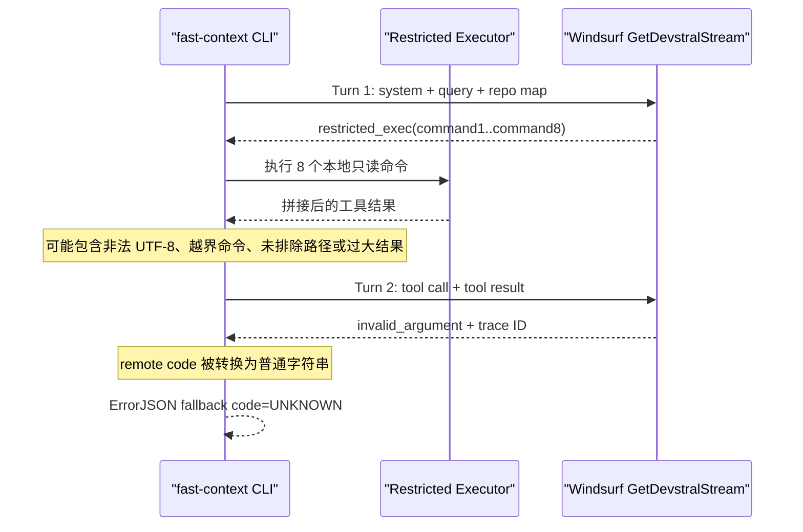
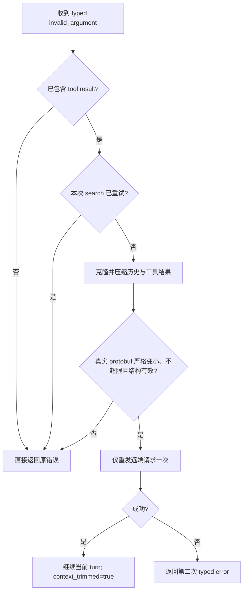

# fast-context `search` 多轮工具结果 `invalid_argument` 修复技术方案

## 1. 文档信息

| 项目 | 内容 |
| --- | --- |
| 文档状态 | 已实施，待提交/发布 |
| 问题范围 | Go CLI 语义搜索的工具结果回传、请求预算、排除边界与远端错误诊断 |
| 当前版本 | `0.1.5`（commit `286dd15`） |
| 影响版本 | 已确认 `0.1.5`；`0.1.4` 曾出现同类远端错误 |
| 建议修复版本 | `0.1.6`（P0；P1 可同版本或独立后续 patch） |
| 编写日期 | 2026-08-03 |
| 实施日期 | 2026-08-04 |
| 关联文档 | [fast-context Go CLI 技术架构方案](./fast-context-go-cli-architecture.md) |

## 2. 结论

本次失败不是 CLI 参数解析、凭据、网络、`--tree-depth 0` 或初始 repo map 大小导致。真实失败发生在多轮搜索的工具结果回传阶段：首轮 `GetDevstralStream` 已成功返回 `restricted_exec`，CLI 执行本地命令后，第二轮携带 `role=2` tool call 与 `role=4` tool result 再次请求远端时，服务端返回：

```text
[Error] invalid_argument: an internal error occurred (trace ID: ...)
```

当前源码存在四类相互叠加的问题：

1. **消息合法性问题**：`ReadFile` 保留原始非法字节，`executor.truncate` 与 `search.trim` 又按 byte 直接切割字符串，可能生成非法 UTF-8；自研 protobuf encoder 会把这些 bytes 原样写入 `string` 字段。
2. **预算与执行边界问题**：CLI 只估算请求大小，没有在网络发送前校验真实 protobuf 大小；`--max-commands` 只约束 prompt/schema，没有在本地执行边界强制；单轮工具结果缺少稳定的聚合预算。
3. **排除边界问题**：`--exclude` 没有覆盖主/Bootstrap executor、hotspot subtree、no-result retry 和最终结果过滤，不能作为完整的本地读取与外发边界。
4. **错误诊断问题**：Connect error frame 被转换为普通字符串，最终 JSON 只能输出 `UNKNOWN`；HTTP 4xx response body 中的远端错误码也会被丢弃。

修复不应继续依赖“缩小 `--project`”或极端降低 `FC_RESULT_MAX_LINES` 作为长期方案。推荐建立以下强制不变量：

- 发往 protobuf `string` 字段的内容必须是合法 UTF-8；
- 未压缩 request protobuf 在发网前必须不超过 `320 KiB`；
- 实际执行命令数不得超过 `MaxCommands`；
- 被 effective excludes 命中的路径不得进入 repo map、本地工具结果、重试探针、最终文件或 snippet；
- 远端提供的结构化错误码必须保持机器可读；
- `invalid_argument` 仅在已包含工具结果、压缩后请求确实变小的条件下自动重试一次，且不得重复执行本地命令。

## 3. 问题现象与验证证据

### 3.1 当前运行环境

当前验证对象：

- `fast-context 0.1.5`；
- Git `HEAD=286dd15`；
- Go `1.25.0 windows/amd64`；
- `doctor --format json` 中 project、ripgrep、credentials 均为 `ok=true`；
- 未设置 `FC_REPO_MAP_MODE`、`FC_BOOTSTRAP_*`、`FC_HOTSPOT_*`、`WS_APP_VER`、`WS_LS_VER` 或 `WS_MODEL` 覆盖值。

因此，本方案基于当前默认配置，而不是用户级环境变量覆盖后的特殊行为。

### 3.2 受控对照矩阵

以下数据为 2026-08-03 会话观测。使用同一凭据、同一查询与同一 CLI，已完成以下只读对照：

| 场景 | repo map | 工具回合 | 结果 | 结论 |
| --- | ---: | --- | --- | --- |
| 完整 Unity 项目，默认 `bootstrap_hotspot` | 约 `80.5 KiB` | 首轮执行 8 个命令 | 第二轮 `invalid_argument` | 原问题可稳定复现 |
| 完整 Unity 项目，`classic` + L1 | 约 `7.9 KiB` | 首轮执行 8 个命令 | 第二轮 `invalid_argument` | 初始 repo map 大小不是充分原因 |
| 完整 Unity 项目，工具结果极限截断 | 约 `7.9 KiB` | 连续 3 轮执行命令 | 第四轮成功回答 | 工具结果体量或内容与失败强相关 |
| 项目收窄到 `Assets/CodeHotUpdate`，默认结果限制 | 约 `64.7 KiB` | 连续 3 轮执行命令 | 第四轮成功回答 | 初始 map 即使更大也可成功；路径范围与工具内容更关键 |
| 当前 Go 仓库的小型回归查询 | 约 `2.6 KiB` | 8 个命令后继续下一轮 | 第三轮成功回答 | 账号、模型与多轮协议没有整体失效 |

极限截断虽然能够绕过错误，但会截坏候选路径，不能作为正式修复。收窄 `--project` 可保留为用户侧临时绕过，但不能替代 CLI 的消息合法性、预算与排除边界。

### 3.3 当前测试基线

已执行：

```powershell
go test -count=1 ./internal/executor ./internal/search ./internal/windsurf ./internal/output ./internal/config ./internal/cli
```

六个 package 均通过。当前测试覆盖的主要空白为：

- `executor.ExecToolCall`、`Tree`、`LS`、递归 tree exclude 未形成完整回归；
- `decodeCommands` 与 `--max-commands` 本地强制没有测试；
- `estimateRequestSize > 320 KiB`、真实 protobuf 大小和 trim 后重试没有端到端测试；
- UTF-8 非法输入、多字节 rune 边界和工具结果 wrapper 完整性没有测试；
- Connect error JSON、HTTP 400 remote error 和 `ErrorJSON` 远端 code 保留没有测试；
- `runSearch` 的真实 search JSON 成功/失败合同没有直接测试。

## 4. 当前实现与失败链路

### 4.1 调用链

```text
internal/cli/cli.go
  -> search.RunPipeline(...)
    -> search.Run(...)
      -> credentials.FindAPIKey()
      -> windsurf.Client.FetchJWT()
      -> windsurf.Client.CheckRateLimit()
      -> executor.New(projectRoot)
      -> repomap.BuildOptimized(...)
      -> windsurf.Client.Stream(messages, toolDefs)
      -> windsurf.Client.ParseResponse(...)
      -> decodeCommands(toolInfo.Args)
      -> executor.ExecToolCall(...)
      -> append role=2 tool call
      -> append role=4 tool result
      -> 下一轮 windsurf.Client.Stream(...)
```

关键源码责任如下：

| 文件 | 当前行为 | 问题 |
| --- | --- | --- |
| `internal/search/search.go:126-145` | 以 `estimateRequestSize` 预估请求，超过 `320 KiB` 才 trim | 估算值不是最终 protobuf 大小 |
| `internal/search/search.go:149-163` | `ParseResponse` 的 `[Error]` 文本被包装为普通 `errors.New` | 远端 code 丢失，最终显示 `UNKNOWN` |
| `internal/search/search.go:175-193` | 执行所有 decode 后命令，并把原始 `toolInfo.Args` 写回历史 | 命令上限可绕过；执行内容与回传 args 可能不一致 |
| `internal/search/search.go:268-287` | 接受所有 `command*` key | 不校验 `command1..commandN`、`command0`、前导零或越界编号 |
| `internal/executor/executor.go:50-64` | executor 只持有 project root 与 rg path | 不知道 effective excludes |
| `internal/executor/executor.go:87-125` | 并行执行全部 command 结果并直接拼接 | 缺少整轮聚合预算 |
| `internal/executor/executor.go:208-243` | `os.ReadFile` 后直接 `string(data)` | 非 UTF-8 文件的非法 bytes 被保留 |
| `internal/executor/executor.go:464-483` | 以 `line[:maxChars]` 截断 | 可能在中文或 emoji 中间截断，生成非法 UTF-8 |
| `internal/search/trim.go:48-74` | 以 byte slice 缩短 command blocks | 可能破坏 UTF-8 和 `<commandN_result>` wrapper |
| `internal/search/trim.go:160-170` | 以固定 byte offset 截断 assistant/tool content | 同样可能产生非法 UTF-8 |
| `internal/windsurf/client.go:107-112` | 构造 protobuf 后直接封装 Connect frame | 未以真实 protobuf 长度执行 `320 KiB` gate |
| `internal/windsurf/client.go:168-177` | 识别 remote error JSON 后返回普通文本 | 结构化 code 被降级 |
| `internal/windsurf/client.go:282-295` | 将 message 字符串写入 protobuf | 没有 outbound UTF-8 最终校验 |
| `internal/protowire/protowire.go:21-29` | `Encoder.String` 原样编码 string bytes | 非法 bytes 会进入 protobuf `string` 字段 |

### 4.2 当前失败时序



## 5. 根因分析

### 5.1 已验证事实

以下结论已由当前源码和运行对照确认：

1. 失败发生在至少一次成功的远端调用和一次本地工具执行之后。
2. 结合该错误文本与当前唯一能够生成 `[Error] <code>: <message>` 的代码路径，可把失败定位到 `ParseResponse` 已解析的 Connect error body，而不是 CLI usage error、HTTP status 分类、DNS、TLS 或本地 timeout；本次诊断没有另行保存原始 HTTP status 或 frame bytes。
3. `--tree-depth 0` 被 CLI 正常接受；错误 JSON 中的 `tree_depth=1` 是默认 `bootstrap_hotspot` 的浅层全局 map 深度。
4. 把 repo map 从约 `80.5 KiB` 降至约 `7.9 KiB` 仍然失败，因此 repo map 大小不是直接充分原因。
5. 缩减工具结果或收窄项目范围可以成功，因此第二轮工具结果内容/体量是决定性差异。
6. `--max-commands 1` 的一次对照中仍实际执行了 8 个命令，证明本地执行边界没有强制该上限。
7. `--exclude` 没有传入主/Bootstrap executor，hotspot subtree 也未应用嵌套 excludes。
8. 远端返回的 `invalid_argument` 会被本地输出层降级为 `UNKNOWN`。

### 5.2 高置信根因候选：非法 UTF-8

Go 当前存在明确的 UTF-8 合法性差异：

- `ReadFile` 把任意文件 bytes 直接转换为 string，不替换非法序列；
- `truncate` 在第 250 byte 等位置直接切片；
- `trimMessages` 在 4000、8000、20000 byte 等位置直接切片；
- 自研 protobuf encoder 不校验 `string` 的 UTF-8 合法性。

例如，`249` 个 ASCII bytes 后接一个汉字时，在第 `250` byte 截断会只保留该汉字的第一个 byte，结果必然不是合法 UTF-8。该内容只有在工具执行后才被加入第二轮请求，与当前错误时序完全一致。

对照 `fast-context-mcp@1.5.2`：Node `readFileSync(..., "utf-8")` 会把非法输入替换为 Unicode replacement character，JavaScript string 进入 `TextEncoder` 后仍生成合法 UTF-8。Go 移植版没有保持这一运行时语义，是当前最明确的实现偏差。

仍需说明：本次失败轮没有落盘或打印完整工具结果，因此尚未直接证明具体请求中存在非法 byte。方案必须把它写为“高置信根因候选”，不能伪装成已经取得远端字段级证据。

### 5.3 中等置信贡献因素：请求预算失真

当前默认单轮理论上限约为：

```text
50 lines × 250 bytes × 8 commands + wrapper/marker ≈ 100,896 bytes
```

这只占 `320 KiB` 的约 `30.79%`，但完整请求还包含 system prompt、repo map、tool definitions、tool args 与历史消息。更重要的是，Go 只用字符串长度估算；上游 `fast-context-mcp@1.5.2` 会先构造真实 protobuf，再用 protobuf byte length 判断是否需要 trim。

因此，本地估算低于阈值不能证明真实 request protobuf 一定满足协议预算。该差异应修复，但不能据此断言远端隐藏阈值就是本次错误的唯一原因。

### 5.4 确定的放大因素

| 因素 | 当前影响 | 与本次错误的关系 |
| --- | --- | --- |
| excludes 未端到端生效 | 大仓库中不需要或敏感路径仍可能被本地工具读取并回传 | 扩大工具结果范围，但未证明单独触发错误 |
| `MaxCommands` 未强制 | 模型可返回超出配置的命令，增加本地 I/O 和 payload | 本次恰好为默认 8 条，不是直接根因，但属于预算绕过 |
| 工具结果无常态聚合上限 | `MaxCommands=20` 时单轮结果可接近 `250 KiB` | 会放大多轮请求与远端校验风险 |
| 远端错误被降级 | 用户只能看到 `UNKNOWN` 和无关的 doctor hint | 不制造失败，但显著妨碍定位与恢复 |

### 5.5 非根因与本次不调整项

以下方向不应在无新证据时修改：

- 凭据来源、优先级、本地 JSON schema 与 JWT 获取流程；
- `WS_APP_VER`、`WS_LS_VER`、`WS_MODEL` 或 model entitlement；
- `GetDevstralStream` endpoint、protobuf field number 与 Connect headers；
- `randomID` 的 32 位 hex 格式。上游使用 UUID，但当前 Go CLI 已在小仓库连续完成多个工具回合，不能把格式差异当作本次根因；
- `--tree-depth 0` 的运行时语义。文档可澄清默认 optimizer 的实际字段含义，但不在本次修改 repo map 策略；
- generic retry。认证、限流、未知 remote code 或首轮 `invalid_argument` 不得被无条件重试。

## 6. 目标与非目标

### 6.1 目标

- 所有由 query、repo map、模型响应和本地工具生成的 outbound message content、tool args 均为合法 UTF-8；remote error message 在输出前同样完成规范化与清理。
- 保持现有 `FC_RESULT_MAX_LINES=50` 与 `FC_LINE_MAX_CHARS=250` 的数值默认，不通过极端降级结果质量解决问题。
- 在发网前按真实、未压缩 protobuf byte length 强制 `320 KiB` 上限。
- 为每轮工具结果建立内部聚合预算，并在常态与恢复态分别保留完整 wrapper。
- 在主搜索与 Bootstrap 中本地强制 `MaxCommands`。
- 让 effective excludes 覆盖所有本地枚举、读取、回传与最终结果路径。
- 在 text/JSON 输出中保留远端 `invalid_argument`，不再降级为 `UNKNOWN`。
- 对已包含工具结果的 `invalid_argument` 提供最多一次、可证明请求变小的恢复重试。
- 不记录或输出源码片段、完整工具结果、API key、JWT、credential path 或完整远端错误 body。

### 6.2 非目标

- 不新增 CLI flag、用户配置文件字段或长期依赖。
- 不把当前私有 Windsurf 协议重写为新的 protobuf/generated client。
- 不修改认证、rate-limit、repo map ranking、answer parser 或 snippets 的业务目标。
- 不把所有 HTTP 4xx/5xx 变成可重试错误。
- 不自动切换模型、账号、endpoint 或 TLS 策略。
- 不把 `--project` 自动改写到某个业务子目录。
- P0 不把 `ReadFile` 重构为流式读取；当前整文件 `os.ReadFile` 的输入侧内存上限属于独立资源治理项，不能因 outbound budget 修复而宣称已解决。
- 不在本任务中执行版本号修改、tag、push 或 npm 发布。

### 6.3 交付分层

为避免把单点可靠性修复扩展成不可独立验收的大重构，本方案拆成两个可分别评审的交付单元：

| 优先级 | 交付范围 | 发布关系 |
| --- | --- | --- |
| P0：错误修复 | UTF-8 合法性、同轮消息预算、真实 protobuf gate、`MaxCommands` 本地强制、typed remote error、一次有界恢复 | `0.1.6` 的最小发布门槛 |
| P1：外发边界加固 | original-root excludes policy 及其在 repo map、dirscore、executor、retry、auto-grep、final result/snippet 的全链路接入 | 推荐同版本完成；若评审认为范围过大，可独立后续 patch，但不得把 P0 宣称为“excludes 已全链路修复” |

P0 可以独立证明当前多轮 `invalid_argument` 的本地高风险路径已消除。P1 解决的是已确认的安全/合同缺口和大仓库放大因素，不应被描述为已证实的单一根因。完整方案的 Definition of Done 同时列出 P0 发布门槛和 P1 完整边界门槛。

## 7. 总体修复设计

### 7.1 核心不变量

P0 必须满足：

```text
utf8.ValidString(all outbound code-search message/tool-definition strings) == true
len(uncompressed request protobuf) <= 320 * 1024
executedCommands <= configuredMaxCommands
cliErrorCode = statusPriorityCode ?? validRemoteCode ?? localFallbackCode
invalidArgumentRecoveryRetries <= 1
```

HTTP 401/403、429、413、5xx 的既有优先分类不被 raw body 覆盖。

P1 完整外发边界必须额外满足：

```text
excludedPath ∉ repoMap ∪ dirScore ∪ pathSpines ∪ toolResults ∪ retryProbe ∪ autoGrep ∪ finalFiles ∪ snippets
```

若某个发布版本只完成 P0，该版本不得在 README、Skill 或 CLI contract 中宣称 `--exclude` 已满足上述 P1 不变量。

这些不变量应由本地单元/集成测试固定，不依赖真实服务端稳定性证明。

### 7.2 UTF-8 规范化与安全截断

新增内部共享 helper，例如 `internal/textutil/utf8.go`：

```go
func NormalizeUTF8(text string) (normalized string, repaired bool)
func TruncateUTF8Bytes(text string, maxBytes int, marker string) (out string, truncated bool)
```

设计要求：

1. 先使用 replacement character 修复非法序列。
2. byte budget 保持现有 payload 语义，不把 `250 bytes` 静默变成 `250` 个汉字。
3. 截断点必须回退到完整 rune 边界。
4. marker 必须计入预算；预算小于 marker 时仍返回合法 UTF-8。
5. 不得在完整 `<commandN_result>` wrapper 外再次执行裸 byte slice。

应用位置：

- `executor.ReadFile`：文件 bytes 转 string 后立即规范化；
- `executor.truncate`：逐行按 UTF-8 byte budget 安全截断；
- `search.truncateToolResultsPreserve`：按 block 重建并保证 tag 完整；
- `search.trimMessages`：assistant/tool content 使用同一 helper；
- `windsurf.buildChatMessage`：发网前执行最后一道 `utf8.ValidString` 防御性校验。

最后一道校验若仍发现非法 UTF-8，应在本地返回 typed `PROTOCOL` error，不得继续发送并把问题伪装成远端 `invalid_argument`。

### 7.3 同轮远端可控内容预算

保持现有每条命令的 `FC_RESULT_MAX_LINES` 与 `FC_LINE_MAX_CHARS`，新增一组内部安全常量，不升级为用户配置：

```text
normalToolResultBudget   = 64 KiB
recoveryToolResultBudget = 20,000 bytes
maxAssistantThinkingBytes = 8 KiB
maxToolArgsJSONBytes      = 16 KiB
maxCommandStringBytes     = 2 KiB
maxCommandListItems       = 32
maxCommandListItemBytes   = 512
```

其中：

- 常态 `64 KiB` 用于限制单轮 8–20 条命令的总结果，避免单条限制相乘后绕过整体预算；
- 恢复态 `20,000 bytes` 复用当前 `trimMessages` 已有的安全目标，仅在远端已经拒绝请求后使用；
- assistant thinking 在写入 `role=2` 历史前按 `8 KiB` 做 UTF-8 安全截断；
- `pattern/path/file` 等单字符串字段最多 `2 KiB`，`include/exclude` 最多 32 项且每项最多 512 bytes；
- validated commands 按顺序加入 batch，序列化 `ToolArgsJSON` 达到 `16 KiB` 后拒绝剩余命令；
- 这些值都是客户端安全预算，不宣称为服务端公开阈值，也不升级为用户配置。

聚合算法必须：

1. 按数字顺序处理 `command1..commandN`。
2. 先预留全部 wrapper 与 truncation marker 的 bytes。
3. 对剩余 body budget 做公平分配，避免前几个命令耗尽预算导致后续 command 完全丢失。
4. 每个被截断 block 在 wrapper 内写入明确 marker。
5. 输出始终为合法 UTF-8，且 `len(result) <= budget`。

thinking、validated `ToolArgsJSON` 与工具结果都必须计入下一轮真实 protobuf 大小。任何被拒绝的超长命令不得执行、不得进入 state/hints，也不得以原始 args 形式写回历史。

### 7.4 真实 protobuf 大小 gate

保留 `search.estimateRequestSize` 作为提前压缩的低成本优化，但它不再是最终安全边界。

为让 search 层的恢复决策与发送层使用同一事实源，应给内部 `search.Client` 增加 request-size 能力，例如：

```go
RequestSize(apiKey, jwt string, messages []Message, toolDefs string) (int, error)
```

生产 `windsurf.Client` 与测试 fake client 均实现该方法。生产实现必须复用 `buildRequest`，不能再维护第二套 size estimator。

在 `windsurf.Client.Stream` 中：

1. 先执行 `buildRequest(...)` 得到真实、未压缩 protobuf。
2. 若 `len(proto) > 320 * 1024`，在 `EncodeConnectFrame` 和 HTTP 请求前返回 typed `PAYLOAD_TOO_LARGE`。
3. 错误只包含实际 bytes 与上限，不包含消息内容。
4. `search.Run` 复用现有 trim-and-retry 路径；重试时再次经过真实大小 gate。

为避免 search/windsurf 两处阈值漂移，应在 `internal/search/types.go` 或独立内部常量文件中定义唯一的共享上限。

### 7.5 `MaxCommands` 本地强制

将当前 `decodeCommands(args)` 改为有上限的验证入口：

```go
decodeCommands(args, maxCommands) -> []NamedCommand, rejectedCount
```

规则：

- 只接受 `command1` 至 `commandN`；
- 拒绝 `command0`、`command01`、非数字后缀和所有越界编号；
- `command1` 必须存在；缺失时整批不执行并进入现有的无有效命令纠正/补偿路径；
- `command1` 存在时允许编号间隙，但输出必须按数字顺序形成有序 slice，不能再依赖 map iteration；
- command object 使用 strict decoder（例如 `json.Decoder.DisallowUnknownFields`），不能让普通 `json.Unmarshal` 静默忽略未知字段；
- 主搜索使用 `opts.MaxCommands`；
- Bootstrap 使用 `opts.BootstrapMaxCommands`；
- hints、state.record、本地执行与写回历史必须使用同一份 validated commands；
- `ToolArgsJSON` 必须从 validated commands 重新 marshal，不能继续使用原始 `toolInfo.Args`。

同时在 tool schema 顶层 parameters 以及每个 command `oneOf` 对象中增加：

```json
{
  "additionalProperties": false
}
```

schema 是模型提示，本地验证才是安全边界。远端返回越界、未知字段或超长命令时，CLI 应拒绝对应项，并在 `--verbose` 中只记录 accepted/rejected 数量，不打印命令内容。

### 7.6 effective excludes 全链路策略

新增一个以初始 project root 为锚点的不可变排除策略，例如 `internal/pathfilter.Policy`。它统一处理默认 excludes 与用户重复传入的 `--exclude`，并提供：

- absolute path 判定；
- original-root relative path 判定；
- active retry root 下的 rg glob 重写；
- basename、相对路径前缀和 glob 匹配；
- symlink resolve 前后的双重判定。

策略在 `RunPipeline` 进入时创建一次，后续重试不得按新 root 静默重解释用户模式。

必须接入：

| 路径 | 修复要求 |
| --- | --- |
| 初始/Classic repo map | 使用统一 policy 过滤所有层级 |
| `bootstrap_hotspot` global tree | 保持 policy |
| hotspot `BuildSubtree` | 递归传入 policy，不能继续传 `nil` |
| dir scoring/path spines | 排除路径不得作为 hotspot 或 spine |
| Bootstrap executor | `rg/readfile/tree/ls/glob` 全部强制 policy |
| 主 executor | 同上 |
| no-result retry selector/probe | 使用用户 effective excludes，不再 `MergeExcludePaths(nil)` |
| narrow-root retry | 继续相对初始 root 解释排除规则 |
| final answer/filter | 模型伪造的 excluded path 必须被丢弃 |
| snippets | 只允许读取过滤后的最终文件 |

`readfile` 显式请求 excluded path 时，应返回稳定的本地工具错误；遍历类命令应静默跳过 excluded descendants，避免把路径名本身发送给远端。

### 7.7 远端错误类型化

复用并扩展 `internal/windsurf.Error`，让它能够承载远端 code 与已清理 message。

新增共享 remote error parser，覆盖：

1. HTTP 非 2xx 的受限 response body；
2. HTTP 2xx Connect stream 中的 raw JSON error frame；
3. Connect protobuf frame 经 `ExtractStrings` 得到的内嵌 JSON error。

HTTP error body 使用 `io.LimitReader`，最多读取 `64 KiB + 1`；超出部分不解析、不记录。最终可见 message 最多保留 `2 KiB`。

解析规则：

- HTTP `401/403`、`429`、`413` 分别继续优先映射为 `AUTH_ERROR`、`RATE_LIMITED`、`PAYLOAD_TOO_LARGE`，不能被 body 中的 raw code 覆盖；
- HTTP `5xx` 继续保持 `SERVER_ERROR`，remote message 只可作为已清理的诊断补充；
- 其他 HTTP `4xx` 与 HTTP 2xx Connect error 有合法远端 code 时，`Code()` 原样返回，例如 `invalid_argument`；
- 合法 remote code 必须匹配 `^[a-z][a-z0-9_]{0,63}$`，不允许控制字符、空白或任意长字符串进入日志/JSON code；
- code 为空或非法时，回退到现有本地 `SERVER_ERROR`/`PROTOCOL` 分类；
- message 先规范化 UTF-8、移除终端控制字符并限制长度；
- 保留 trace ID；
- 不返回或记录完整 raw body。

`search.Run` 在最终失败时设置 `Meta.ErrorCode`；恢复成功时必须保持 `error_code` 为空，不能在成功结果中残留中间失败语义。

`output.ErrorJSON` 的结构保持不变：

```json
{
  "error": {
    "code": "invalid_argument",
    "message": "...trace ID..."
  },
  "meta": {
    "error_code": "invalid_argument",
    "context_trimmed": true
  }
}
```

该修改保持 JSON 结构，但会把既有 `error.code` 的取值从 `UNKNOWN` 改为原始小写远端 code，属于字段值语义的兼容性变更。CLI contract 必须明确区分 raw remote code 与本地大写稳定分类；不新增必填字段。

### 7.8 有界 `invalid_argument` 恢复

仅在同时满足以下条件时，允许一次应用层恢复重试：

1. typed remote code 精确为 `invalid_argument`；
2. 当前 messages 已含 `role=4` tool result；
3. 本次 search 尚未执行过 `invalid_argument` 恢复重试；
4. 对 messages 的副本执行 recovery trim 后，通过同一 `RequestSize`/`buildRequest` 得到的真实 protobuf bytes 严格小于原请求且不超过 `320 KiB`；
5. trim 后 messages 仍保持最新 tool call/result 引用关系且全部 UTF-8 合法。

恢复流程：



该重试不得：

- 重新执行已经执行过的本地命令；
- 消耗或重置 `MaxTurns`；
- 扩大 project root 或取消 excludes；
- 对首轮 `invalid_argument`、认证、限流或其他 remote code 生效；
- 与 `Client.Stream` 的 HTTP 5xx/network retry 混为同一计数。

Bootstrap 仍保持 best-effort：发生 typed remote error 时记录受限 `--verbose` 诊断并终止 bootstrap，不额外消耗恢复重试；主搜索继续使用本地 scoring fallback。

### 7.9 诊断信息

不新增默认输出噪声。仅在 `--verbose` 下输出非敏感统计：

```text
Tool batch: accepted=8 rejected=0 bytes_before=... bytes_after=... truncated=false utf8_repaired=true
Remote invalid_argument on turn 2: request protobuf reduced from ... to ... bytes; retrying once
```

禁止输出：

- 命令 pattern、文件路径、源码内容；
- effective excludes 完整列表；
- API key、JWT、credential source path；
- 完整 remote body。

现有 `Meta.ContextTrimmed` 与 `Meta.ErrorCode` 足以承载结构化状态，本次不新增 success JSON 字段。

## 8. 文件级变更设计

### 8.1 代码与测试变更

| 文件 | 优先级 | 变更 |
| --- | --- | --- |
| `internal/textutil/utf8.go` | P0 | 新增 UTF-8 规范化与 byte-budget 安全截断 helper |
| `internal/textutil/utf8_test.go` | P0 | 覆盖非法 bytes、中文/emoji 边界、marker 与小预算 |
| `internal/pathfilter/policy.go` | P1 | 新增以初始 root 为锚点的统一 excludes policy |
| `internal/pathfilter/policy_test.go` | P1 | 覆盖默认/用户模式、嵌套路径、retry rebase 与 symlink |
| `internal/executor/executor.go` | P0 + P1 | 安全截断与命令结果聚合预算；接入 policy 并在所有工具执行前过滤 |
| `internal/executor/executor_test.go` | P0 + P1 | 增加五类工具、命令聚合、超长字段、UTF-8 与 excluded path 测试 |
| `internal/repomap/repomap.go` | P1 | 递归 tree/subtree 使用统一 policy |
| `internal/repomap/optimized.go` | P1 | hotspot subtree 传递 policy |
| `internal/repomap/repomap_test.go` | P1 | 增加嵌套 excludes 与 hotspot subtree 测试 |
| `internal/dirscore/dirscore.go` | P1 | profile、probe 与 path spine 使用 original-root policy |
| `internal/dirscore/dirscore_test.go` | P1 | 断言嵌套用户排除路径不参与评分或 path spine |
| `internal/search/search.go` | P0 + P1 | 强制 MaxCommands、strict command decode、thinking/args 预算、marshal validated args、typed error、恢复重试；P1 增加最终结果过滤 |
| `internal/search/bootstrap.go` | P0 + P1 | 强制 BootstrapMaxCommands、记录 typed error；P1 接入 policy |
| `internal/search/retry.go` | P1 | retry selector/probe 使用 original-root policy |
| `internal/search/autogrep.go` | P1 | narrow-root 下使用 policy 生成的 active-root rg globs |
| `internal/search/pipeline.go` | P1 | 从初始 root 创建并复用 policy |
| `internal/search/trim.go` | P0 | UTF-8 安全、完整 wrapper、常态/恢复态预算与严格缩小判断 |
| `internal/search/types.go` | P0 | 固化唯一 `320 KiB` 上限并扩展内部 `Client.RequestSize`；不新增 JSON 字段 |
| `internal/search/*_test.go` | P0 + P1 | 覆盖命令上限、超长历史、第二轮恢复、无缩小不重试和 excluded result 过滤 |
| `internal/windsurf/client.go` | P0 | 真实 protobuf gate、typed remote error、HTTP/Connect 共享解析、outbound message UTF-8 guard |
| `internal/windsurf/client_test.go` | P0 | 覆盖 HTTP status 优先级、Connect error、oversize no-send 与非法 UTF-8 no-send |
| `internal/output/output.go` | P0 | 为 `invalid_argument` 提供正确诊断与 hint |
| `internal/output/output_test.go` | P0 | 断言远端 code 不再退化为 `UNKNOWN` |

### 8.2 必须同步的文档与嵌入合同

| 文件 | 优先级 | 更新内容 |
| --- | --- | --- |
| `README.md` | P0 + P1 | 只记录用户可见语义：`--max-commands` 本地强制、remote code/有限恢复，以及 P1 的 excludes 端到端边界；澄清 `FC_LINE_MAX_CHARS` 是 rune-safe UTF-8 byte cap |
| `internal/skills/assets/fast-context/SKILL.md` | P1 | 只固化 excludes 对 repo map 与 restricted-tool reads 同时生效的外传边界和本地复核要求，不写内部预算常量 |
| `internal/skills/assets/fast-context/references/cli-contract.md` | P0 + P1 | 记录 flags 的强制语义、raw remote code、`invalid_argument`、`context_trimmed/error_code` 与一次恢复条件 |
| `docs/fast-context-go-cli-architecture.md` | P0 + P1 | 承载 UTF-8、真实 protobuf gate、聚合预算、excludes policy、命令预算与错误状态机细节 |

同时在 README/CLI contract 中澄清：`--tree-depth 0` 的 project-size auto depth 是 `classic` 路径语义；默认 `bootstrap_hotspot` 的 `tree_depth`/`hotspot_depth` 分别描述浅层全局 map 与热点子树。只修订说明，不修改运行时算法。

### 8.3 明确不修改

- `internal/credentials/**`；
- `internal/config/local.go` 与用户 JSON schema；
- `.deploy/version`；
- npm platform manifests、launcher 与 optional dependencies；
- `npm/fast-context/README.md`，除非实施时确认其中存在直接冲突的 search 行为说明；
- `internal/skills/assets/fast-context/agents/openai.yaml`；
- Windsurf app/model/version 常量；
- `go.mod`、`go.sum` 与第三方依赖。

## 9. CLI、JSON 与兼容性影响

### 9.1 保持不变

- 所有现有命令、flags、exit code 和环境变量名称；
- `search` 成功 JSON 的字段结构；
- `error`、`meta.error_code`、`meta.context_trimmed` 现有字段名；
- `FC_RESULT_MAX_LINES` 与 `FC_LINE_MAX_CHARS` 默认数值；
- doctor、credentials、Skill list/show 与 npm launcher 合同。

### 9.2 有意变化

| 行为 | 修复前 | 修复后 |
| --- | --- | --- |
| remote Connect `invalid_argument` | `error.code=UNKNOWN` | `error.code=invalid_argument` |
| 成功恢复后的 `meta.error_code` | 可能残留中间错误 | 必须为空 |
| `--max-commands N` | 模型可绕过并执行更多命令 | 本地最多执行 N 条 |
| `--exclude` | 主要影响 repo map/部分 grep | 成为完整读取与外发边界 |
| 多字节长行 | 可能产生非法 UTF-8 | rune-safe 且仍遵守 byte budget |
| request > 320 KiB | 依赖估算，可能发网 | 真实 protobuf gate 在发网前拒绝 |

严格 excludes 可能使过去“虽然 map 排除了，但 executor 仍意外找到”的文件不再出现。这是对已声明外传边界的修复，不提供兼容开关；确需搜索该目录时，用户应调整或移除相应 `--exclude`。

## 10. 测试设计

### 10.1 UTF-8 与文本预算

| 用例 | 断言 |
| --- | --- |
| 249 ASCII bytes + 一个汉字，250 byte cap | 输出 `utf8.ValidString=true`，总 bytes 不超 250 |
| emoji 落在 4000/8000/20000 byte 边界 | 不产生半个 surrogate/rune |
| 输入包含非法 byte sequence | 使用 replacement character，输出合法 UTF-8 |
| budget 小于 marker | 输出仍合法且不超 budget |
| 8/20 个 command blocks 超预算 | 每个 wrapper 完整，顺序稳定，总 bytes 不超限 |
| 单个超长行与多行超限 | line/total marker 正确，既有行数上限仍生效 |

### 10.2 command budget

- `MaxCommands=1` 时，`command2..command8` 不执行、不进入 `ToolArgsJSON`；
- `command0`、`command01`、`command999` 和非数字 key 被拒绝；
- command object 的未知字段被 strict decoder 拒绝，不能被静默忽略；
- 缺少 `command1` 时整批不执行；`command1` 存在时允许编号间隙并保持数字顺序；
- 超过 2 KiB 的 command string、超过 32 项或单项超过 512 bytes 的 include/exclude 被拒绝；
- assistant thinking 安全截断后不超过 8 KiB，validated `ToolArgsJSON` 不超过 16 KiB；
- 主搜索与 Bootstrap 使用各自上限；
- validated commands 的执行、state.record、hints 和历史 JSON 完全一致；
- 并发执行后的输出仍按数字顺序组装。

### 10.3 excludes policy

使用临时 fixture 构造：

```text
/codebase
  /src/keep.go
  /src/private/secret.go
  /node_modules/pkg/index.js
  /nested/generated/output.go
  /retry-root/private/hidden.go
```

验证：

- Classic/global/hotspot tree 不包含 excluded path；
- dir profile、probe、hotspot 评分与 path spine 不读取或返回 excluded path；
- `rg/readfile/tree/ls/glob` 均不能返回 excluded path 或内容；
- Bootstrap 与主 executor 行为一致；
- no-result probe 与 narrow-root retry 不重新解释或丢失策略；
- auto-grep 在 narrow-root 下使用正确重写后的 policy globs；
- model answer 即使伪造 excluded path，也会在 result/snippet 前被过滤；
- symlink 指向 excluded path 时仍被拒绝。

### 10.4 request protobuf gate

使用 `httptest.Server` 记录请求次数：

- 小于等于 `320 KiB` 的 protobuf 正常发送；
- 大于阈值时返回 `PAYLOAD_TOO_LARGE`，server request count 必须为 `0`；
- search 收到该错误后 trim，再次调用时重新执行真实 gate；
- trim 后仍超限时只返回 typed error，不无限重试；
- 错误与日志不包含 message body。

### 10.5 remote error 与恢复

| 用例 | 预期 |
| --- | --- |
| HTTP 400 JSON `invalid_argument` | typed code 保留为 `invalid_argument` |
| HTTP 2xx Connect error frame | 同上 |
| Connect protobuf 内嵌 JSON error string | 同上 |
| HTTP 401/403、429、413 带 remote body | 分别保持 `AUTH_ERROR`、`RATE_LIMITED`、`PAYLOAD_TOO_LARGE` |
| HTTP 5xx 带 remote body | 保持 `SERVER_ERROR`，只使用受限清理后的 message |
| 远端 code 为空/非法 | 回退稳定本地分类 |
| remote code 含空白/控制字符或超过 64 chars | 不作为 JSON code 原样透传 |
| message 含控制字符/超长文本 | 清理、限长且保留 trace ID |
| 首轮 `invalid_argument` | 不重试 |
| 已含 tool result，trim 后真实 protobuf 严格变小且不超限 | 仅重发一次，不重新执行本地命令 |
| trim 无变化 | 不重试 |
| 第二次仍失败 | 返回第二次 typed error |
| 非 `invalid_argument` remote code | 不进入该恢复路径 |
| 恢复成功 | `context_trimmed=true`，`error_code` 为空 |

### 10.6 本地回归

```powershell
go test -count=1 ./internal/textutil ./internal/pathfilter ./internal/executor ./internal/repomap ./internal/search ./internal/windsurf ./internal/output ./internal/config ./internal/cli
go test ./...
go vet ./...
git diff --check
```

额外检查：

- `fast-context skills show fast-context --format content` 与 source `SKILL.md` 保持一致；
- docs/Skill/contract 使用 LF，UTF-8 无 BOM；
- `git diff` 不包含 key、JWT、完整 remote body、真实源码片段或机器 credential path；
- npm launcher/platform manifests 与 `.deploy/version` 保持不变。

### 10.7 真实 E2E

真实 E2E 会向 Windsurf 发送 query、repo map 和受限工具结果。仅在加载版本匹配的 `fast-context` Skill 且 `doctor --format json` 返回 `ok=true` 后执行。

用例 A：公开或专用小 fixture：

```powershell
fast-context search "where is CLI command dispatch implemented" `
  --project <PUBLIC_FIXTURE> `
  --tree-depth 0 `
  --max-results 5 `
  --format json `
  --verbose
```

用例 B：包含中文长行、非法 UTF-8 fixture、嵌套 excluded 目录与 8 条工具命令的专用大仓库 fixture。

用例 C：原始 Unity 查询，先使用完整 project root，再使用相关源码子目录作为对照；保持 `--include-snippets` 关闭。

验收时只记录：

- turn、accepted/rejected command count；
- request/tool-result bytes before/after；
- UTF-8 repair/truncate boolean；
- error code 与 trace ID；
- 最终候选路径是否存在。

不得记录工具结果正文。完整 project root 用例必须成功返回候选，或返回与真实服务问题一致的 typed remote code；不能再因本地非法 UTF-8、命令越界、excluded path 或超限 protobuf 导致 `UNKNOWN`。

## 11. 实施步骤

### M1：建立失败测试与诊断基线

- 新增 UTF-8 边界、非法 bytes、command budget、nested excludes、Connect error 与真实 protobuf oversize 红灯测试。
- 使用 fake client 捕获第二轮 messages，只记录 bytes、roles、validity 与 refs，不记录源码。
- 确认测试在当前 `0.1.5` 实现上按预期失败。

### M2（P0）：修复消息合法性与预算

- 实现共享 UTF-8 helper。
- 修复 executor 与 trim 中所有裸 byte slice。
- 增加常态/恢复态工具结果聚合预算。
- 在 `Stream` 增加真实 protobuf `320 KiB` gate。
- 先运行 textutil、executor、search、windsurf 定向测试。

### M3（P0）：收紧命令与同轮历史预算

- 本地强制主/Bootstrap `MaxCommands`。
- 从 validated commands 生成执行列表与历史 `ToolArgsJSON`。
- 限制 command 字段、数组、serialized args 与 assistant thinking。
- 运行 executor、search 与 Bootstrap 定向测试。

### M4（P0）：修复远端错误与一次恢复

- 让 HTTP body 与 Connect frame 共用 remote error parser。
- 保留 `invalid_argument` code，清理并限长 message。
- 实施一次、有严格缩小条件的应用层恢复。
- 修复成功结果残留 `meta.error_code` 的问题。
- 运行 windsurf、search、output、cli 定向测试。

### M5（P1）：统一 excludes 外发边界

- 建立 original-root pathfilter policy。
- 覆盖 repo map、hotspot subtree、dirscore/path spine、Bootstrap/主 executor、retry、auto-grep、final result/snippet。
- 运行 pathfilter、repomap、dirscore、executor、pipeline 测试。

### M6：同步文档与完整回归

- 更新 README、embedded Skill、CLI contract 与架构文档。
- 执行 scoped tests、`go test ./...`、`go vet ./...`、`git diff --check`。
- 检查 Skill embed 一致性与安全信息泄露。

### M7：受控 E2E

- 依次运行公开小 fixture、专用大 fixture和原始 Unity 查询。
- 确认默认设置下不再需要极端结果截断。
- 若仍出现远端 `invalid_argument`，使用 trace ID 请求服务端日志；不得继续放宽本地安全边界或盲目增加重试次数。

### M8：版本与发布

- P0 DoD 完成后可准备 `0.1.6`；若 P1 计划同版本交付，则必须同时完成 P1 DoD。
- `.deploy/release-version.ps1`、commit、tag、push 与 npm 发布属于独立授权步骤。
- 未获得明确授权时，只保留代码、测试和文档修改，不改版本、不创建 tag、不发布。

## 12. 风险与应对

| 风险 | 概率 | 影响 | 应对 |
| --- | --- | --- | --- |
| `64 KiB` 常态聚合预算降低搜索上下文 | 中 | 中 | 公平保留所有 command blocks；允许后续 turn 精读；用 E2E 比较候选质量 |
| replacement character 改变非 UTF-8 文件内容 | 中 | 低 | 明确标记 repair；语义搜索只把结果作为候选，不能发送非法 protobuf string |
| `ReadFile` 仍先整文件读入 | 中 | 中 | 本方案只保证外发合法性与预算；后续以流式按行读取建立独立输入资源上限 |
| excludes 收紧后减少历史“意外命中” | 高 | 中 | 这是声明边界的预期修复；用户可调整显式 exclude |
| path policy 在 retry root 下重解释错误 | 中 | 高 | policy 锚定初始 root；增加 explicit path 与 rebase 测试 |
| symlink 绕过 excludes | 低 | 高 | lexical path 与 resolved path 双重校验 |
| 一次恢复增加远端调用 | 中 | 低 | 仅 `invalid_argument` + tool result + 严格变小；全 search 最多一次 |
| remote message 回显敏感内容 | 低 | 高 | 限长、清理控制字符，不保留 raw body |
| JSON 消费方依赖 `UNKNOWN` | 低 | 低 | 文档化为错误码修复；字段结构不变 |
| 服务端仍存在独立内部故障 | 中 | 中 | 返回 typed code/trace，不伪装为本地成功；交由远端日志确认 |

## 13. 回滚方案

### 13.1 发布前

- 回退本方案涉及的代码、测试与文档即可；
- 不涉及数据、配置、凭据或依赖迁移；
- `.deploy/version` 与 npm 包未改变。

### 13.2 发布后

- npm 已发布版本不可覆盖；发现回归时发布后续 patch。
- 若主要问题是常态聚合预算影响结果质量，可在保持 UTF-8、真实 protobuf gate、excludes 与命令上限不变的前提下调整内部预算。
- 若一次 `invalid_argument` 恢复产生异常远端开销，可移除该恢复分支；typed error 与本地安全不变量不得一并回退。
- `0.1.5` 可作为短期功能回退，但其 `UNKNOWN`、UTF-8、exclude 与 command budget 缺陷仍然存在，不应作为长期目标版本。

## 14. Definition of Done

### 14.1 P0 发布门槛

- [x] UTF-8 边界测试在旧实现上失败、修复后通过。
- [x] 所有 outbound code-search message/tool-definition string 在测试中满足 `utf8.ValidString=true`。
- [x] 真实 request protobuf 超过 `320 KiB` 时不产生 HTTP 请求。
- [x] 常态/恢复态工具结果均不超预算，所有 command wrapper 完整。
- [x] assistant thinking、command fields/arrays 与 `ToolArgsJSON` 均不超内部预算。
- [x] 主搜索与 Bootstrap 都强制 `MaxCommands`，越界命令不执行、不回传。
- [x] HTTP 400/Connect remote `invalid_argument` 均保留原始 code，不再输出 `UNKNOWN`。
- [x] 401/403、429、413、5xx 的既有本地分类不因 remote body 解析而回归。
- [x] `invalid_argument` 最多恢复一次，且只在真实 protobuf 严格变小且不超限时重发。
- [x] 恢复过程不重复执行本地命令。
- [x] 恢复成功的 JSON 只保留 `context_trimmed=true`，不残留 `error_code`。
- [x] P0 定向测试、`go test ./...`、`go vet ./...`、`git diff --check` 通过。
- [x] README、CLI contract 与架构文档中的 P0 用户语义/内部设计同步。
- [x] 小 fixture、大 fixture 与原始 Unity 查询完成受控 E2E，默认设置下不再需要极端结果截断。

### 14.2 P1 完整外发边界门槛

- [x] effective excludes 覆盖 repo map、hotspot、dirscore/path spine、五类 executor 命令、retry、auto-grep、final result 与 snippets。
- [x] original-root policy 在 narrow-root retry 与 symlink 场景不漂移。
- [x] pathfilter、repomap、dirscore、executor、search 定向测试通过。
- [x] README、embedded Skill、CLI contract 与架构文档中的 P1 外传边界同步。

### 14.3 交付安全门槛

- [x] 输出、日志、测试和文档不包含真实 key、JWT、源码正文或私有 credential path。
- [x] 未经授权不修改版本、不创建 tag、不 push、不发布。

### 14.4 实施验证结果

| 验证项 | 结果 |
| --- | --- |
| 本地质量门槛 | `go test -count=1 ./...`、`go vet ./...`、`git diff --check` 全部通过 |
| 真实 protobuf 恢复链路 | 使用真实 `windsurf.Client` 与本地 HTTP 服务验证失败请求、严格缩小后的单次重发及成功 JSON 状态 |
| 小 fixture | 最终构建完成多轮 restricted tool 调用并返回 CLI dispatch 候选 |
| 大 fixture | 8-command 多轮搜索成功；nested exclude 未进入候选；非法 UTF-8 读取显示 `utf8_repaired=true` |
| Unity 完整根目录 | 原始查询完成 3 个 8-command 工具回合并成功返回候选，未再出现 `UNKNOWN`/`invalid_argument` |
| Unity 窄化对照 | `Assets/CodeHotUpdate` 完成 3 个 8-command 工具回合并成功返回候选 |
| 发布动作 | 未修改版本，未创建 tag，未 push，未发布 |

## 15. 最终决策

本问题应按“多轮消息合法性与外发边界缺陷”修复，而不是继续调低 tree depth、变更凭据或对远端错误进行无限重试。

推荐决策为：

1. P0 先用红灯测试固定 UTF-8、真实 protobuf 大小、同轮历史预算与 command budget 缺陷。
2. P0 保持现有每命令结果默认值，通过合法 UTF-8、整轮预算和真实 protobuf gate 控制 payload。
3. P0 把 `--max-commands` 从提示性配置提升为本地强制边界，保留远端结构化 code，并只对已含工具结果、真实 protobuf 可证明缩小的 `invalid_argument` 重试一次。
4. P1 以独立 changeset 把 `--exclude` 提升为 original-root 锚定的完整读取与外发边界，不把它冒充为本次错误的唯一根因。
5. 不修改凭据、模型、endpoint、repo map ranking 或 tree-depth 运行时策略。
6. P0 完成受控 E2E 后可准备 `0.1.6`；P1 推荐同版本完成，但若拆分不得影响 P0 结论的准确表述；发布动作单独授权。

该方案既直接覆盖当前 Unity 大仓库的失败条件，也修复了同一路径上的安全、预算和可观测性缺口；同时保持 CLI flags、配置 schema、成功 JSON 和 npm 分发结构稳定。
